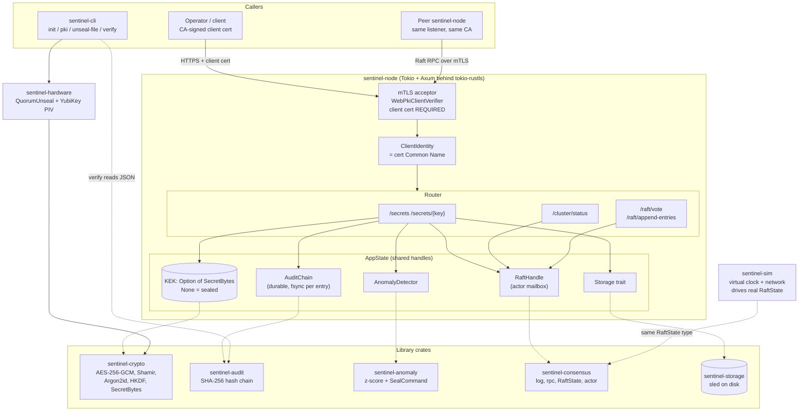
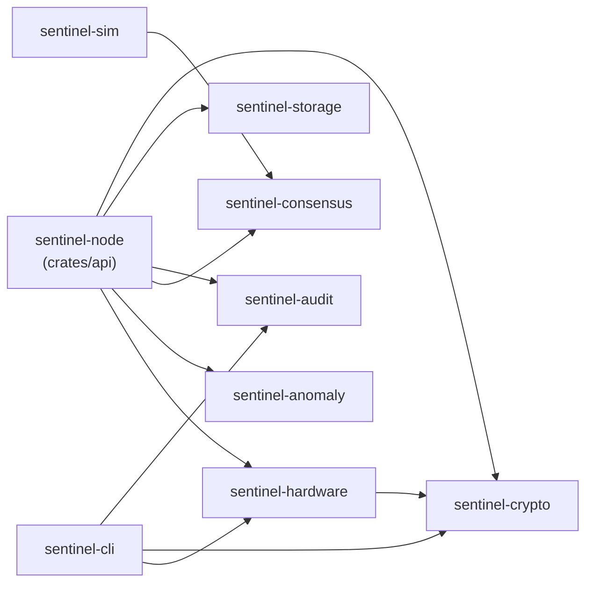
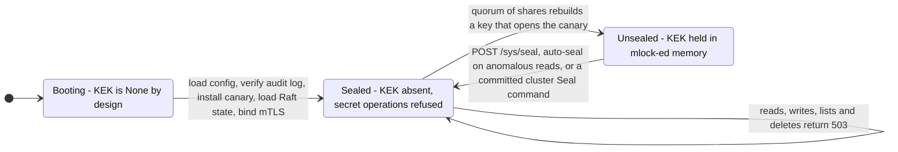
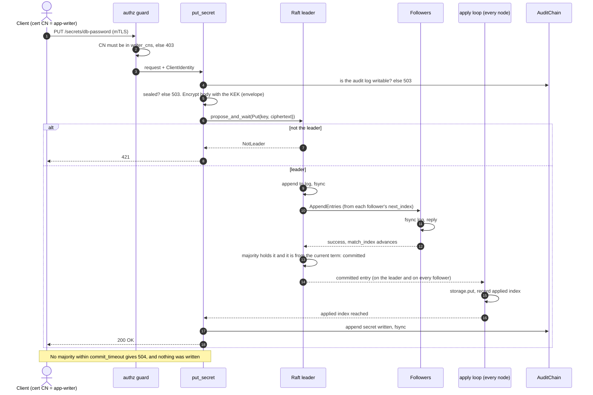
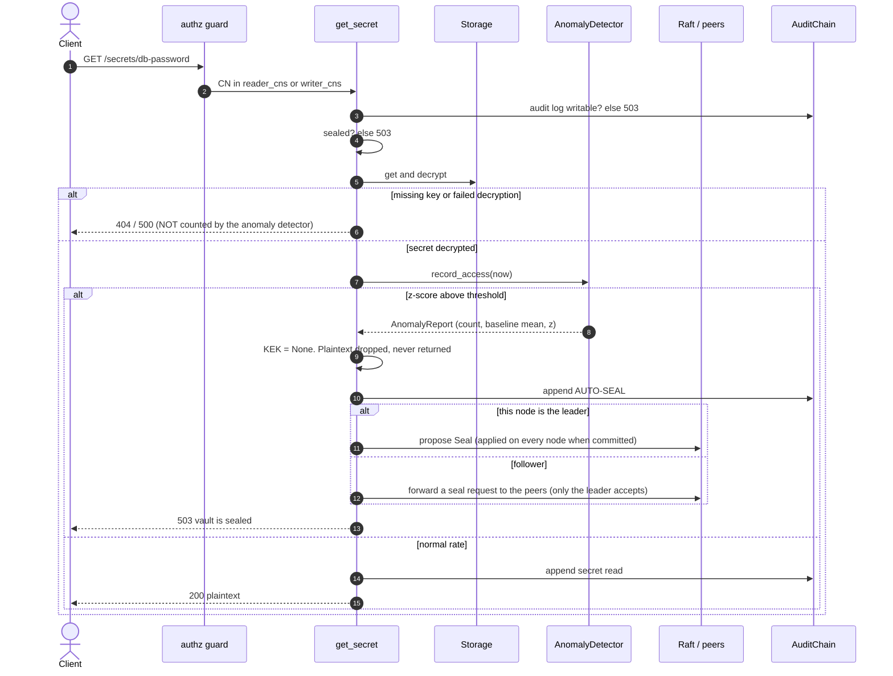
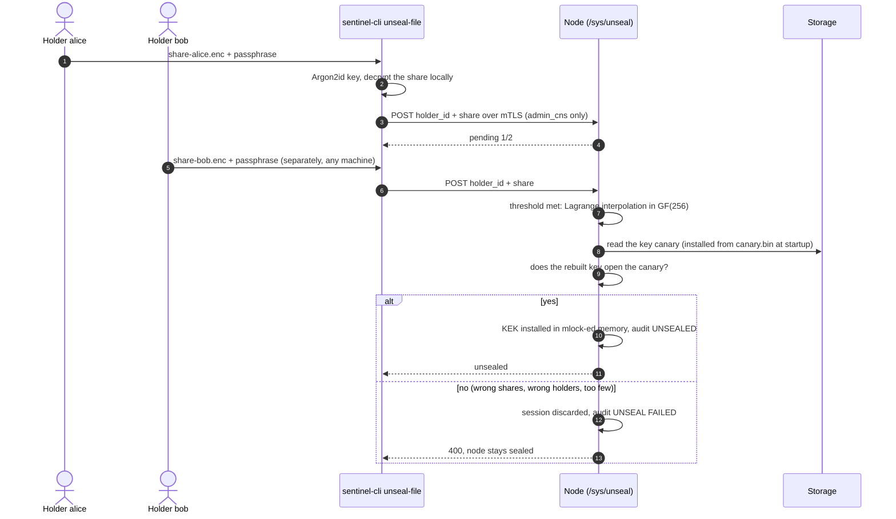
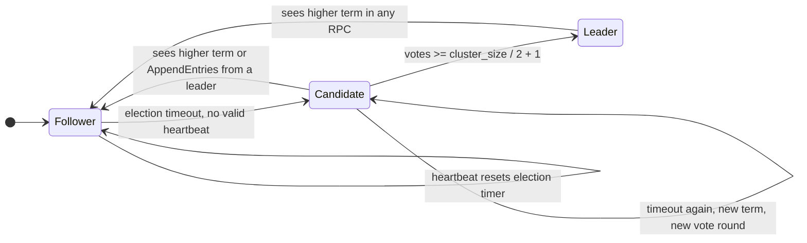
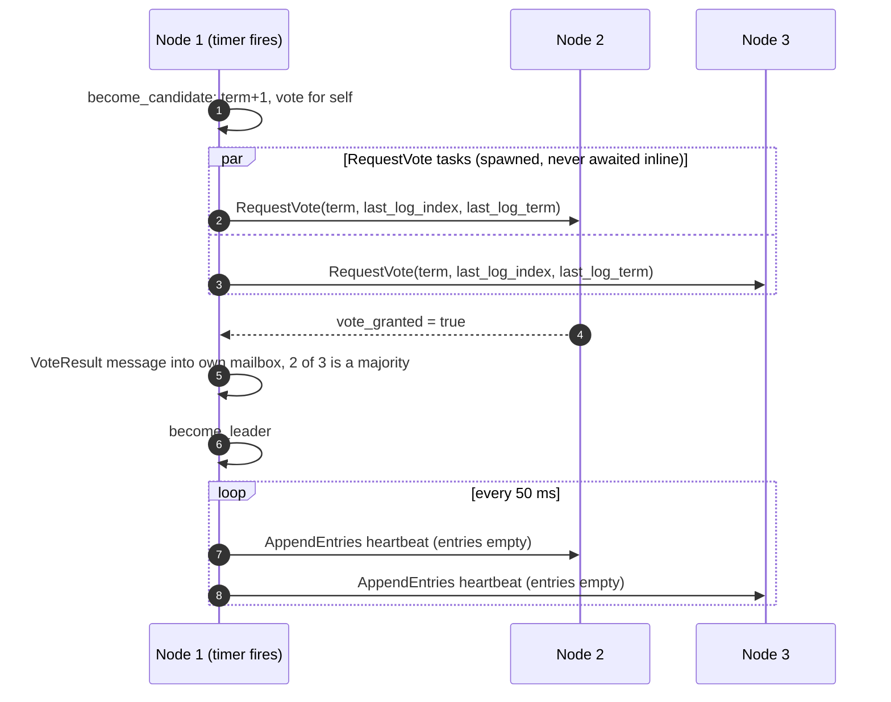
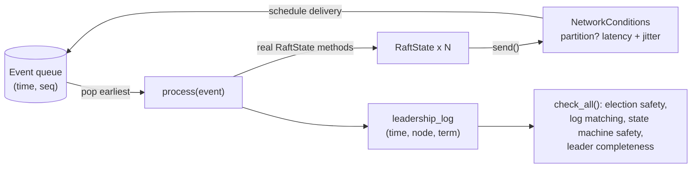

<div align="center">

# 🛡️ SENTINEL

### A zero-trust, quorum-unsealed, distributed secrets vault — written in Rust

Envelope encryption · Shamir quorum unsealing · hand-rolled replicated Raft · mutual TLS + roles ·
durable hash-chained audit log · statistical auto-seal · deterministic simulation testing


</div>

---

## Table of Contents

1. [Overview](#1-overview)
2. [Project Status — What Works Today](#2-project-status--what-works-today)
3. [System Architecture](#3-system-architecture)
4. [Request Lifecycles & State Machines](#4-request-lifecycles--state-machines)
5. [Concept Guide](#5-concept-guide)
6. [Crate-by-Crate Reference](#6-crate-by-crate-reference)
7. [HTTP API Reference](#7-http-api-reference)
8. [CLI Reference](#8-cli-reference)
9. [Configuration](#9-configuration)
10. [Getting Started](#10-getting-started)
11. [Testing, Fuzzing & Verification](#11-testing-fuzzing--verification)
12. [Security Model](#12-security-model)
13. [Known Limitations & Findings](#13-known-limitations--findings)
14. [Roadmap](#14-roadmap)
15. [Project Layout](#15-project-layout)
16. [Contributing & License](#16-contributing--license)

---

## 1. Overview

### The problem

Small engineering teams routinely keep database passwords and API keys in `.env` files, chat messages, or plaintext config — not out of carelessness, but because the "right" tools (HashiCorp Vault, AWS Secrets Manager) carry real operational weight. Leaked credentials remain a leading cause of breaches precisely because the correct path feels too heavy for a small team's risk profile.

### What Sentinel is

Sentinel is an attempt at a middle ground: a **single static Rust binary** with no JVM and no runtime dependencies, designed around the properties that actually matter:

| Principle | How Sentinel approaches it |
|---|---|
| **Secrets are never stored in plaintext** | Every value is envelope-encrypted (AES-256-GCM, fresh DEK per secret) before it touches storage; the storage trait only ever sees ciphertext. |
| **Unsealing needs a quorum of key holders** | The master key (KEK) is split with Shamir's Secret Sharing; each share is protected for its holder (passphrase-protected today; the YubiKey path is unverified, see [§13](#13-known-limitations--findings)). No single person can unseal, and a wrong or partial quorum is rejected by a key canary. |
| **Every connection is mutually authenticated and authorized** | One mTLS listener serves clients *and* cluster peers; there is no plaintext port anywhere in the code. A default-deny role policy then decides what each certificate identity may do. |
| **History can't be silently edited** | Every operation is appended to a SHA-256 hash chain, attributed to the caller's certificate CN, written durably, and verified at startup. |
| **Attacks trigger lockdown, not just alerts** | A rolling z-score detector watches read rate and clears the in-memory KEK the moment access looks like exfiltration. |
| **Writes are only acknowledged once a majority holds them** | Raft is hand-written, persists its state before replying, and a deterministic simulator drives the *same* `RaftState` type through partitions, crashes, message loss, duplication and reordering while checking its safety properties. |

It is also a **learning artifact**: the code is heavily commented with the *why* behind each decision, and this README explains every primitive and concept used.

---

## 2. Project Status — What Works Today

Everything below is implemented, tested, and — for the cluster behaviour — exercised against real `sentinel-node` binaries over real mTLS. Test counts come from `cargo test --workspace` (426 tests, 0 failures, 0 clippy warnings), run on Linux in CI and on the author's Windows machine.

| Layer | Status | Evidence |
|---|:-:|---|
| Envelope encryption, Shamir (GF(256)), HKDF/Argon2id, `mlock` + zeroize | ✅ | 25 unit + 7 property tests |
| Key canary: a reconstructed key is *verified* before it is accepted | ✅ | 5 canary tests + unseal handler tests |
| Raft elections, **log replication, majority commit, apply loop** | ✅ | 74 consensus tests incl. real multi-node clusters over a cuttable network |
| **Durable Raft state** (term, vote, log; CRC-checked WAL, fsync before replying) | ✅ | Restart-the-whole-cluster test; disk-failure test; torn-tail recovery tests |
| **Writes gated on majority commit**; storage changed only by the apply loop | ✅ | A leader without a majority returns 504 and writes nothing (tested) |
| **Cluster-wide seal** (`Seal` command applied on every node) | ✅ | 3-node test; follower-detected anomalies are forwarded to the leader |
| mTLS listener with mandatory client certificates | ✅ | Real handshakes; no cert / untrusted CA rejected |
| **Role-based authorization** (peer / admin / writer / reader / monitor, default-deny) | ✅ | Policy and router tests; real-cluster run with an intruder certificate |
| **Health, readiness and metrics** for monitoring (`/healthz`, `/readyz`, `/metrics`) behind their own `monitor` role | ✅ | 15 tests, 8 mutation checks, and a real run with real certificates; **not yet tried with an actual Prometheus** |
| **Certificate revocation** (serial deny-list) | ✅ | Revoked client cannot connect (real run) |
| Quorum unseal of a **running node** (`/sys/unseal`, node-side quorum) | ✅ | Handler tests; real 3-node unseal with passphrase-protected shares |
| **Provisioning**: `sentinel-cli init`, `pki ca`, `pki issue` | ✅ | 14 CLI tests; whole vault provisioned with no `openssl` |
| **Durable, verified audit log** + `sentinel-cli verify` (`--expect-tip`) | ✅ | 19 audit + 8 verify tests; tamper / truncate / torn-tail on real files |
| Audit failure is **fail-closed** (secret operations refused if the log can't be written) | ✅ | Handler test with a failing sink |
| Rolling z-score anomaly detector (counts **successful reads only**) | ✅ | 18 detector tests, the 404-flood test and a lone-read-after-idle regression test |
| Web dashboard (`/`, `/api/status`) | ✅ | Router tests; served over mTLS |
| Deterministic simulator: **replication, crashes, loss, duplication** + 4 safety checkers | ✅ | 31 sim tests incl. 200 random fault schedules |
| CI on **Linux and Windows**, with a **rustfmt gate** and clippy `-D warnings` | ✅ | `.github/workflows/ci.yml` |
| **Dependency audit** (RustSec) on every lockfile change and daily | ✅ | `.github/workflows/audit.yml`; accepted advisories are listed with reasons in `.cargo/audit.toml` |
| CLI survives a closed pipe (`sentinel-cli ... \| head`) with unchanged exit codes | ✅ | Unit tests + an integration test that runs the real binary with a reader-less stdout |
| **YubiKey PIV decryption on real hardware** | ⚠️ **Unverified, probably wrong** | Never run on a device; see [§13](#13-known-limitations--findings) |
| **Raft log compaction and snapshots, library level** (log base offset, local compaction, `InstallSnapshot` decisions, crash-safe reconciliation of a log with its snapshot) | ✅ in `sentinel-consensus`, **not yet in the node** | 35 new unit tests; 6 simulator scenarios and 200 random fault schedules with crashes mid-compaction and mid-install; 12 mutation checks (§11.2) |
| **Durable snapshots and WAL trimming in the Raft store** (snapshot file, atomic trimmed WAL, crash-safe load) | ✅ in `sentinel-consensus` (`FileStore`, `MemoryStore`) | 18 new unit tests including a restart from every crash point of a compaction; 25 mutation checks (§11.2) |
| **The Raft actor driving snapshots** (compaction on request, `InstallSnapshot` to far-behind followers, durable-before-reply installs, redelivery after a restart) | ✅ in `sentinel-consensus`, **not yet used by the node** | 16 new actor tests including a 3-node catch-up; 33 mutation checks (§11.2) |
| **Snapshots in the running node** (the state machine takes and restores images, the `InstallSnapshot` HTTP route and `HttpTransport` method, `snapshot_threshold`, metrics) | ✅ in `sentinel-node`, verified in-process **and** on real processes over mTLS (Linux, §11.5; Windows, §11.6; one host each) | 24 new node tests including a 3-node catch-up that also carries a missed cluster-wide seal; 28 mutation checks (§11.2); a real 3-node run with kills, pauses and a cold restart (§11.5), and the same scenarios as a script on Linux and on Windows (§11.6). **Not run across several hosts or a real network** |
| Dynamic membership | ❌ | Not implemented |

> **Bottom line:** you can provision a vault, run a 3-node mTLS cluster, unseal every node with a quorum of passphrase-protected shares, write secrets that are only acknowledged once a majority holds them, kill every node with `kill -9`, restart, and find the data, the audit chain and the cluster intact. What is *not* proven: the hardware-key path, and anything beyond a handful of nodes on a single machine. See [§13](#13-known-limitations--findings) for the full, honest list.

---

## 3. System Architecture

### 3.1 High-level architecture



### 3.2 ASCII fallback (for viewers without Mermaid)

```
                 ┌──────────────────────────────────────────────┐
                 │  Operator / client   ·   Peer sentinel-node   │
                 └───────────────────────┬──────────────────────┘
                                         │  mutual TLS — client cert REQUIRED
                 ┌───────────────────────▼──────────────────────┐
                 │               sentinel-node                   │
                 │  tokio-rustls acceptor ─► CN → ClientIdentity │
                 │                                               │
                 │  /secrets, /secrets/{key}   (CRUD, encrypted) │
                 │  /cluster/status            (Raft status)     │
                 │  /raft/vote, /raft/append-entries (peer RPC)  │
                 └──┬───────┬────────┬─────────┬──────────┬──────┘
                    │       │        │         │          │
              ┌─────▼───┐ ┌─▼─────┐ ┌▼──────┐ ┌▼───────┐ ┌▼────────┐
              │ crypto  │ │storage│ │ audit │ │consen- │ │ anomaly │
              │ AES-GCM │ │ sled  │ │ hash  │ │sus Raft│ │ z-score │
              │ Shamir  │ │       │ │ chain │ │        │ │ + seal  │
              │ mlock   │ │       │ │       │ │        │ │         │
              └─────────┘ └───────┘ └───────┘ └───▲────┘ └─────────┘
                                                  │ same RaftState type
      ┌────────────────────┐              ┌───────┴─────────┐
      │ sentinel-hardware  │              │  sentinel-sim   │
      │ Shamir quorum +    │              │ virtual time +  │
      │ YubiKey PIV (CLI)  │              │ chaos network   │
      └────────────────────┘              └─────────────────┘
```

### 3.3 Crate dependency graph

The direction is strictly one-way. `crypto` and `consensus` know nothing about HTTP, TLS, or each other, and `api` (the `sentinel-node` binary) is the only crate that assembles everything. That layering is exactly what makes `sentinel-sim` possible: the simulator drives the production `RaftState` through a different scheduler instead of needing a second Raft implementation.



### 3.4 Network surface

| Interface | Default | Notes |
|---|---|---|
| Client + cluster API | `api_bind_addr` (e.g. `127.0.0.1:8443`) | **Only** listener; TLS 1.2/1.3 via rustls with the `ring` provider. Every route is additionally guarded by an authorization role ([§12](#12-security-model)). |
| Peer RPC | Same port, paths `/raft/*` | Peers call each other with a `reqwest` client presenting the node's own cert (5 s timeout). Only identities in `peer_cns` are admitted. |
| Storage | `storage_path` | `sled` embedded KV store. Only the Raft apply loop writes secrets into it. |
| Raft state | `raft_dir` (default `<storage_path>.raft`) | CRC-checked write-ahead log + atomically replaced vote file; fsync'd before the node replies. |
| Audit log | `audit_path` (default `<storage_path>.audit.jsonl`) | JSON lines, one hash-chained entry per line, fsync'd per entry, verified at startup. |
| Logging | stdout, JSON lines | `tracing` + `EnvFilter`. The default level is `info` (start-up lines, warnings, errors); `RUST_LOG` overrides it (`RUST_LOG=warn` is quieter, `RUST_LOG=debug` is louder). A `RUST_LOG` that does not parse falls back to `info` with a message on stderr. |

### 3.5 Node lifecycle



A node **always starts sealed** — nothing in the bootstrap path populates the KEK, deliberately, because a node that could unseal itself by starting up would defeat the purpose of the quorum. A node also refuses to start if its audit log fails verification, if its storage holds a different vault's canary than `canary_file`, or if its authorization policy would lock everyone out.

---

## 4. Request Lifecycles & State Machines

### 4.1 Writing a secret — `PUT /secrets/{key}`



The handler never writes storage itself. Only committed log entries do, so "200" means a majority of the cluster holds the ciphertext durably. Followers store ciphertext too and do not need to be unsealed to apply a write.

### 4.2 Reading a secret and the auto-seal path — `GET /secrets/{key}`



Design notes that matter:

- Only **successful** reads count toward the rate. A flood of lookups for names that do not exist can never seal the vault.
- The secret that trips the detector is withheld: it was decrypted but is dropped, not returned.
- The local seal never waits on Raft: a node that sees an attack protects itself even if replication is degraded. If no leader is reachable, only the detecting node is sealed.
- Reads are served from the node's own storage; a follower that is a moment behind the leader can briefly return an older value.

### 4.3 Quorum unseal — `sentinel-cli unseal-file` → `POST /sys/unseal`



Each holder runs the command on their own, from any machine that can reach the node, and submits **only their own share**; no single request ever carries the whole key. The node holds the quorum session in memory for at most five minutes, rejects a second share from the same holder, and discards the session on any failure.

### 4.4 Raft roles (as implemented in `RaftState`)



Timings in the production node: **heartbeat 50 ms**, **election timeout 150–300 ms** (randomized per reset).

### 4.5 One election round (3 nodes)



---

## 5. Concept Guide

Each concept below explains **what it is**, **why Sentinel uses it**, and **where it lives in the code**.

### 5.1 Envelope encryption

Instead of encrypting data directly with one master key, generate a fresh random **Data Encryption Key (DEK)** per secret, encrypt the data with it, then encrypt (wrap) the DEK with a longer-lived **Key Encryption Key (KEK)**. The stored artifact is `{encrypted_DEK, encrypted_data}`.

**Why:** the KEK only ever wraps 32-byte DEKs and never touches secret data directly. Rotating the KEK means re-wrapping DEKs, not re-encrypting every secret; compromising one DEK exposes one secret, not the vault.

**Code:** `crates/crypto/src/envelope.rs` — AES-256-GCM (an AEAD, so tampering is detected, not just hidden).

```
EnvelopeCiphertext  (bincode-serialized, stored at  secrets/<key>)
├── encrypted_dek : Vec<u8>   48 bytes  = 32-byte DEK + 16-byte GCM tag
├── dek_nonce     : [u8; 12]  fresh random nonce for the wrap
├── ciphertext    : Vec<u8>   plaintext length + 16-byte GCM tag
└── data_nonce    : [u8; 12]  fresh random nonce for the data
```

- Random 96-bit nonces from `OsRng`, a new one for *every* encryption.
- Wrong-length KEK (≠ 32 bytes) is rejected up front.
- The unwrapped DEK lives in a `SecretBytes` and is zeroized when it goes out of scope.
- Tests: round-trip, wrong KEK fails closed, tampered ciphertext fails closed, wrong key length rejected.

### 5.2 Shamir's Secret Sharing

Split a secret into `N` shares so that any `K` reconstruct it but any `K−1` reveal **nothing** — information-theoretically, not "computationally hard". The secret is the constant term of a random degree-`K−1` polynomial; shares are points `(x, p(x))`; `K` points determine the polynomial via **Lagrange interpolation**.

**Code:** `crates/crypto/src/shamir.rs` — hand-rolled over **GF(2⁸)** (the AES field, reduction constant `0x1B`):

- Each secret byte is an *independent* polynomial; a share is `{ x: u8, y: Vec<u8> }` with `x ∈ 1..=N`.
- `gf_mul` is a shift-and-XOR multiply; `gf_inv` is exponentiation (`a²⁵⁴`); a test verifies **all 255** nonzero inverses.
- Validation: threshold ≥ 2, total ≥ threshold, no duplicate `x`, equal share lengths.
- Randomness comes from a caller-supplied `RngCore` (tests use `OsRng`).

**Why hand-rolled:** an earlier attempt with the `vsss-rs` crate pulled in elliptic-curve scalar machinery just to split 32 raw bytes. GF(256) does it in ~120 lines with no extra surface. *(Housekeeping note: `vsss-rs` is still listed in `crates/crypto/Cargo.toml` but no code uses it — it can be removed.)*

> **A property worth understanding:** Shamir has **no integrity check**. Combining too few or wrong shares does not error — it silently returns garbage that looks like a secret. That is why the node verifies every reconstructed KEK against a **key canary** (`sentinel_crypto::canary`: a known plaintext encrypted under the KEK, created by `sentinel-cli init` and installed at startup) before accepting it. `combine_shares` does not know the threshold and `QuorumUnseal` only guards the count, so the canary is what turns "some bytes came out" into "this is the vault's key".

### 5.3 Hardware-rooted unsealing (YubiKey PIV)

PIV is a smart-card standard; a PIV-enabled YubiKey holds a private key that **never leaves the device**. Each Shamir share is meant to be encrypted to one holder's PIV public key at provisioning time, so recovering it requires that physical key plus its PIN (plus a touch, depending on slot policy).

**Code (deliberately split in two):**

| File | Role | Verified how |
|---|---|---|
| `hardware/src/quorum.rs` | Pure composition logic: collect fragments in any order, reject a repeated `holder_id`, reconstruct at threshold. Touches no `yubikey` types. | 5 unit tests, including "one holder touching twice cannot fake a 2-of-3 quorum" |
| `hardware/src/yubikey_piv.rs` | `YubiKeyUnsealer::decrypt_share(pin, encrypted_share)` — open device, verify PIN, PIV-decrypt (slot 9d "Key Management"). | **Never run against a physical device.** |

> ⚠️ **Worth double-checking before relying on it:** the code requests `AlgorithmId::EccP256` through `yubikey::piv::decrypt_data`. PIV's *decrypt* operation is defined for RSA keys, whereas ECC keys on PIV perform ECDH key agreement. Confirm against the `yubikey` crate's documentation (or use an RSA slot) when you first test on real hardware. This is not just a doubt: it is the main open finding in [§13](#13-known-limitations--findings). `sentinel-cli init` does **not** use hardware; it protects each share with its holder's passphrase (Argon2id + AES-256-GCM), and no tool in the repo encrypts a share to a YubiKey.

### 5.4 Memory hygiene: `mlock` and zeroize

| Protection | Defends against | Mechanism |
|---|---|---|
| **Lock pages** | A KEK being swapped to disk and read long after the process exits | `libc::mlock` (Unix) / `VirtualLock` via `windows-sys` (Windows) |
| **Zeroize on drop** | A later allocation reading stale bytes | `zeroize` overwrites the buffer in `Drop`, then unlocks |

**Code:** `crates/crypto/src/secret.rs` — `SecretBytes`, the project's **only hand-written `unsafe`**.

- `shrink_to_fit()` *before* locking, so no later reallocation can silently move the secret to an unlocked page.
- Every `unsafe` block has a `SAFETY:` comment justifying pointer/length validity.
- If locking fails (e.g. low `RLIMIT_MEMLOCK`), it falls back to zeroize-only protection instead of panicking.
- `Debug` prints only the length — a stray `{:?}` in a log line cannot leak key bytes.
- A real Windows compile failure (no `mlock` there) drove the `cfg`-gated split.

### 5.5 Argon2id and HKDF

| KDF | Use when | Property | API |
|---|---|---|---|
| **Argon2id** | Input may be low-entropy | Deliberately slow and memory-hard | `derive_kek_argon2(input, salt)` — crate defaults: **19 MiB memory, t=2, p=1**, 32-byte output |
| **HKDF-SHA256** | Input is already high-entropy | Fast; derives independent per-purpose keys | `derive_key_hkdf(master, info, out_len)` |

Plus `random_salt()` (16 bytes). Tests cover determinism, salt separation, context separation, and no-panic across all lengths. *(Argon2id derives the key that protects each holder's share file in `sentinel-cli init` / `unseal-file`. HKDF is available for context-separated subkeys but is not yet used by the node.)*

### 5.6 Raft consensus

Raft gets a cluster to agree on an ordered log despite crashes and partitions: one **leader** per **term** accepts writes and replicates them; an entry is committed once a **majority** has it.

**Why hand-rolled instead of `raft-rs`/`openraft`:** a portfolio decision (implementing from the paper demonstrates understanding) and consistency with the project's preference for small, fully understood dependencies.

**Files (separated by concern):**

| File | Contents |
|---|---|
| `log.rs` | `ReplicatedLog` — 1-based indices, `append_new` (leader), `append_entries` (follower consistency check §5.3 + delete-conflicting-suffix), `entries_from`, `term_at` |
| `rpc.rs` | `RequestVote{Request,Response}`, `AppendEntries{Request,Response}` — all `serde`-serializable (JSON on the wire) |
| `state.rs` | `RaftState` — synchronous, no `async`, no timers, no I/O: vote granting, step-down, `become_candidate`, `record_vote`, `handle_append_entries` |
| `actor.rs` | Tokio actor owning one `RaftState`, driven by a mailbox; election timer, heartbeat ticker, `Transport` trait |

**Safety properties:**

| Property | How it is upheld | How it is tested |
|---|---|---|
| **Election Safety** — ≤ 1 leader per term | One vote per term; candidate's log must be at least as up-to-date | `SimWorld::check_election_safety()` across partition / heal / skew / reordering scenarios |
| **Leader Append-Only** | Leader only ever calls `append_new` (push) | Structural |
| **Log Matching** | `append_entries` rejects a mismatched `prev_log_term` and truncates conflicting suffixes | Log unit tests, and `SimWorld::check_log_matching()` after every step of the chaos runs |
| **State Machine Safety** — no two nodes apply different commands at one index | Only entries committed by a majority are applied; current-term rule for commit | `SimWorld` records the first command applied at each index and flags any later mismatch, including replays after a restart |
| **Leader Completeness** — a new leader already holds every applied entry | Election restriction (a candidate's log must be at least as up-to-date) | Checked at the moment of every election in the simulator (entries a leader has compacted are looked up in its snapshot) |
| **Snapshot consistency** — a snapshot holds exactly the entries the cluster committed, and a node's log, state machine and snapshot agree | A snapshot only ever covers *applied* entries; installs and restarts reconcile the log with the snapshot (§5.13) | `SimWorld::check_snapshot_consistency()` after every simulator step, including after crashes in the middle of a compaction or an install |

> **Scope:** the simulator checks all four Raft properties above, plus snapshot consistency, under partitions, crashes with restart, message loss, duplication and reordering (see [§5.11](#511-deterministic-simulation-testing) and [§11.2](#112-the-simulator)). One protection is covered by a unit test rather than the simulator: the "commit only entries of the current term" rule (Raft's Figure 8) cannot be reached from outside, because every leader appends a no-op and so an old entry always travels with a current-term one.

### 5.7 The actor model — and the deadlock that really happened

An **actor** owns its state exclusively; everything else talks to it via a channel. No shared locks, no data races by construction.

**The bug:** an early `actor.rs` sent `RequestVote` RPCs on election timeout and then **awaited the replies inline**, inside the same loop that handles the node's own mailbox. If two nodes campaigned simultaneously, each blocked waiting for the other's vote while neither could answer — a genuine deadlock, reproduced against the buggy code before it was fixed.

**The fix:** vote requests are `tokio::spawn`ed as independent tasks that report back via the actor's *own* mailbox as `RaftMessage::VoteResult`. The loop never blocks on a peer. The regression test (`repeated_elections_do_not_deadlock_under_tight_simultaneous_timeouts`) runs 20 clusters with 30–60 ms election timeouts and requires a leader within 2 s each.

**A second bug, found the same way:** a single-node cluster (`peers: []`) could never elect itself, because the majority check lived only in the vote-*response* path, which never runs with no peers. Fixed (a lone node's own vote is a majority of one) with a regression test.

### 5.8 Mutual TLS (mTLS)

Ordinary TLS authenticates the server; **mTLS makes the server demand a CA-signed client certificate too**, and aborts the handshake otherwise.

- `crates/api/src/middleware/mtls.rs` builds a `rustls::ServerConfig` with `WebPkiClientVerifier` — client certs are **mandatory**; there is no config path that admits an anonymous connection.
- `main.rs` runs a raw `tokio-rustls` accept loop (not `axum-server`, which doesn't expose peer certificates the way this project needs) and bridges each connection into the Axum router via `hyper-util`.
- The client cert's **Common Name** becomes `ClientIdentity`, attached once per connection and used for audit attribution. A cert with no readable CN is refused.
- `ring` is installed as the process-wide crypto provider (`Once`-guarded) because `reqwest` pulls in `aws-lc-rs` and rustls 0.23 refuses to guess between two compiled-in providers.
- Cluster RPCs use the *same* listener — no weaker internal channel.

**Observed behaviour (real handshakes against generated certs):**

| Client presents | Result |
|---|---|
| Cert signed by the trusted CA | ✅ handshake succeeds, CN extracted |
| No certificate | ❌ `peer sent no certificates` (curl exit 56) |
| Certificate from an untrusted CA | ❌ `invalid peer certificate` (curl exit 56) |

### 5.9 Hash-chained audit log

Each entry's hash covers its own content **plus the previous entry's hash**, so changing, deleting, or forging any entry breaks every link after it.

```
hash = SHA-256( index (u64, big-endian)
              ‖ timestamp (RFC 3339 string)
              ‖ event (UTF-8 bytes)
              ‖ prev_hash (32 bytes) )          genesis prev_hash = 32 zero bytes
```

An explicit byte layout (not `serde_json`) is hashed, so the encoding is unambiguous and stable.

`verify()` walks the chain and reports the first break with its type:

| Error | Meaning |
|---|---|
| `HashMismatch { index }` | An entry's content/timestamp was altered |
| `BrokenLink { index, … }` | `prev_hash` doesn't match the real predecessor (e.g. a spliced forgery) |
| `NonSequentialIndex { expected, found }` | An entry was deleted or reordered |

**What it proves:** *tamper-evidence*, not tamper-prevention — someone who can rewrite the whole file consistently can recompute every hash. It defeats the realistic attack: editing one entry to cover tracks.

> **Persistence.** The node opens `audit_path` at startup, verifies the whole chain, and appends every new entry to it as one JSON line, fsync'd. A log that fails verification stops the node; a half-written final record from a crash is cut off and reported. If the file ever cannot be written, the chain is marked *degraded* and the secret endpoints refuse to operate until it is restored. `sentinel-cli verify` reads exactly this file. Truncation of the **newest** entries cannot be seen from the file alone; compare the tip hash against a copy recorded elsewhere (`--expect-tip`).

### 5.10 Rolling z-score anomaly detection

```
time ─► │ bucket │ bucket │ bucket │ … │ current (open) bucket │
         counts feed a rolling window of the last N closed buckets

mean = Σcᵢ / n          stddev = √( Σ(cᵢ − mean)² / n )     (population stddev)
z    = (current_count − mean) / stddev        flag if  z > threshold
```

| Parameter | Node default | Meaning |
|---|---|---|
| Bucket width | 1 s | Resolution of the rate signal |
| `max_history` | 60 buckets | Rolling baseline length |
| `z_threshold` | 3.0 | Std-devs above mean that counts as anomalous |
| `min_history_for_detection` | 5 | Warm-up — **no detection before 5 closed buckets** |
| `min_burst` (`anomaly_min_burst`) | 10 | Count floor — **a bucket with fewer reads than this is never flagged**, whatever its z-score |

Behaviours worth knowing:

- **Idle gaps count as zero buckets** — silence is part of the baseline.
- **Flat baseline (stddev = 0):** *any* count above the mean is flagged (`z = ∞`) — which is exactly why the count floor exists. After a quiet spell the baseline is all zeros, and without a floor a **single ordinary read** scores as an infinite-sigma outlier: with the node's old settings (1 s buckets, 60-bucket window, `z = 3.0`) two reads 20 s apart gave `z = 4.36` and would have sealed the vault. A bucket now needs at least `anomaly_min_burst` reads before it can flag (the library default is 1, i.e. no floor; the node sets 10). An application that reads N secrets in one burst at start-up needs a value greater than N, or it will seal its own vault.
- **Worked example:** a baseline alternating 2 and 4 reads/second has mean 3, stddev 1, so with `z = 3.0` the current bucket is flagged once it exceeds `3 + 3×1 = 6` → on the **7th read** within that second.
- Detection fires *during* a burst, not after (tested: flagged well before 40 requests land).
- One detector covers **aggregate** node traffic, so a coordinated multi-identity attack still shows as one spike. Only **successful** reads count: lookups of names that do not exist (404), requests while sealed, and failed decryptions do not, so a client looping over made-up names cannot lock the vault.
- Time is passed in as an `Instant` parameter (never read internally), which makes the detector fully deterministic to test.

**`SealCommand`:** `{ reason, current_count, baseline_mean, z_score }`, encoded as the ASCII tag `SEAL:` + bincode payload so a log applier can distinguish it from other commands without a shared enum (which would invert the crate layering).

### 5.11 Deterministic simulation testing

Instead of real sockets and real timers, `sentinel-sim` replaces the network and clock with programmer-controlled versions:

- **`SimTime`** — virtual milliseconds; a "30-second partition" costs microseconds of test time.
- **`NetworkConditions`** — symmetric partitions (`partition`, `heal`, `heal_all`), base latency, 0–3 ms random jitter (which naturally reorders in-flight messages), and a configurable percentage of messages **lost** or **delivered twice**.
- **`SimWorld`** — a discrete-event scheduler (binary heap ordered by `(time, seq)`) that drives the **production** `RaftState`: elections, `build_append_entries` / `handle_append_entries_response`, majority commit, `take_newly_committed`, and `RaftState::restore` for crashed nodes. Same seed + same actions ⇒ byte-identical results.



**Scenarios tested** (all seeded):

| Test | Asserts |
|---|---|
| Five nodes, no faults | One leader; every node applies the same commands in order |
| 2-node minority partitioned; leader isolated then healed; clock skew; heavy jitter; 4 partition/heal cycles | Election Safety, stepping down, convergence (the original election suite) |
| A deposed leader accepts a write while cut off | The orphaned write never commits, and is gone from the old leader's log after healing |
| A node misses 30 commands, then reconnects | It catches up completely and in order |
| 30% message loss, 25% duplication, reordering | Safety holds at every step; the cluster still commits; one history after the faults stop |
| Every node crashes at once, then restarts | No committed command lost or reordered; the cluster keeps working |
| The leader is crashed and restarted six times | Acknowledged commits survive |
| **200 random fault schedules** (proposals, partitions, heals, crashes, restarts, loss) | All four properties after every step; after recovery the cluster converges and commits a fresh command |
| Same seed twice | Identical commits, leadership history and event count, faults included |
| Each checker, fed a deliberately corrupted node | The checker **fails**, so a silent checker means something |

**Snapshot scenarios** (added in phase 20a, in `crates/sim/tests/snapshot_test.rs`):

| Test | Asserts |
|---|---|
| Periodic snapshots on every node during normal operation | Committed and applied history is identical to a run without snapshots; every node's log stays short |
| A node is cut off while the others compact | It is caught up by a real `InstallSnapshot` and ends with exactly the committed history |
| A node is only slightly behind a compacted leader | It is served from the retained tail; **no** snapshot is sent |
| A node dies after writing a snapshot but before trimming its log | The restart finishes the compaction; nothing is lost |
| A node dies in the middle of installing a snapshot | The snapshot is on its disk, its old log is not yet replaced; the restart repairs it and it converges |
| Every node restarts after compaction | No committed command lost |
| **200 random fault schedules** with snapshots at random moments, random retained tails, nodes dying mid-compaction and mid-install | All five properties after every step; the cluster recovers, commits a fresh command, and every node converges. The test also requires that snapshots were really taken, followers really installed them and nodes really died mid-install, so a run that never exercised the feature cannot pass |

*Not modelled:* disk corruption (the Raft storage layer has its own tests), Byzantine behaviour, membership changes, and snapshots larger than one message.

### 5.12 Property-based testing and fuzzing

- **`proptest`** (stable Rust, runs in every `cargo test`): states a property over generated inputs and shrinks failures. **7 properties** — `decrypt` never panics on arbitrary/garbage bytes (two variants), encrypt→decrypt round-trips for arbitrary plaintext, `combine_shares` never panics on arbitrary shares, HKDF never panics, `split_secret` never panics across the full 0–255 threshold/total space (40 cases), Argon2 never panics across input/salt lengths (20 cases).
- **`cargo-fuzz`/libFuzzer** (nightly, long coverage-guided runs): `crates/crypto/fuzz/fuzz_targets/{decrypt,combine_shares,kdf}.rs` mirror the same boundaries. The fuzz crate is deliberately isolated from the workspace (own empty `[workspace]` table).

Why both: the property tests catch regressions on every commit; the fuzzers find inputs a human or random sampler wouldn't. `decrypt` is the highest-value target — it parses attacker-influenced bytes read back from storage.

### 5.13 Log compaction and snapshots (library level; not yet in the node)

Without compaction the Raft log grows with every write and a node that was offline for a long time must replay all of it. The fix is the Raft paper's §7: the state machine takes a *snapshot* of itself at some applied index, and the log entries up to there are discarded.

**What exists today** (`sentinel-consensus`, exercised by `sentinel-sim`; the running node does not use it yet):

- **A log with a base.** `ReplicatedLog` remembers the index and term of the last discarded entry (`snapshot_index`/`snapshot_term`); everything else is addressed as before. With nothing compacted the base is 0 and behaviour is unchanged (all earlier tests pass untouched).
- **Local compaction.** `RaftState::compact(upto)` discards entries up to `upto`, but only entries that have been **applied**: a snapshot is the state machine's state, so it cannot cover what the state machine has not seen.
- **Catching a follower up.** If the entries a follower needs were compacted, the leader's `needs_snapshot(peer)` is true, `build_append_entries` returns `None`, and the leader sends an `InstallSnapshotRequest` instead (one message, carrying the whole state). `handle_install_snapshot` decides what it means for the follower:

| The snapshot is... | Result |
|---|---|
| from a stale term | rejected |
| at or below what the follower has already **applied** | acknowledged and ignored (installing would roll the state machine back) |
| inside a log that agrees with it | installed; the entries after it are kept |
| contradicted by the log, or beyond everything the log holds | installed; the whole log is discarded |

  After an install the commit and applied indices jump to the snapshot's index; if the follower's commit index was already further ahead, the entries between are applied from the log exactly once.
- **Crash safety by reconciliation, not by a new log format.** A compaction is two steps: make the snapshot durable, then trim the stored log. A crash between them leaves a log that overlaps the snapshot. An install has the same gap. Rather than journaling compaction, loading **reconciles** the two (`ReplicatedLog::reconcile_with_snapshot`): the snapshot is authoritative, and stored entries are kept only where they provably agree with it (the log holds the snapshot's last entry with the same term, or already starts right after it). A log that stops short of the snapshot, or contradicts it, is discarded; a log that cannot be joined to the snapshot is reported as damaged. This is pure logic, so the simulator runs the same code after crashes injected at exactly those two moments.

**Persistence (phase 20b, step 1).** The store can now hold a snapshot, and it is the part where a crash costs data if it is done in the wrong order. `RaftStore` gained two calls that must be made in this order: `save_snapshot` (a `snapshot` file, written to a temporary file, fsynced, renamed over the old one, directory fsynced; carries a CRC and the term and index it covers) and then `rewrite_log` (the WAL is rewritten with only the entries after the snapshot, by the same temp-and-rename dance). Properties, each with a test:

- **A crash at any point loses nothing.** One test copies the data directory at five moments of a compaction (before, snapshot temp file half written, snapshot durable but log untouched, trimmed-log temp file half written, log trimmed) and restarts a node from every copy: all of them come back with the same log and the same retained entries.
- **The WAL says where it starts.** A trimmed WAL begins at `snapshot + 1`, an untrimmed one at 1; `load` reads the first record to tell which. No new record format and no migration: a WAL written before this phase loads exactly as before, and a WAL that starts anywhere other than 1 with no snapshot to explain it is refused as corrupt.
- **A damaged snapshot is a refusal to start.** Unlike a torn WAL tail, which is simply cut off, a snapshot that fails its checksum, is truncated, has an unknown format, covers nothing or cannot be read is an error, because the WAL no longer holds what it covered and starting "fresh" would silently drop committed data.
- **Leftover `*.tmp` files are ignored** and removed at startup; the real files are never half-written.
- **A snapshot cannot move backwards**, cannot exceed `MAX_SNAPSHOT_BYTES` (64 MiB, so that it can travel in one message and a corrupt file cannot make a node allocate without bound; larger fails loudly with `SnapshotTooLarge`), and the retained log must continue exactly after it.

**The actor (phase 20b, step 2).** The Raft actor now drives all of this, still only inside the library:

- **One ordered stream.** The state machine receives `ApplyItem::Entry` and `ApplyItem::Snapshot` on the same channel, so a snapshot arrives exactly between the entries before and after it. A state machine already at or past a snapshot's index ignores it.
- **Compaction is requested from outside.** Only the state machine can serialize itself, so after applying entry N it calls `RaftHandle::compact(N, image)`. Entries up to N are dropped and the image is kept to serve to followers. A request ahead of what was applied, or an image over 64 MiB, is refused and changes nothing; an index at or below the current snapshot is a no-op. If the disk fails the node stops, as for any other write.
- **Durable before visible.** A follower that is sent a snapshot saves it and trims its WAL *before* handing it to the state machine and *before* replying, so a leader never counts a snapshot the follower could lose. A local compaction saves the snapshot before trimming the log.
- **Restart redelivers.** A node with a snapshot on disk hands it to the state machine first, before any entry, because the state machine may not have installed it before the crash.
- **Leaders serve them.** When a follower's next entry has been compacted away, the leader sends the snapshot instead (also from heartbeats). It is one message per peer at a time, a failed send is retried only after a one-second delay (a 64 MiB message at heartbeat speed to a dead peer would be a self-inflicted outage), and a send that never returns is abandoned after 60 seconds. A node that was itself caught up by a snapshot, or restarted with one, can serve it when it leads.
- **A transport must opt in.** `Transport::send_install_snapshot` defaults to "unsupported", so existing transports compile, and a leader whose transport cannot carry snapshots keeps serving the followers that do not need one.

**The node (phase 20b, step 3).** The node now uses all of the above:

- **The image.** After applying enough entries the state machine serializes every secret, *still encrypted*, plus `last_seal_index`, and asks Raft to compact (`RaftHandle::compact`). The key-encryption key, the key canary (installed from its file at start-up, not through Raft), the sealed state and the applied-index checkpoint are not in it. A node that is sealed can serve an image. It is bounded at 64 MiB; an image that would be larger is not taken, an error is logged, and the log keeps growing.
- **A seal must survive compaction.** Sealing only changes memory, so a node caught up by an image would skip a cluster-wide seal that replaying the log would have applied, and stay unsealed while the rest of the cluster is sealed. Each applied `Seal` therefore records its log index, the image carries the last one, and a node that installs an image with a seal newer than its own applied index seals itself and says so in the audit log. An in-process 3-node test isolates a node, commits writes, a delete and a seal, lets the others trim their logs, reconnects it, and checks it ends with the same secrets, without the deleted one, and sealed.
- **A tail.** The image is taken at the threshold, but the log is trimmed to it only after `snapshot_threshold / 10` more entries (at most 100) have been applied, so a follower that is only a little behind is served entries and not a whole snapshot.
- **Restoring.** The secrets are made to match the image exactly (stale keys deleted, the rest written) and the applied-index checkpoint is written last. It is not atomic, deliberately: a crash in the middle leaves the old checkpoint, Raft hands the same snapshot over again after the restart, and the restore starts over. Until it finishes, a read on that node can see a mixture of old and new secrets (reads were never linearizable). An image can name only `secrets/` keys: it can never overwrite the checkpoint or the canary, and anything else makes the node stop applying rather than carry on with state it cannot trust.
- **On the wire.** `POST /raft/install-snapshot` takes a bincode body, with its own body limit and its own 120-second upload allowance (the shared client gives a request 5 seconds). The reply means "durable on this node's Raft disk and handed to the state machine", not "restored": the state machine installs it a moment later.
- **Metrics.** `sentinel_raft_snapshot_index` (gauge) and `sentinel_raft_snapshots_{taken,installed,sent}_total`, numbers only like the others.

**What does not exist yet, or is not verified:** chunked transfer for state larger than one message (so a vault whose encrypted secrets exceed 64 MiB cannot be snapshotted); a real-process run across several hosts or a real network (the runs in §11.5 and §11.6 were on one machine over loopback, on Linux and on Windows); and a mixed-version cluster: an old node has no `/raft/install-snapshot` route, so a new leader's snapshot to it would fail and be retried once a second. Upgrade every node before relying on snapshots, or set `snapshot_threshold = 0` meanwhile. Snapshots are **on by default**, a behaviour change for existing deployments.

---

## 6. Crate-by-Crate Reference

| Crate (package) | Path | Responsibility | Key public API | Tests |
|---|---|---|---|:-:|
| `sentinel-crypto` | `crates/crypto` | Cryptographic primitives | `envelope::{encrypt, decrypt, EnvelopeCiphertext}`, `shamir::{split_secret, combine_shares, ShamirShare}`, `canary::{create, verify}`, `kdf::{derive_kek_argon2, derive_key_hkdf, random_salt}`, `SecretBytes` | 25 + 7 property |
| `sentinel-storage` | `crates/storage` | Pluggable ciphertext store | `trait Storage { get, put, delete, list }`, `SledStorage` | 4 |
| `sentinel-audit` | `crates/audit` | Tamper-evident, **durable** log | `AuditChain::{append, verify, tip_hash, is_healthy}`, `open_persistent`, `parse_log`, `AuditSink`, `FileSink` | 19 |
| `sentinel-consensus` | `crates/consensus` | Raft: elections, replication, persistence, snapshot/compaction logic | `RaftState`, `spawn_raft_actor{,_with_apply,_persistent}`, `ApplyItem`, `RaftHandle::{propose, propose_and_wait, inspect, compact, install_snapshot, snapshot_status, shutdown}`, `RaftStore` (`FileStore`, `MemoryStore`), `Transport` | 143 |
| `sentinel-hardware` | `crates/hardware` | Quorum + YubiKey (**hardware path unverified**; the `yubikey` feature, on by default, is off for the server) | `QuorumUnseal`, `UnsealFragment`, `YubiKeyUnsealer` | 5 |
| `sentinel-anomaly` | `crates/anomaly` | Access-rate detection | `AnomalyDetector::{record_access, snapshot}`, `AnomalyReport`, `SealCommand` | 18 |
| `sentinel-node` | `crates/api` | The server binary | mTLS listener, guarded Axum router, `Policy`, replicated state machine (`statemachine`), `HttpTransport`, `NodeConfig` | 119 |
| `sentinel-sim` | `crates/sim` | Deterministic chaos harness | `SimWorld::{propose, crash, restart, check_all, ...}`, `NetworkConditions` | 26 + 8 + 7 + 8 |
| `sentinel-cli` | `crates/cli` | Admin and provisioning tool | `init`, `pki`, `unseal-file`, `submit-share`, `seal`, `reset-unseal`, `verify`, `unseal` | 32 + 2 |

**Total: 423 tests, all passing; `cargo clippy --workspace --all-targets -- -D warnings` is clean.**

Key dependencies (resolved in `Cargo.lock`): `axum 0.8`, `tokio 1.53`, `rustls 0.23`, `tokio-rustls 0.26`, `hyper-util 0.1`, `reqwest 0.12` (rustls), `x509-parser 0.16`, `rcgen 0.13`, `aes-gcm 0.10`, `argon2 0.5`, `hkdf 0.12`, `sled 0.34`, `yubikey 0.8`, `zeroize 1.9`, `proptest 1.11`, `chrono 0.4`.

---

## 7. HTTP API Reference

All routes are served **only** over mTLS, and every route group requires a role (see [§12](#12-security-model)). A valid certificate whose Common Name has no role gets `403`.

### 7.1 Routes

| Method & path | Role | Behaviour |
|---|---|---|
| `GET /` | admin, reader, writer | Dashboard page (polls `/api/status`) |
| `GET /api/status` | admin, reader, writer | JSON: role, term, commit index, sealed, audit (verified, persistent, healthy, tip hash, recent events), anomaly snapshot |
| `GET /cluster/status` | admin, reader, writer | `{role, term, commit_index, applied_index}` |
| `GET /healthz` | monitor, admin | Liveness: `200 {"status":"ok"}`, or `503` if the Raft actor stops answering (the failure class of an earlier deadlock) |
| `GET /readyz` | monitor, admin | Readiness: `200 {"ready":true,"role":...}`, or `503 {"ready":false,"reasons":[...]}` while the vault is sealed, the audit log cannot be written, or Raft is unresponsive. It does **not** prove a leader exists; a write sent to a follower still gets `421` |
| `GET /metrics` | monitor, admin | Prometheus text (format 0.0.4): sealed, audit health and size, Raft term/indexes/leadership, and counters for reads, writes, deletes, denials, auto-seals and unseals. Values are numbers only: no identity or secret name appears in it |
| `GET /secrets` | reader, writer | List secret names (`503` if sealed) |
| `GET /secrets/{key}` | reader, writer | Decrypt and return. Successful reads feed the anomaly detector |
| `PUT /secrets/{key}` | writer | Encrypt, replicate, return only after a **majority commit** and local apply. Leader only |
| `DELETE /secrets/{key}` | writer | Same contract as `PUT` |
| `POST /sys/unseal` | admin | Body `{"holder_id": "...", "share": "<hex>"}`; `{"status":"pending",...}` until the threshold, then `{"status":"unsealed"}` |
| `DELETE /sys/unseal` | admin | Discard a half-finished unseal session |
| `POST /sys/seal` | admin | Seal this node now |
| `POST /raft/vote` | peer | Raft `RequestVote` |
| `POST /raft/append-entries` | peer | Raft `AppendEntries` |
| `POST /raft/install-snapshot` | peer | A leader sends a follower that fell behind its trimmed log a whole snapshot. Body is bincode, not JSON (JSON would spell every byte of the image as a number, about four times the size); the one route with a body limit above axum's 2 MiB default, capped at the snapshot size limit plus 1 MiB |
| `POST /raft/seal-request` | peer | A follower asks the leader to seal the cluster; `202` from the leader, `421` otherwise |

### 7.2 Error model

Errors are JSON `{"error": "<message>"}`. Internal errors are logged server-side and returned as a generic `internal server error`.

| Status | Meaning |
|---|---|
| `400` | Malformed input (bad share, bad holder id, bad secret name), or the submitted shares did not rebuild the vault key |
| `403` | Authenticated, but the certificate's identity has no permission for this route (audited once per identity and permission per minute) |
| `404` | Secret does not exist |
| `409` | Conflict: already unsealed, duplicate holder in the session, or the vault has no canary and bootstrap is not allowed |
| `421` | This node is not the Raft leader; write there instead |
| `503` | Vault sealed, leadership changed before the write committed (retry), or the **audit log is not writable** (secret operations are refused) |
| `504` | A write was not confirmed by a majority in time. **It may or may not have been applied**: check before retrying |

### 7.3 Examples

```bash
# Unseal (each holder runs this themselves, with their own share file)
sentinel-cli unseal-file --node https://localhost:8443 --cert pki/alice-admin.crt \
  --key pki/alice-admin.key --ca pki/ca.crt --file vault/share-alice.enc

# Write and read as an application client
curl --cacert pki/ca.crt --cert pki/app-writer.crt --key pki/app-writer.key \
  -X PUT -d 'hunter2' https://localhost:8443/secrets/db-password        # 200
curl --cacert pki/ca.crt --cert pki/app-writer.crt --key pki/app-writer.key \
  https://localhost:8443/secrets/db-password                             # hunter2

# Role separation: an admin cannot read secrets
curl --cacert pki/ca.crt --cert pki/alice-admin.crt --key pki/alice-admin.key \
  https://localhost:8443/secrets/db-password                             # 403
```

---

## 8. CLI Reference

`sentinel-cli <COMMAND>` (build it with `cargo build -p sentinel-cli`; **`cargo test` does not rebuild the binary**).

Commands that talk to a node take `--node <URL> --cert <PEM> --key <PEM> --ca <PEM>`: the client certificate to present and the CA that signed the node's certificate.

| Command | Purpose |
|---|---|
| `pki ca --out DIR [--cn NAME] [--days N]` | Create a certificate authority (`ca.crt`, `ca.key`). Refuses to overwrite. |
| `pki issue --ca DIR --out DIR --cn NAME [--kind node\|client] [--san HOST]... [--days N]` | Issue `<cn>.crt` / `<cn>.key`. `node` certs (server + client auth) need at least one `--san`; `client` certs are client-auth only. The CN is the identity the node's policy matches on. |
| `init --holder NAME... --threshold K --out DIR [--format passphrase\|plain] [--passphrase-env-prefix P]` | Provision a vault: generate the root key (never written to disk), split it K-of-N, write `canary.bin`, one share file per holder, and `PROVISIONING.txt`. Self-tests by rebuilding the key from the files it wrote. Refuses to write into a non-empty directory. |
| `unseal-file --file share-<name>.enc [--passphrase-env VAR]` + node flags | A holder decrypts their share locally and submits just that share. |
| `submit-share --holder NAME` + node flags | Submit one already-decrypted share (hex on stdin). **Scripting and tests only**: it puts a plaintext share in your shell. |
| `seal` / `reset-unseal` + node flags | Seal a node now / discard a half-finished unseal session. |
| `verify [PATH] [--expect-tip HASH] [--expect-entries N] [--allow-torn-tail]` | Verify an audit log (the node's JSON-lines file or a JSON-array export). Exit code is non-zero on any failure. |
| `unseal [--manifest FILE]` + node flags | Interactive YubiKey unseal. **Unverified on hardware**; see [§13](#13-known-limitations--findings). |

### `verify`: what it can and cannot prove

The hash chain makes any edit, insertion, deletion or reordering **inside** the log detectable. It cannot, by itself, show that the **newest** entries were cut off the end. Record the tip hash somewhere the log's custodian cannot edit (the dashboard shows it, `sentinel-cli verify` prints it) and check it later with `--expect-tip`.

---

## 9. Configuration

Settings come from an optional **`.env.toml`** in the working directory and from environment variables named `SENTINEL__<KEY>` (note the **double underscore**). **The environment overrides the file.** List values from the environment are comma-separated: `SENTINEL__PEERS="2=https://h2:8443,3=https://h3:8443"`.

| Key | Default | Meaning |
|---|---|---|
| `node_id` | required | This node's Raft id (u64) |
| `api_bind_addr` | required | Address of the mTLS listener |
| `storage_path` | required | Directory for the `sled` store |
| `tls_cert_path`, `tls_key_path`, `ca_cert_path` | required | This node's certificate and key, and the CA it trusts |
| `peers` | `[]` | `"<node_id>=<base_url>"` entries for the other nodes; empty = single node |
| `unseal_threshold` | `2` | Key holders needed to unseal; must match what `init` used; minimum 2 |
| `raft_dir` | `<storage_path>.raft` | Raft's durable state. Keep it paired with `storage_path` |
| `commit_timeout_ms` | `5000` | How long a write waits for a majority commit |
| `peer_cns` | `[]` | Common Names of the other cluster nodes (required whenever `peers` is set) |
| `admin_cns` | `[]` | Identities allowed to seal/unseal (at least one required) |
| `writer_cns`, `reader_cns` | `[]` | Identities allowed to write/delete+read, or read only (at least one of the two required) |
| `monitor_cns` | `[]` | Monitoring identities: `/healthz`, `/readyz` and `/metrics` only. They cannot read secrets or the dashboard (which shows audit events). A node certificate cannot also be a monitor |
| `revoked_serials` | `[]` | Certificate serial numbers (hex) refused after the handshake |
| `audit_path` | `<storage_path>.audit.jsonl` | The durable audit log |
| `canary_file` | none | The `canary.bin` from `init`, installed into storage at startup |
| `allow_canary_bootstrap` | `false` | **Dev only**: let the first unseal of an empty vault define the canary |
| `snapshot_threshold` | `1000` | Take a snapshot, and let Raft forget the log entries it replaces, after this many applied entries since the last one. `0` turns taking snapshots off (the Raft log then grows without bound and the node warns at start-up); installing a snapshot a leader sends is always on |
| `anomaly_min_burst` | `10` | Auto-seal floor: a one-second bucket with fewer than this many secret reads is never flagged. An app that reads N secrets at start-up needs a value above N. Minimum 1 |
| `insecure_allow_any_client` | `false` | **Dev only**: any valid certificate may do anything. Logs a warning at startup |

**Startup refuses**: a policy that would lock everyone out (no admins, no secret clients, peers without `peer_cns`, a node certificate that is also listed as a client); an audit log that fails verification; a storage directory whose canary differs from `canary_file`; `unseal_threshold < 2`; `anomaly_min_burst = 0`.

A fully commented example is in [`.env.toml.example`](.env.toml.example).

---

## 10. Getting Started

### 10.1 Prerequisites

Rust 1.87 or newer (edition 2024; `rust-toolchain.toml` selects `stable`). A CI job checks that 1.87 really builds the workspace; it is non-blocking until it has been seen green. No `openssl` is needed: the CLI creates the PKI.

**Linux only, for building and running `sentinel-cli`:** its (unverified) YubiKey support links the PC/SC smart-card library, so install `pkg-config` and `libpcsclite-dev` to build (`sudo apt install pkg-config libpcsclite-dev` on Debian/Ubuntu; `pcsc-lite-devel` on Fedora; `pcsclite` on Arch) and `libpcsclite1` to run it. **`sentinel-node` does not need it**: build it alone with `cargo build -p sentinel-node` on a machine with no smart-card stack. Windows needs nothing extra (it uses the built-in smart-card API). macOS is untested.

### 10.2 Build and test

```bash
cargo build --workspace
cargo test --workspace --no-fail-fast
cargo clippy --workspace --all-targets -- -D warnings
cargo fmt --all -- --check      # CI gate; fix with `cargo fmt --all`
```

The first build compiles `rustls`, `ring` and `sled` and takes a few minutes. The consensus and property tests take around 10-40 s.

### 10.3 Provision a vault (once)

```bash
CLI=target/debug/sentinel-cli

$CLI pki ca --out ca
mkdir pki && cp ca/ca.crt pki/
$CLI pki issue --ca ca --out pki --cn node1       --kind node   --san localhost --san 127.0.0.1
$CLI pki issue --ca ca --out pki --cn alice-admin --kind client
$CLI pki issue --ca ca --out pki --cn app-writer  --kind client

$CLI init --holder alice --holder bob --holder carol --threshold 2 --out vault
# prompts for each holder's passphrase (12+ characters, typed twice); read vault/PROVISIONING.txt next
```

On Windows PowerShell use `.\target\debug\sentinel-cli.exe`. **Run `init` as a single command on its own line**: pasting several lines can feed stray Enter keypresses to the hidden passphrase prompts.

### 10.4 Run a single node

`.env.toml`:

```toml
node_id          = 1
api_bind_addr    = "127.0.0.1:8443"
storage_path     = "data/node1"
tls_cert_path    = "pki/node1.crt"
tls_key_path     = "pki/node1.key"
ca_cert_path     = "pki/ca.crt"
canary_file      = "vault/canary.bin"
unseal_threshold = 2
admin_cns        = ["alice-admin"]
writer_cns       = ["app-writer"]
```

```bash
cargo run -p sentinel-node
```

### 10.5 Unseal and use it

```bash
for h in alice bob; do
  $CLI unseal-file --node https://localhost:8443 \
    --cert pki/alice-admin.crt --key pki/alice-admin.key --ca pki/ca.crt \
    --file vault/share-$h.enc          # each holder is prompted for their own passphrase
done
curl --cacert pki/ca.crt --cert pki/app-writer.crt --key pki/app-writer.key \
  -X PUT -d 'hunter2' https://localhost:8443/secrets/db-password
```

The dashboard is at `https://localhost:8443/` (your browser needs a client certificate whose CN is an admin, reader or writer).

### 10.6 Run a 3-node cluster

Issue one certificate per node (`--cn node1`, `node2`, `node3`, each with its own `--san`) and give every node:

```toml
peers    = ["2=https://host2:8443", "3=https://host3:8443"]   # the others, "<id>=<url>"
peer_cns = ["node1", "node2", "node3"]
```

Start all three; they elect a leader. **Unseal every node** (the key lives only in memory), write through the leader, read from any node. A write sent to a follower returns `421`.

### 10.7 Check the audit log

```bash
$CLI verify data/node1.audit.jsonl
$CLI verify data/node1.audit.jsonl --expect-tip <hash shown on the dashboard earlier>
```

### 10.8 Fuzzing and Miri (nightly)

```bash
cargo +nightly install cargo-fuzz
cd crates/crypto && cargo +nightly fuzz run decrypt
```

See [§11.3](#113-what-has-not-been-executed): these have not been run by the author.

### 10.9 Health checks and metrics

Give the monitoring system its own client certificate (`pki issue ... --kind client --cn prometheus`) and list it:

```toml
monitor_cns = ["prometheus"]
```

It can then call exactly three routes, and nothing else (no secrets, no dashboard):

```bash
curl --cacert pki/ca.crt --cert pki/prometheus.crt --key pki/prometheus.key https://localhost:8443/healthz   # {"status":"ok"}
curl ... https://localhost:8443/readyz     # 200 when unsealed and healthy; 503 with "reasons" otherwise
curl ... https://localhost:8443/metrics    # Prometheus text
```

A Prometheus scrape job looks like this (**written from the documentation; only `curl` was used to test it**):

```yaml
scrape_configs:
  - job_name: sentinel
    scheme: https
    metrics_path: /metrics
    tls_config:
      ca_file: pki/ca.crt
      cert_file: pki/prometheus.crt
      key_file: pki/prometheus.key
      server_name: localhost        # must be one of the node certificate's SANs
    static_configs:
      - targets: ["node1:8443"]
```

Notes: every request needs a client certificate, so a plain HTTP probe (such as a Kubernetes `httpGet`) cannot call these routes; use a probe that can present a certificate. `/readyz` says whether *this node* should receive traffic (unsealed, audit log writable, Raft responding); it does not prove that the cluster has a leader. Useful alerts: `sentinel_sealed == 1`, `sentinel_audit_healthy == 0`, `sentinel_raft_responsive == 0`, an increase in `sentinel_auto_seals_total` or `sentinel_unseal_failures_total`, and a rapid increase in `sentinel_authz_denials_total`.

Snapshot metrics (numbers only): `sentinel_raft_snapshot_index` (gauge; the log index the Raft log is trimmed to, 0 = never) and the counters `sentinel_raft_snapshots_taken_total`, `sentinel_raft_snapshots_installed_total` and `sentinel_raft_snapshots_sent_total`.

---

## 11. Testing, Fuzzing & Verification

### 11.1 Test inventory

| Area | What is proven |
|---|---|
| Crypto | Round trips; wrong key and tampered ciphertext fail closed; Shamir for every subset; property tests (no panics on arbitrary input) |
| Key canary | Only the right key verifies; wrong lengths and tampering do not panic |
| Raft state machine | Vote rules, log rules, commit only by current-term replicas (Figure 8), one-step back-off per rejection, reordered/duplicated/stale replies |
| Raft actor | Real multi-node clusters over a network that can be cut: ordering, catch-up, a deposed leader's write never applied, fail-stop on disk failure, restart of the **whole cluster** loses nothing, a restarted node cannot vote twice |
| Persistence | CRC-checked WAL, torn-tail recovery, a damaged vote file is refused rather than read as zero |
| Authorization | Every role against every route group; an identity with no role; denials audited once; the original `/raft/*` hole |
| Audit | Tampered/deleted/reordered entries detected; torn tail recovered; a failing disk degrades the log; tail truncation shown to be detectable **only** by an external tip |
| Provisioning | Any threshold of holders rebuilds a key that opens the canary, fewer cannot; never overwrites key material; certificates chain to the CA with the right identity and usages |
| Simulator | See below |

### 11.2 The simulator

`sentinel-sim` drives the **same `RaftState`** as the production actor on a discrete-event scheduler with virtual time. It adds replication, node **crashes with restart from persisted state**, message **loss, duplication and reordering**, and checks four Raft properties after every step: election safety, log matching, state machine safety, and leader completeness. 200 random fault schedules run in the suite, each followed by a recovery phase that must converge and commit a fresh command; identical seeds reproduce identical histories.

The checkers are themselves tested: each has a test that deliberately corrupts a node and requires the checker to fail.

**Mutation results** (deliberately breaking the production consensus code):

| Bug introduced | Caught by |
|---|---|
| Followers never truncate conflicting entries | simulator (log matching) |
| Election restriction removed | simulator (leader completeness) |
| A node may vote for several candidates in a term | simulator (election safety) |
| Commit on a minority | simulator (state machine safety) |
| Commit old-term entries by counting replicas (Figure 8) | consensus unit test only: every leader appends a no-op, so a replica of an old entry always travels with a current-term entry, which makes this unreachable from outside |
| A restarted node forgets its vote | consensus unit and actor tests (3 failures); the random fault runs do not reach it |

**Snapshot mutation results (phase 20a).** Twelve deliberate breakages of the snapshot logic, each run against the consensus unit tests *and* the simulator:

| Bug introduced | Caught by |
|---|---|
| A node may compact entries it has not applied | unit test |
| A snapshot from a stale term is accepted | unit test |
| An install keeps a log suffix that contradicts the snapshot | 2 unit tests |
| Reconciliation ignores a term mismatch at the snapshot | 2 unit tests |
| `append_entries` compares entries that lie below the snapshot | 2 unit tests |
| An install does not advance `last_applied` | 3 unit tests |
| The leader still builds `AppendEntries` for a follower behind its snapshot | unit test |
| A snapshot reply does not advance the follower's progress | 2 unit tests **and 3 simulator tests** |
| Off-by-one in `log.get` after compaction | 46 unit tests **and 19 simulator tests** |
| Restore does not start applied/committed at the snapshot | 2 unit tests **and 3 simulator tests** |
| `compact_to` does not check the term | unit test |
| The leader announces the wrong `last_included_term` | unit test **and 4 simulator tests** |

Eight of the twelve are caught only by unit tests. For most that is expected, because the simulator never produces the situation (it never sends a stale-term snapshot, never compacts unapplied entries). One deserves a note: "an install does not advance `last_applied`" is, in the simulator, almost an *equivalent* mutant, because the next apply step skips the compacted entries and `last_applied` catches up within the same event. It is only harmful when a follower already holds the snapshot's last entry in its log but has not applied it, which is exactly what the unit test `a_snapshot_never_moves_the_commit_index_back_and_replays_what_it_does_not_cover` builds deterministically and which 200 random schedules never reached.

**Snapshot persistence mutation results (phase 20b, step 1).** Deliberate breakages of the store's snapshot code, each run against the persistence tests. The first pass ran 26 and caught 21; five survived (four distinct causes), which was informative:

| Survivor of the first pass | What it was | What was done |
|---|---|---|
| The WAL start is inferred even without a snapshot | Equivalent: a later check ("the WAL may not start after the snapshot") rejects the same input | The redundant guard was removed from the code |
| A damaged snapshot is treated as "none" | A real gap: only checksum damage was tested, not a snapshot file that cannot be read | Test added (a directory where the file should be) |
| A snapshot covering index 0 is accepted, on load and on save | A real gap: the test setups were rejected by *other* checks first | Two tests added that isolate it |
| The result of replacing the WAL is ignored | A real gap: no test made the replacement fail | Test added (the temp name is occupied) |

After that, all 25 remaining mutants are caught (the redundant-guard mutant no longer exists, since the code it targeted is gone). The mutants include: no WAL base inference, always the snapshot index as base, checksum or magic not checked, a damaged snapshot ignored, temp files not removed, the contiguity check skipped, a backwards snapshot allowed, the size limit absent or off by one, the reopened WAL not positioned at its end (which would overwrite the log), and the same kind of breakage in `MemoryStore`. They were run against the persistence unit tests only (not the simulator, which does not use these stores).

**Snapshot actor mutation results (phase 20b, step 2).** Thirty-three deliberate breakages of the actor's snapshot code, each run against the actor tests: skipping or reordering the durable steps (log trimmed before the snapshot saved, snapshot delivered before it is durable, a failed save that does not stop the node), forgetting the held image, the startup redelivery, the one-at-a-time and retry-delay rules, the size limits, the counters, and the fallback from entries to snapshot. The first pass caught 27 and left five:

| Survivor | What it was | What was done |
|---|---|---|
| A follower does not reset its election timer on a snapshot | A real gap: a leader sending only snapshots would not keep a follower quiet | Test added; caught |
| The journal is not drained after a snapshot is persisted | Equivalent: the journal is flushed after every message, so it is already empty there. The line stays as a guard | Left, documented here |
| Entries are not drained after an install | Equivalent: the commit index is raised to the snapshot index, so nothing newly committed can be pending | Left, documented here |
| The "held image matches the compacted log" check | Equivalent while the code keeps that invariant; it exists to turn a future bug into a loud log line instead of a wrong snapshot | Left, documented here |
| Peers that need no snapshot are not excluded early | Equivalent: `build_install_snapshot` already returns nothing for them | Left, documented here |

One more mutant (restart redelivery) failed to apply the first time because of an indentation slip in my pattern; it was retargeted and caught. So 29 of 33 are caught and 4 are equivalent. After a later refactor (bundling two arguments into one struct to satisfy clippy's `too_many_arguments`) the four mutants around that code were rerun and are caught. The mutation runs cover the actor tests only, not the simulator.

**Node snapshot mutation results (phase 20b, step 3).** Twenty-eight deliberate breakages of the node's snapshot code, each run against the whole node test suite: stale keys kept on restore, the seal marker not carried or not recorded, a missed seal not sealing the node (and the comparison off by one), keys outside `secrets/` accepted, the image version or exact size limit unchecked, the tail ignored or uncapped, the next snapshot counted from the wrong place, an image rebuilt over a waiting one, a failed restore not stopping the loop, the checkpoint not moved, no audit entry, the wrong path or an HTTP error accepted as success, the upload held to the shared client's 5 seconds, the snapshot route keeping axum's default body limit or having none, garbage not rejected, wrong metric values, and a changed default. All 28 are caught; none survived. Before running them I reviewed which breakages the tests could not tell apart and wrote tests for six (the tail value, where the next image falls after a tail, the seal boundary, the upload timeout, an error status with a success-looking body, and the metric values). One mutant failed to compile the first time (it used a method that does not exist) and was retargeted. Not covered by any test: the retry back-off after a failed snapshot is a rate limit that nothing observable depends on, and the `main.rs` wiring that passes the policy to the apply loop (that needs real processes, step 4).

Two findings from building it, neither a mutation result: a hang in my own HTTP snapshot test (it finished, and deleted its data directory, while the state machine was still restoring the image; fixed by waiting for the state machine, 14 of 14 runs and 8 full-suite runs pass afterwards; the mechanism is inferred, the fix is verified), and clippy's dead-code check, which showed that the node no longer used the original `spawn_apply_loop` (now compiled for tests only).

### 11.3 What has *not* been executed

| Item | Why |
|---|---|
| YubiKey PIV decryption on hardware | No device; the code is believed to be wrong for ECC keys (see §13) |
| Long `cargo-fuzz` campaigns | Needs nightly. A **non-blocking** CI job (`continue-on-error`) fuzzes each of the three targets for 45 s. In CI run #8 the individual steps were checked and ticked (the fuzz step took 2 min 46 s) and no crash was reported. 45 s per target is a smoke test, not a campaign: it shows the targets build and survive a short run, not that `decrypt` and friends are robust. Since the job is non-blocking, check its steps (not just the overall tick) after any change to the crypto crate |
| Miri | Needs nightly; the crypto crate calls `mlock`/`VirtualLock`, which Miri cannot execute |
| Clusters larger than 5 nodes, real multi-host networks, sustained load | Only single-machine, loopback runs |
| macOS | The **non-blocking** CI job built and tested phase 20a green, checked step by step on the pull request (not just the overall tick). It has been seen on one change only, and nobody has run the node on a Mac |
| Real power loss and the fsync-before-rename ordering of snapshot and WAL replacement | The crash tests copy the data directory between the steps; they cannot cut power or reorder disk writes. The ordering is correct by construction (and was reviewed), but not something a test here can prove |
| The weekly 10-minute `fuzz-long` workflow | Has never run |
| Snapshots between real `sentinel-node` processes across **several hosts** | The real-process runs (§11.5 on Linux, §11.6 on Windows) used three nodes on one machine over loopback. Nothing about snapshots has been run with the real binaries over a real network, with real latency or a firewall, or with the YubiKey share format instead of plain shares |
| A cluster of mixed versions during an upgrade | Not tried; see §5.13 |


### 11.4 Bugs found by adversarial testing and real runs

1. **Actor deadlock** (§5.7), found by a timing stress test.
2. **Single-node election bug** (§5.7).
3. **Windows build break**: `mlock` does not exist on Windows; led to the `cfg`-gated `VirtualLock`.
4. **Lagging followers started elections**: a follower reset its election timer only when an append *succeeded*, so a merely-behind follower would have disrupted the cluster once real replication began.
5. **Audit file opened append-only**: on Windows an append-only handle cannot be truncated, so recovering from a torn final record failed with "Access is denied". Found by the Windows test run, not by Linux.
6. **Timing assumptions in tests**: a test asserted "exactly one leader" from a single snapshot after a fixed sleep, which is not a Raft guarantee (only one leader *per term* is). Replaced by polling plus the real invariant.
7. **`cargo test` does not rebuild binaries**: stale `sentinel-node`/`sentinel-cli` binaries produced misleading end-to-end failures.
8. **Ubuntu CI failed on a clean machine**: building anything that depends on the `yubikey` crate needs `libpcsclite-dev`, which the development sandbox happened to have installed unnoticed, and this README had wrongly claimed it was not needed on Linux. Fixed by installing it in CI and by making YubiKey support an optional `yubikey` feature of `sentinel-hardware`, so the **server no longer depends on the smart-card stack at all** (a CI guard enforces that). The Ubuntu, Windows and clippy jobs have been green since (CI run #8).
9. **Auto-seal flagged a lone read after idle time**: an unrelated flaky test (a read that should have returned 200 returned 503 on a loaded machine) turned out to be a real bug. With an all-zero baseline (mean 0, stddev 0) the detector flagged *any* single read; with the node's real settings, two reads 20 s apart would have sealed the vault. Existing tests only used bursts, so nobody saw it. Fixed with a count floor (`anomaly_min_burst`); the regression test (`one_ordinary_read_after_a_long_quiet_spell_does_not_seal_the_vault`) fails when the floor is removed.
10. **`sentinel-cli ... | head` panicked**: `println!` panics when the reader of a pipe goes away, so the CLI printed a panic message and exited with status 101. The fix (`outln!`) discards only `BrokenPipe` and keeps running, so exit codes are unchanged: a tampered log still makes `verify` fail even when its report could not be printed. The first version of the integration test passed on broken code about one run in three, because it closed the pipe *after* spawning the child and so raced with the child's first print. It now creates the pipe and drops its reader *before* spawning, which makes the failure deterministic (it fails 5 of 5 runs with the fix removed).
11. **Eleven known vulnerabilities in dependencies**, found by the first run of `cargo audit` (added in phase 19; nothing had checked before). Four in `rustls` (among them TLS 1.3 handshake messages accepted across encryption levels, and an unauthenticated ServerHello that could downgrade key exchange), one in `rustls-webpki` (certificate verification accepting distrusted intermediates), one in `webpki-roots`, three in `quinn-proto`, plus a `tokio` soundness warning. All of these were fixed by a lockfile-only update of five crates (`cargo update -p rustls -p rustls-webpki -p webpki-roots -p quinn-proto -p tokio`); the tests and clippy were re-run on the result. Two advisories remain and are accepted explicitly: see §13.2 item 13. How exploitable each one was *in this project* was not assessed. `rustls` and `rustls-webpki` are in the server's TLS path; `quinn-proto` was in the lockfile but not in the normal build graph that was inspected. The point is that nothing was checking: the audit now runs whenever dependencies change and daily, not once.
12. **The anti-deadlock stress test failed on a slow machine**: `repeated_elections_do_not_deadlock_under_tight_simultaneous_timeouts` required exactly one leader within 2 s with 30-60 ms election timeouts. On a machine slowed roughly 20x it failed 8 of 8 runs, with the old and the new `tokio` alike (so it was not caused by the dependency update, which was suspected first): heartbeats later than the election timeout make leadership change continuously, which is not a deadlock. The deadline is now 20 s. A real deadlock never recovers, so it fails at any deadline: with the original bug reintroduced (awaiting vote replies inline) the test fails at exactly 20 s in about 6 of 10 runs, because the deadlock only occurs when two nodes happen to campaign at the same moment. It passes 6 of 6 under the load that failed 8 of 8 before.
13. **A test that listed permissions by hand silently skipped a new one**: `each_role_gets_exactly_its_permissions` iterated a fixed array of permissions, so adding `Observe` would not have been checked by it at all. It was found while adding the monitor role, before it mattered; the array now includes `Observe`, and a mutation that lets readers observe is caught by three tests. Worth remembering for the next permission.

---

### 11.5 A real-process run of snapshots (phase 20b, step 4)

Everything about snapshots had been verified in-process. This run used the real `sentinel-node` and `sentinel-cli` binaries as three separate processes with real certificates from `sentinel-cli pki`, real mTLS, real sled storage and real files, driven with `curl` and `sentinel-cli submit-share`. It ran on Linux, on one machine over loopback, with `snapshot_threshold = 10` so a few dozen writes cross it, plain-format shares (development only), and the anomaly detector's burst floor raised so that the verification reads could not trip an auto-seal.

| What was done | What was observed |
|---|---|
| Started three nodes and read the start-up log | `snapshots on: ... threshold 10, tail 1`: the `main.rs` wiring, which no unit test covers, is live. (This run set `RUST_LOG=info`. Before phase 20c an unset `RUST_LOG` printed errors only, so that line was invisible by default; `info` is now the default.) |
| Wrote 25 secrets through the leader | All 25 acknowledged. Every node took snapshots on its own (index 20 at applied 26); the leader's WAL was 1 KB next to a 2.6 KB snapshot file |
| `kill -9` a follower; wrote 40 more and deleted two while it was down; restarted it | The survivors trimmed to index 60 while it was away. After the restart it caught up in about a second by snapshot (`installed=1`; the leader reported `sent=1`), came back sealed (503) as designed, served the right values after unsealing, and the two deleted keys were 404. Its audit log recorded `state restored from a snapshot at log index 60 (this node had applied up to 26)` and its hash chain verified |
| Paused a follower (`SIGSTOP`) while it was unsealed; asked the leader, as a peer, to seal the whole cluster; re-unsealed the others; wrote 40 more so their logs were trimmed past the seal; resumed it | It caught up by snapshot (index 104) and **became sealed** (503) although it had never seen the seal command. Its audit log: `vault SEALED: the snapshot installed here covers a cluster-wide seal (log index 74) that this node had not applied`. This is the seal-through-snapshot case that had only been tested in-process |
| An 80-second chaos run: a writer recording every acknowledged write, while nodes were killed with `kill -9` and restarted (re-unsealed each time) or paused for 3 s, 9 kills and 6 pauses, leadership term rising to 54 | 1,287 writes acknowledged. The cluster stayed available throughout except while no unsealed leader existed |
| The sandbox VM was snapshotted and restored after the chaos run, killing every process at once (the environment's doing, not an experiment of mine); all three nodes were restarted cold from their data directories | Identical raft directories (1 KB WAL, 191 KB snapshot), a leader elected, applied index 1423 on all three (the value seen before the restore). **Every one of the 1,287 acknowledged writes was present on all three nodes with the right value**; the three key sets were identical (1,390 keys, the exact expected number); no applied-but-unacknowledged chaos writes. All three audit hash chains verified. At least eight snapshot restores are recorded across the audit logs |

A mistake in the harness, for the record: one step used a stale leader address, so a seal request and 40 writes were refused with 421 "not the leader" and changed nothing; they were redone against the real leader. That was the script's fault, not the node's.

What this run does **not** show: Windows (§11.6 is a Windows run); several hosts or a real network; a realistic threshold or state size (values were tiny); a mixed-version cluster; the YubiKey share path; sustained load; recovery from a *torn* write (the cold restart followed a sandbox-level stop, not a crash at a chosen instruction, and what the disk held at that instant is not known). The pauses and kills show that a stopped or killed node recovers, not that every crash point is safe; the crash points of compaction itself are covered by the persistence and simulator tests (§11.2).


### 11.6 The real-process scenarios as a script (phase 21a)

`scripts/cluster-test.ps1` repeats the real-process runs of 11.5 as one script, so they can be run again on any machine, Windows included. It starts three real `sentinel-node` processes on loopback with real certificates, drives them with real client certificates, and runs four scenarios: `smoke` (start-up log, nodes start sealed, unseal, write / read / list / delete, a reader certificate cannot write), `restart` (`kill -9` a follower, write past a snapshot, restart it: caught up by snapshot, comes back sealed, right values, audit entry), `pause` (suspend an unsealed follower, seal the cluster, trim the log past the seal, resume: the node must seal itself from the snapshot) and `chaos` (a timed run of writes with random kills and pauses, then a cold restart of all three nodes and a check that every acknowledged write is on every node with the right value, that the key sets are identical, and that the audit chains verify). Everything is checked by the script and the exit code is 0 only if every check passed.

Run it from the repo root after `cargo build -p sentinel-node -p sentinel-cli`:

```
powershell -ExecutionPolicy Bypass -File .\scripts\cluster-test.ps1
powershell -ExecutionPolicy Bypass -File .\scripts\cluster-test.ps1 -Scenario restart
powershell -ExecutionPolicy Bypass -File .\scripts\cluster-test.ps1 -Scenario chaos -ChaosSeconds 120
```

Windows PowerShell cannot load the PEM keys that `sentinel-cli pki` writes, and the `curl.exe` builds that ship with Windows and with Git for Windows use Schannel, which cannot take separate PEM files either. The script therefore converts each client certificate to a `.pfx` with an `openssl.exe` (the one in Git for Windows is found automatically, or pass `-OpenSsl`) and makes its HTTPS calls through a small embedded C# helper that presents that certificate and accepts only server certificates that chain to the test CA. It uses `NtSuspendProcess` on Windows and `kill -STOP` on Linux to pause a node. All data goes into a fresh `run-<time>` folder (under the temp directory unless `-WorkDir` is given) which the script never deletes.

What has been verified: all scenarios pass against the real binaries on two platforms. On Linux with PowerShell 7 the full run was 44 of 44 checks. On Windows 10 (build 19045) with Windows PowerShell 5.1.19041, three nodes on one machine over loopback, each scenario passed when run on its own (smoke 14, restart 15, pause 16, chaos 11 checks) and then the default run of all four passed 44 of 44. The two Windows chaos runs acknowledged 1,371 of 1,384 writes through 5 kills and 5 pauses (leadership term 33) and 947 of 973 through 2 kills and 7 pauses (term 47). After the cold restart of all three nodes every acknowledged write was present with the right value on all three, the key sets were identical, and all three audit chains verified. That covers PFX loading and client-certificate TLS in Windows PowerShell 5.1, `openssl.exe` from Git for Windows, `Stop-Process -Force` as the kill, process suspension through `NtSuspendProcess`, and Windows paths in the node configuration. The script itself was sabotage-tested on Linux: with snapshots switched off, exactly the four snapshot checks failed; with a node binary in which the seal-from-snapshot code was removed, the pause scenario failed. That second test found a weak check in the first version of the script (it treated `/readyz` returning 503 as "sealed", but 503 also means an unwritable audit log or an unresponsive Raft actor), so every sealed/unsealed claim now reads the `sentinel_sealed` metric. What has **not** been verified: several hosts or a real network, a realistic threshold or state size, a mixed-version cluster, the YubiKey share path, sustained load, a crash at a chosen instruction, and any Windows or PowerShell version other than the one named. The script does not check the server's host name (it is a loopback harness), injects one fault at a time, and writes from a single sequential writer. Only acknowledged writes are checked: a write that was not acknowledged may or may not have been applied, which is why a node can hold more keys than were acknowledged.

**The same script in CI, and a flaw it found (phase 22).** The `cluster-windows` job in `.github/workflows/ci.yml` builds `sentinel-node` and `sentinel-cli` on a GitHub-hosted `windows-latest` machine, runs this script there twice (once under Windows PowerShell 5.1, once under PowerShell 7, on different port ranges) and uploads the harness, node and audit logs as the artifact `cluster-test-logs-windows`. It is **non-blocking** (`continue-on-error`), like the macOS and MSRV jobs, so the overall tick can hide a red step: open the job and read its steps. The chaos fault schedule is random; its seed is printed in the step log and `-Seed <n>` replays it. **Status: it has not run on GitHub yet.** What was checked in a Linux sandbox: the workflow parses; the PowerShell 7 step, extracted from the YAML and run the way the runner wraps a step, passed 44 of 44 with exit code 0 against the real binaries, and the same step ended with exit code 1 when a check failed; the artifact patterns match the text logs and not the test keys or the sled data. What cannot be checked there: the `powershell.exe` 5.1 step, Git's `openssl.exe` and the port ranges on the runner, and how a shared runner copes with the chaos scenario. A red first run may be the runner and not the product.

Running the PowerShell 7 step for the first time on that sandbox (one core, debug builds) failed one check, and repeating the `restart` scenario on its own showed it was intermittent: the check "the leader reports having sent a snapshot" asked the node that was leader when the scenario began, but leadership can change while the follower is down, and in 6 of 14 repeated runs another node had sent the snapshot, so the check failed although the snapshot had been sent and installed. Why leadership changed there was not investigated. The Windows runs recorded above did not hit it, and they used the earlier wording of that one check. The check now reads `sentinel_raft_snapshots_sent_total` on all three nodes and requires at least one to be 1 or more: 10 of 10 repeated runs passed (in two of them the sender was not the remembered leader), a node binary that never counts a sent snapshot fails exactly that check, and with snapshots switched off the same four snapshot checks fail as before. The script still takes one node as "the leader" for other purposes (choosing a follower to kill, comparing applied indexes); those did not fail in any repeated run, but they carry the same assumption.

## 12. Security Model

### 12.1 What Sentinel is designed to guarantee

| Property | Mechanism |
|---|---|
| Secrets at rest are ciphertext | AES-256-GCM envelope encryption under the KEK; the Raft log and every follower's disk see only ciphertext |
| The KEK never touches disk | Held in `mlock`-ed, zeroizing memory; rebuilt from shares at unseal; `init` never writes it |
| No single person can unseal | Shamir K-of-N; each holder submits only their own share |
| A wrong or partial quorum is rejected | The rebuilt key must open the provisioned canary; no trust-on-first-use by default |
| Every client is authenticated and authorized | Mandatory mTLS, then a default-deny role policy; revoked serials refused |
| A node certificate cannot read secrets; an admin cannot either; a monitor cannot do anything except observe | Roles are separate by design. `/metrics` carries only numbers: no identity or secret name |
| An acknowledged write is on a majority and survives restarts | Commit-gated writes; fsync'd Raft state; whole-cluster restart tested |
| The audit trail is tamper-evident and durable | Hash chain, fsync per entry, verified at startup; a tampered log stops the node |
| No secret operation without a durable audit record | Fail-closed when the audit log cannot be written |
| An exfiltration burst seals the vault | Rolling z-score on successful reads; the triggering secret is withheld; the seal is replicated |

### 12.2 Threat model

| Threat | Mitigation |
|---|---|
| Stolen disk or backup | Only ciphertext; the KEK is not on disk. Share files are passphrase-protected |
| Rogue application with a valid certificate | Role policy limits it to its role; auto-seal on abnormal read rates |
| A stolen node certificate | Cannot read secrets or unseal; can still act as a Raft peer (see limits). Revoke the serial |
| One malicious or coerced key holder | Needs K holders |
| A client probing for names | 404s are not counted, cannot trigger a seal, and are not recorded as reads |
| Tampering with the audit log | Detected at startup and by `verify`; truncation of the tail needs an external tip |
| A node whose disk fails | Raft actor stops (fail-stop); audit degradation refuses secret operations |
| Network eavesdropping or injection | TLS with mandatory client certificates |

### 12.3 Non-goals (today)

- **Byzantine peers.** Raft tolerates crashes, not malicious nodes. Anyone holding a `peer_cns` certificate is fully trusted by the cluster.
- **Defence against a fully compromised, *unsealed* node.** The KEK is in its memory.
- **Protection of secret *names*.** Names appear in the audit log, and in storage keys.
- **Side channels, core dumps and swap while unsealed** beyond best-effort `mlock`.

---

## 13. Known Limitations & Findings

The original list of problems in this project (functional gaps, security findings, housekeeping) was worked through in phases 12-18. Status:

### 13.1 Resolved

| Original problem | Resolution |
|---|---|
| A running node could never be unsealed | `/sys/unseal` with a node-side quorum; `unseal-file` |
| Raft did not replicate or advance `commit_index` | `next_index`/`match_index`, majority commit, apply loop |
| Writes were not gated on majority commit | Handlers propose and wait; only the apply loop writes storage |
| Raft term, vote and log were not persisted | `FileStore` WAL, fsync before replying |
| `SealCommand` was not applied cluster-wide | Replicated `Seal` command; follower anomalies forwarded to the leader |
| Dashboard routes returned 404 | Mounted and tested |
| Audit chain was in memory only; `verify` had no producer | Durable JSON-lines log; `verify` reads it |
| A reconstructed KEK was not verified | Key canary |
| No provisioning tooling | `init`, `pki ca`, `pki issue` |
| Any client certificate could call `/raft/*`; no authorization | Role-based, default-deny policy |
| `list`/`delete` worked while sealed | Refused with 503 |
| 404 reads counted toward the auto-seal rate | Only successful reads count |
| Auto-seal flagged a lone read after idle time (found later, by a flaky test) | Count floor `anomaly_min_burst` (§5.10) |
| Unused dependencies, 9 stray lockfiles, mixed editions, config precedence and file-name confusion | Cleaned up; edition 2024 everywhere; environment overrides the file |
| `rustfmt` was not enforced (566 diffs) | The tree is formatted and a CI job fails on any unformatted change |
| `sentinel-cli ... \| head` printed a broken-pipe panic | `outln!` (§11.4 bug 10) |
| Known vulnerabilities in `rustls`, `rustls-webpki`, `webpki-roots`, `quinn-proto`, `tokio` | Updated; audited by CI from now on (§11.4 bug 11) |

### 13.2 Remaining

1. **The YubiKey path is unverified and probably wrong.** `sentinel-hardware` calls PIV `decrypt_data` with an **ECC P-256** key. On a PIV card, ECC keys perform ECDH key agreement; they do not decrypt. The author has no device to confirm. Fixing it needs a device and a design decision (an RSA slot, or ECDH with a hybrid scheme). Until then use passphrase-protected shares from `init`; they are a weaker second factor than hardware.
2. **Snapshots are verified in-process and on one Linux host, not beyond.** The node trims its Raft log (`snapshot_threshold`, default 1000) and catches far-behind followers up by snapshot; this was verified in the simulator, in-process, and with three real `sentinel-node` processes over mTLS (§11.5), but only with a tiny threshold (10), small values, loopback networking and plain-format shares. Snapshots travel in one message, so state over 64 MiB cannot be snapshotted (chunked transfer is not built), and an upgrade needs every node on the new version (§5.13).
3. **No dynamic membership.** The peer set is static; no joint consensus.
4. **Per-node audit logs.** Each node records what it saw; they are not merged or replicated. Tail truncation is detectable only against an externally recorded tip.
5. **Reads are not linearizable.** They are served from the node's own storage, so a lagging follower can return an older value.
6. **Revocation is a deny-list**, edited in config and applied on restart; not CRL or OCSP.
7. **Identity is the certificate's Common Name.** Two certificates with the same CN are indistinguishable to the policy.
8. **Auto-seal needs a warm-up and a minimum burst.** The detector needs history before it can flag anything, and a bucket needs at least `anomaly_min_burst` reads. A fast attacker on a freshly started node is not caught, and a slow read rate below the floor is never flagged. A reader with a valid certificate can also deliberately trigger a seal by reading fast: that is the defence working, but it is also a lever.
9. **Forwarded seals are best-effort.** If no leader is reachable at that moment, only the detecting node is sealed.
10. **A node holds the whole key in memory while unsealed, and briefly while a quorum assembles.** Anyone who can read that process's memory defeats the scheme.
11. **Unsealing is manual per node.** The key lives only in memory, so every restart needs a new quorum on every node.
12. **Share distribution is out of band.** `init` produces files; getting each to its holder safely is your responsibility.
13. **Two dependency advisories are accepted, not fixed** (`.cargo/audit.toml`): `rsa` (Marvin timing attack, RUSTSEC-2023-0071, no patched release exists) and `crypto-bigint` 0.5 (RUSTSEC-2026-0387, needs `crypto-bigint` 0.7, which needs a new `yubikey` release). Both are reached **only** through the `yubikey` crate, i.e. the unverified hardware-key feature of `sentinel-cli`. The server does not depend on them, and CI fails if it ever starts to. They go away with the hardware-key redesign (item 1).
14. **Unmaintained dependencies** (warnings, not vulnerabilities): `bincode` 1.x (used for the envelope and seal-command encodings, so replacing it is a stored-data format migration), and `fxhash` and `instant`, which come in through `sled` 0.34, itself unmaintained. (`rustls-pemfile`, also unmaintained, was replaced by the PEM parser in `rustls-pki-types`, which was already a dependency.)

---

## 14. Roadmap

**Next, in rough priority order:**

- [ ] Resolve the hardware-key design on a real device (see §13.2-1), then re-enable hardware shares in `init`. This also removes the two accepted advisories (§13.2-13).
- [ ] Plan the `bincode` 1.x format migration and a replacement for the `sled` backend (§13.2-14).
- [x] Snapshot and compaction **logic** in the Raft library, verified in the simulator (phase 20a).
- [x] Durable snapshot file and crash-safe WAL trimming in the Raft store (phase 20b, step 1).
- [x] The Raft actor driving snapshots: compaction on request, `InstallSnapshot` to far-behind followers, durable-before-reply installs (phase 20b, step 2).
- [x] Snapshots in the node: `InstallSnapshot` route and `HttpTransport` method, state machine producing and restoring images (carrying cluster-wide seals), `snapshot_threshold`, metrics (phase 20b, step 3).
- [x] A real multi-node run with the real binaries that kills nodes around a snapshot (phase 20b, step 4; §11.5).
- [ ] The same run across hosts, with a realistic threshold and larger state. (Windows on one machine is done: §11.6.)
- [ ] Linearizable reads (read-index or lease reads) as an option.
- [ ] Replicate or merge audit logs; periodic external tip anchoring.
- [ ] Dynamic membership (joint consensus).
- [ ] CRL/OCSP or short-lived certificates instead of a restart-time deny-list.
- [ ] Auto-unseal options (KMS) for restarts, with their own threat model.
- [ ] Packaged releases.

**Done in phases 12-19:** everything in §13.1.

---

## 15. Project Layout

```
sentinel/
├── Cargo.toml                    # workspace, shared package settings
├── rust-toolchain.toml
├── .env.toml.example             # every setting, commented
├── .github/workflows/
│   ├── ci.yml                    # Linux + Windows build/test, rustfmt and clippy gates, server-has-no-PC/SC guard;
│   │                             # non-blocking: macOS, MSRV 1.87, 45 s fuzz smoke,
│   │                             # real 3-node cluster scenarios on Windows (§11.6)
│   ├── audit.yml                 # cargo audit: on dependency changes and daily
│   └── scheduled.yml             # weekly: 10-minute-per-target fuzzing
├── .cargo/audit.toml             # advisories accepted on purpose, each with its reason
├── README.md
├── scripts/
│   └── cluster-test.ps1          # real-process cluster scenarios; Windows PowerShell 5.1 and PowerShell 7 (§11.6)
└── crates/
    ├── crypto/       src/{envelope,shamir,kdf,canary,secret}.rs   tests/ (property)   fuzz/ (own workspace)
    ├── storage/      src/{lib,sled_backend}.rs
    ├── audit/        src/{chain,persist}.rs
    ├── consensus/    src/{state,log,actor,persist,rpc}.rs
    ├── hardware/     src/{quorum,yubikey_piv}.rs                   (hardware path unverified)
    ├── anomaly/      src/{detector,seal}.rs
    ├── sim/          src/{world,mock_clock,mock_network}.rs   tests/{raft_safety,log_matching}_test.rs
    ├── cli/          src/{main,init,pki,unseal,verify}.rs
    └── api/          src/{main,config,state,statemachine,bootstrap,transport,errors}.rs
                      src/handlers/{secrets,unseal,raft,cluster,dashboard,ops}.rs   src/metrics.rs
                      src/middleware/{mtls,authz}.rs   src/routes/mod.rs   dashboard/index.html
```

---

## 16. Contributing & License

**Workflow** (CI runs the tests on Linux and Windows, and the formatting and clippy checks on Linux):

```bash
cargo fmt --all
cargo clippy --workspace --all-targets -- -D warnings
cargo test --workspace --no-fail-fast
```

The house rule from this project's history: *write it, prove it runs, then ship it*, and never hand over code that was only reviewed. Break the code on purpose to confirm the tests can fail. If something can't be executed here (hardware, nightly tooling, another operating system), say so explicitly in the code and the docs, as this repo does. Platform-specific bugs are real: the audit-log bug in §11.4 passed on Linux and failed on Windows, which is why CI runs both.

**License:** MIT — © MuaazTasawar.

---

<div align="center">

*Built across 20 phases (0-19), each compiled and tested before being called done.*

</div>
