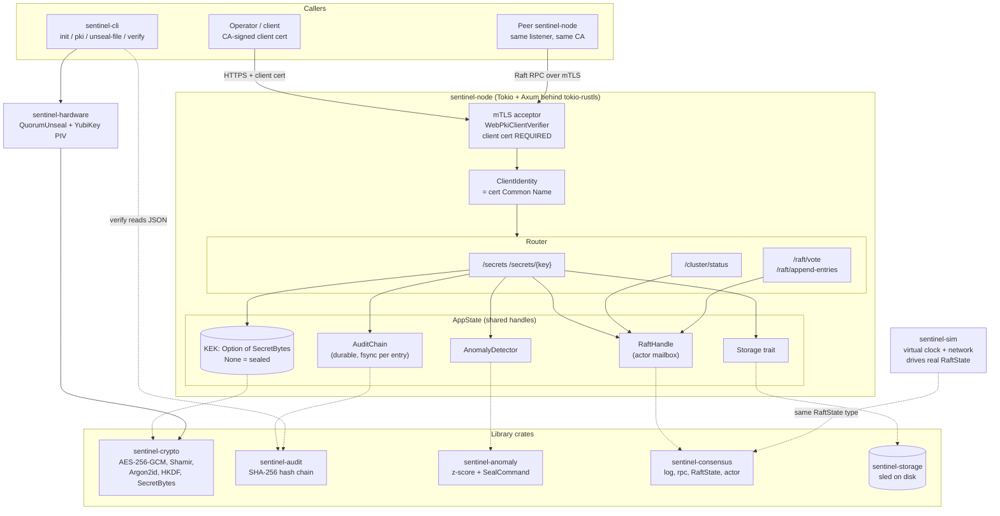
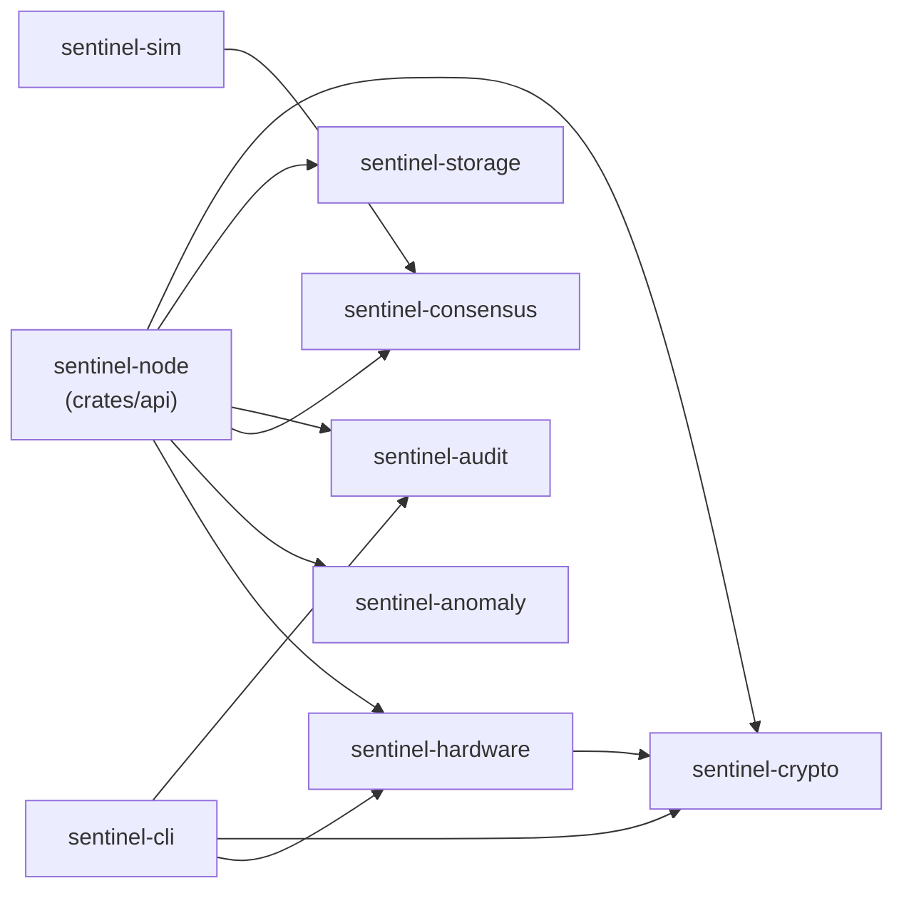
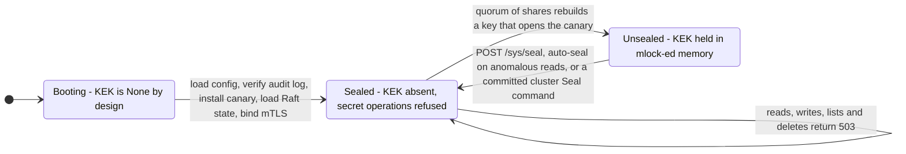
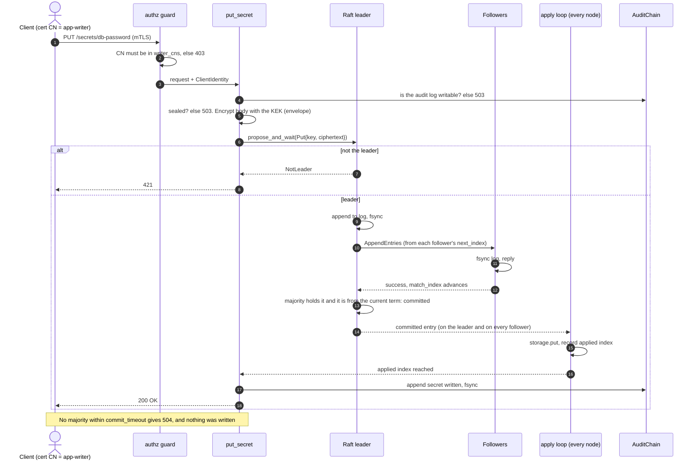
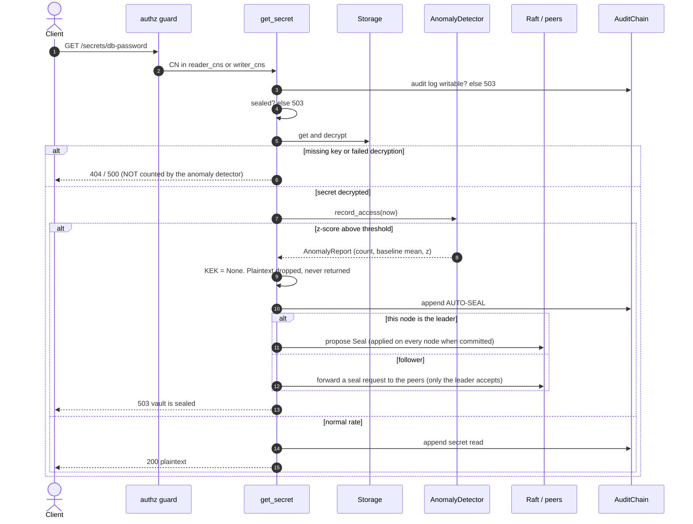
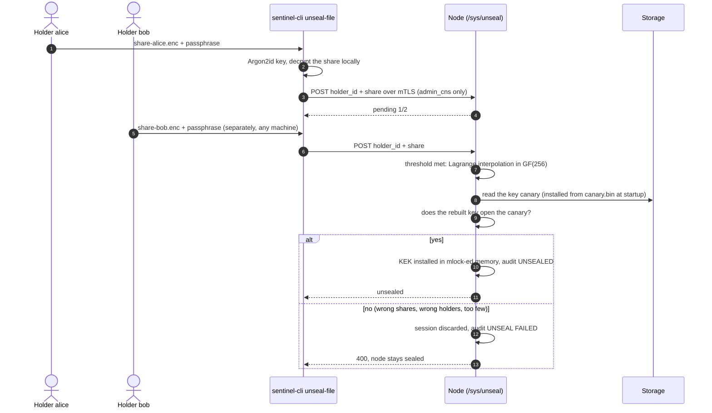
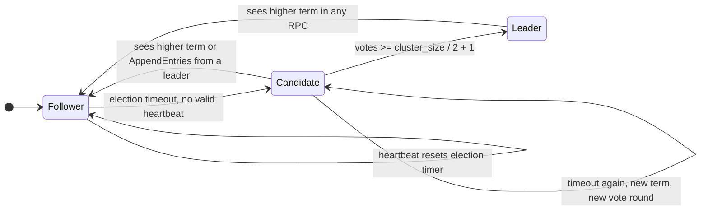
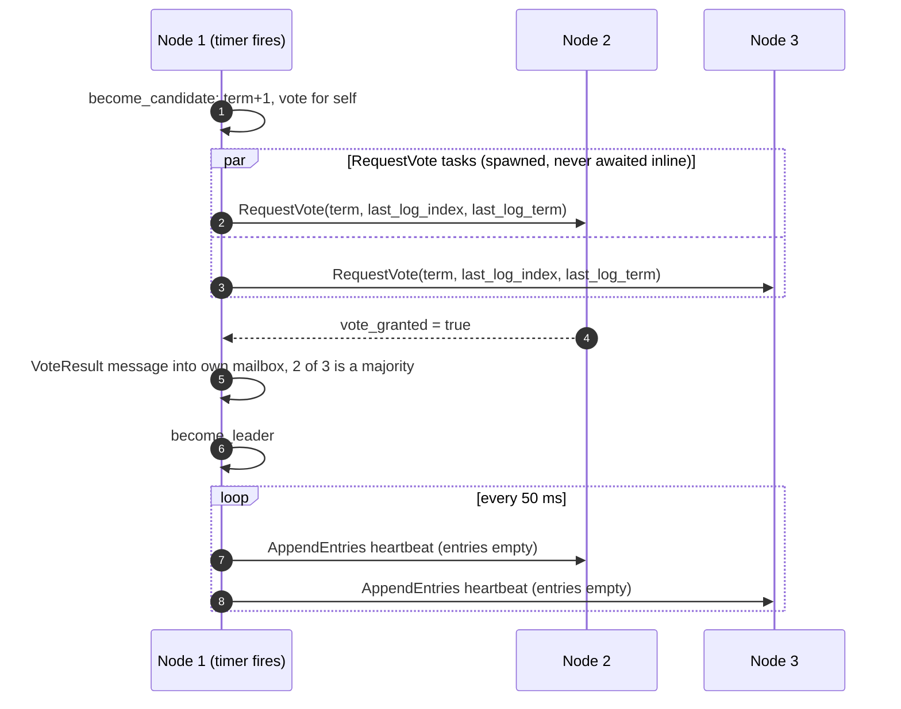
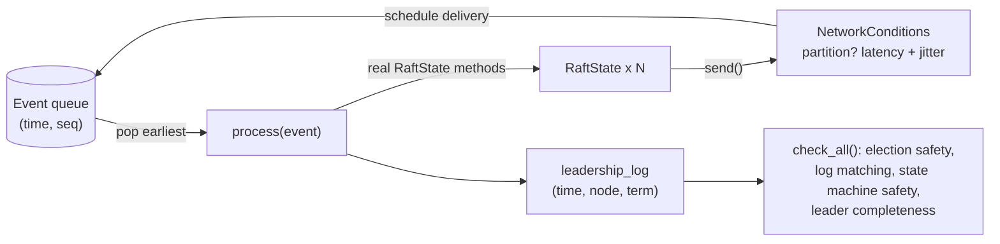

<div align="center">

# 🛡️ SENTINEL

### A zero-trust, quorum-unsealed, distributed secrets vault — written in Rust

Envelope encryption · Shamir quorum unsealing · hand-rolled replicated Raft · mutual TLS + roles ·
durable hash-chained audit log · statistical auto-seal · deterministic simulation testing


</div>

---

## Table of Contents

1. [Overview](#1-overview)
2. [Project Status — What Works Today](#2-project-status--what-works-today)
3. [System Architecture](#3-system-architecture)
4. [Request Lifecycles & State Machines](#4-request-lifecycles--state-machines)
5. [Concept Guide](#5-concept-guide)
6. [Crate-by-Crate Reference](#6-crate-by-crate-reference)
7. [HTTP API Reference](#7-http-api-reference)
8. [CLI Reference](#8-cli-reference)
9. [Configuration](#9-configuration)
10. [Getting Started](#10-getting-started)
11. [Testing, Fuzzing & Verification](#11-testing-fuzzing--verification)
12. [Security Model](#12-security-model)
13. [Known Limitations & Findings](#13-known-limitations--findings)
14. [Roadmap](#14-roadmap)
15. [Project Layout](#15-project-layout)
16. [Contributing & License](#16-contributing--license)

---

## 1. Overview

### The problem

Small engineering teams routinely keep database passwords and API keys in `.env` files, chat messages, or plaintext config — not out of carelessness, but because the "right" tools (HashiCorp Vault, AWS Secrets Manager) carry real operational weight. Leaked credentials remain a leading cause of breaches precisely because the correct path feels too heavy for a small team's risk profile.

### What Sentinel is

Sentinel is an attempt at a middle ground: a **single static Rust binary** with no JVM and no runtime dependencies, designed around the properties that actually matter:

| Principle | How Sentinel approaches it |
|---|---|
| **Secrets are never stored in plaintext** | Every value is envelope-encrypted (AES-256-GCM, fresh DEK per secret) before it touches storage; the storage trait only ever sees ciphertext. |
| **Unsealing needs a quorum of key holders** | The master key (KEK) is split with Shamir's Secret Sharing; each share is protected for its holder (passphrase-protected today; the YubiKey path is unverified, see [§13](#13-known-limitations--findings)). No single person can unseal, and a wrong or partial quorum is rejected by a key canary. |
| **Every connection is mutually authenticated and authorized** | One mTLS listener serves clients *and* cluster peers; there is no plaintext port anywhere in the code. A default-deny role policy then decides what each certificate identity may do. |
| **History can't be silently edited** | Every operation is appended to a SHA-256 hash chain, attributed to the caller's certificate CN, written durably, and verified at startup. |
| **Attacks trigger lockdown, not just alerts** | A rolling z-score detector watches read rate and clears the in-memory KEK the moment access looks like exfiltration. |
| **Writes are only acknowledged once a majority holds them** | Raft is hand-written, persists its state before replying, and a deterministic simulator drives the *same* `RaftState` type through partitions, crashes, message loss, duplication and reordering while checking its safety properties. |

It is also a **learning artifact**: the code is heavily commented with the *why* behind each decision, and this README explains every primitive and concept used.

---

## 2. Project Status — What Works Today

Everything below is implemented, tested, and — for the cluster behaviour — exercised against real `sentinel-node` binaries over real mTLS. Test counts come from `cargo test --workspace` (283 tests, 0 failures, 0 clippy warnings), run on Linux in CI and on the author's Windows machine.

| Layer | Status | Evidence |
|---|:-:|---|
| Envelope encryption, Shamir (GF(256)), HKDF/Argon2id, `mlock` + zeroize | ✅ | 25 unit + 7 property tests |
| Key canary: a reconstructed key is *verified* before it is accepted | ✅ | 5 canary tests + unseal handler tests |
| Raft elections, **log replication, majority commit, apply loop** | ✅ | 74 consensus tests incl. real multi-node clusters over a cuttable network |
| **Durable Raft state** (term, vote, log; CRC-checked WAL, fsync before replying) | ✅ | Restart-the-whole-cluster test; disk-failure test; torn-tail recovery tests |
| **Writes gated on majority commit**; storage changed only by the apply loop | ✅ | A leader without a majority returns 504 and writes nothing (tested) |
| **Cluster-wide seal** (`Seal` command applied on every node) | ✅ | 3-node test; follower-detected anomalies are forwarded to the leader |
| mTLS listener with mandatory client certificates | ✅ | Real handshakes; no cert / untrusted CA rejected |
| **Role-based authorization** (peer / admin / writer / reader, default-deny) | ✅ | 24 policy and router tests; real-cluster run with an intruder certificate |
| **Certificate revocation** (serial deny-list) | ✅ | Revoked client cannot connect (real run) |
| Quorum unseal of a **running node** (`/sys/unseal`, node-side quorum) | ✅ | Handler tests; real 3-node unseal with passphrase-protected shares |
| **Provisioning**: `sentinel-cli init`, `pki ca`, `pki issue` | ✅ | 14 CLI tests; whole vault provisioned with no `openssl` |
| **Durable, verified audit log** + `sentinel-cli verify` (`--expect-tip`) | ✅ | 19 audit + 8 verify tests; tamper / truncate / torn-tail on real files |
| Audit failure is **fail-closed** (secret operations refused if the log can't be written) | ✅ | Handler test with a failing sink |
| Rolling z-score anomaly detector (counts **successful reads only**) | ✅ | 13 detector tests + 404-flood test |
| Web dashboard (`/`, `/api/status`) | ✅ | Router tests; served over mTLS |
| Deterministic simulator: **replication, crashes, loss, duplication** + 4 safety checkers | ✅ | 31 sim tests incl. 200 random fault schedules |
| CI on **Linux and Windows** | ✅ | `.github/workflows/ci.yml` |
| **YubiKey PIV decryption on real hardware** | ⚠️ **Unverified, probably wrong** | Never run on a device; see [§13](#13-known-limitations--findings) |
| Log compaction / snapshots, dynamic membership | ❌ | Not implemented |

> **Bottom line:** you can provision a vault, run a 3-node mTLS cluster, unseal every node with a quorum of passphrase-protected shares, write secrets that are only acknowledged once a majority holds them, kill every node with `kill -9`, restart, and find the data, the audit chain and the cluster intact. What is *not* proven: the hardware-key path, and anything beyond a handful of nodes on a single machine. See [§13](#13-known-limitations--findings) for the full, honest list.

---

## 3. System Architecture

### 3.1 High-level architecture



### 3.2 ASCII fallback (for viewers without Mermaid)

```
                 ┌──────────────────────────────────────────────┐
                 │  Operator / client   ·   Peer sentinel-node   │
                 └───────────────────────┬──────────────────────┘
                                         │  mutual TLS — client cert REQUIRED
                 ┌───────────────────────▼──────────────────────┐
                 │               sentinel-node                   │
                 │  tokio-rustls acceptor ─► CN → ClientIdentity │
                 │                                               │
                 │  /secrets, /secrets/{key}   (CRUD, encrypted) │
                 │  /cluster/status            (Raft status)     │
                 │  /raft/vote, /raft/append-entries (peer RPC)  │
                 └──┬───────┬────────┬─────────┬──────────┬──────┘
                    │       │        │         │          │
              ┌─────▼───┐ ┌─▼─────┐ ┌▼──────┐ ┌▼───────┐ ┌▼────────┐
              │ crypto  │ │storage│ │ audit │ │consen- │ │ anomaly │
              │ AES-GCM │ │ sled  │ │ hash  │ │sus Raft│ │ z-score │
              │ Shamir  │ │       │ │ chain │ │        │ │ + seal  │
              │ mlock   │ │       │ │       │ │        │ │         │
              └─────────┘ └───────┘ └───────┘ └───▲────┘ └─────────┘
                                                  │ same RaftState type
      ┌────────────────────┐              ┌───────┴─────────┐
      │ sentinel-hardware  │              │  sentinel-sim   │
      │ Shamir quorum +    │              │ virtual time +  │
      │ YubiKey PIV (CLI)  │              │ chaos network   │
      └────────────────────┘              └─────────────────┘
```

### 3.3 Crate dependency graph

The direction is strictly one-way. `crypto` and `consensus` know nothing about HTTP, TLS, or each other, and `api` (the `sentinel-node` binary) is the only crate that assembles everything. That layering is exactly what makes `sentinel-sim` possible: the simulator drives the production `RaftState` through a different scheduler instead of needing a second Raft implementation.



### 3.4 Network surface

| Interface | Default | Notes |
|---|---|---|
| Client + cluster API | `api_bind_addr` (e.g. `127.0.0.1:8443`) | **Only** listener; TLS 1.2/1.3 via rustls with the `ring` provider. Every route is additionally guarded by an authorization role ([§12](#12-security-model)). |
| Peer RPC | Same port, paths `/raft/*` | Peers call each other with a `reqwest` client presenting the node's own cert (5 s timeout). Only identities in `peer_cns` are admitted. |
| Storage | `storage_path` | `sled` embedded KV store. Only the Raft apply loop writes secrets into it. |
| Raft state | `raft_dir` (default `<storage_path>.raft`) | CRC-checked write-ahead log + atomically replaced vote file; fsync'd before the node replies. |
| Audit log | `audit_path` (default `<storage_path>.audit.jsonl`) | JSON lines, one hash-chained entry per line, fsync'd per entry, verified at startup. |
| Logging | stdout, JSON lines | `tracing` + `EnvFilter` (`RUST_LOG=info`). |

### 3.5 Node lifecycle



A node **always starts sealed** — nothing in the bootstrap path populates the KEK, deliberately, because a node that could unseal itself by starting up would defeat the purpose of the quorum. A node also refuses to start if its audit log fails verification, if its storage holds a different vault's canary than `canary_file`, or if its authorization policy would lock everyone out.

---

## 4. Request Lifecycles & State Machines

### 4.1 Writing a secret — `PUT /secrets/{key}`



The handler never writes storage itself. Only committed log entries do, so "200" means a majority of the cluster holds the ciphertext durably. Followers store ciphertext too and do not need to be unsealed to apply a write.

### 4.2 Reading a secret and the auto-seal path — `GET /secrets/{key}`



Design notes that matter:

- Only **successful** reads count toward the rate. A flood of lookups for names that do not exist can never seal the vault.
- The secret that trips the detector is withheld: it was decrypted but is dropped, not returned.
- The local seal never waits on Raft: a node that sees an attack protects itself even if replication is degraded. If no leader is reachable, only the detecting node is sealed.
- Reads are served from the node's own storage; a follower that is a moment behind the leader can briefly return an older value.

### 4.3 Quorum unseal — `sentinel-cli unseal-file` → `POST /sys/unseal`



Each holder runs the command on their own, from any machine that can reach the node, and submits **only their own share**; no single request ever carries the whole key. The node holds the quorum session in memory for at most five minutes, rejects a second share from the same holder, and discards the session on any failure.

### 4.4 Raft roles (as implemented in `RaftState`)



Timings in the production node: **heartbeat 50 ms**, **election timeout 150–300 ms** (randomized per reset).

### 4.5 One election round (3 nodes)



---

## 5. Concept Guide

Each concept below explains **what it is**, **why Sentinel uses it**, and **where it lives in the code**.

### 5.1 Envelope encryption

Instead of encrypting data directly with one master key, generate a fresh random **Data Encryption Key (DEK)** per secret, encrypt the data with it, then encrypt (wrap) the DEK with a longer-lived **Key Encryption Key (KEK)**. The stored artifact is `{encrypted_DEK, encrypted_data}`.

**Why:** the KEK only ever wraps 32-byte DEKs and never touches secret data directly. Rotating the KEK means re-wrapping DEKs, not re-encrypting every secret; compromising one DEK exposes one secret, not the vault.

**Code:** `crates/crypto/src/envelope.rs` — AES-256-GCM (an AEAD, so tampering is detected, not just hidden).

```
EnvelopeCiphertext  (bincode-serialized, stored at  secrets/<key>)
├── encrypted_dek : Vec<u8>   48 bytes  = 32-byte DEK + 16-byte GCM tag
├── dek_nonce     : [u8; 12]  fresh random nonce for the wrap
├── ciphertext    : Vec<u8>   plaintext length + 16-byte GCM tag
└── data_nonce    : [u8; 12]  fresh random nonce for the data
```

- Random 96-bit nonces from `OsRng`, a new one for *every* encryption.
- Wrong-length KEK (≠ 32 bytes) is rejected up front.
- The unwrapped DEK lives in a `SecretBytes` and is zeroized when it goes out of scope.
- Tests: round-trip, wrong KEK fails closed, tampered ciphertext fails closed, wrong key length rejected.

### 5.2 Shamir's Secret Sharing

Split a secret into `N` shares so that any `K` reconstruct it but any `K−1` reveal **nothing** — information-theoretically, not "computationally hard". The secret is the constant term of a random degree-`K−1` polynomial; shares are points `(x, p(x))`; `K` points determine the polynomial via **Lagrange interpolation**.

**Code:** `crates/crypto/src/shamir.rs` — hand-rolled over **GF(2⁸)** (the AES field, reduction constant `0x1B`):

- Each secret byte is an *independent* polynomial; a share is `{ x: u8, y: Vec<u8> }` with `x ∈ 1..=N`.
- `gf_mul` is a shift-and-XOR multiply; `gf_inv` is exponentiation (`a²⁵⁴`); a test verifies **all 255** nonzero inverses.
- Validation: threshold ≥ 2, total ≥ threshold, no duplicate `x`, equal share lengths.
- Randomness comes from a caller-supplied `RngCore` (tests use `OsRng`).

**Why hand-rolled:** an earlier attempt with the `vsss-rs` crate pulled in elliptic-curve scalar machinery just to split 32 raw bytes. GF(256) does it in ~120 lines with no extra surface. *(Housekeeping note: `vsss-rs` is still listed in `crates/crypto/Cargo.toml` but no code uses it — it can be removed.)*

> **A property worth understanding:** Shamir has **no integrity check**. Combining too few or wrong shares does not error — it silently returns garbage that looks like a secret. That is why the node verifies every reconstructed KEK against a **key canary** (`sentinel_crypto::canary`: a known plaintext encrypted under the KEK, created by `sentinel-cli init` and installed at startup) before accepting it. `combine_shares` does not know the threshold and `QuorumUnseal` only guards the count, so the canary is what turns "some bytes came out" into "this is the vault's key".

### 5.3 Hardware-rooted unsealing (YubiKey PIV)

PIV is a smart-card standard; a PIV-enabled YubiKey holds a private key that **never leaves the device**. Each Shamir share is meant to be encrypted to one holder's PIV public key at provisioning time, so recovering it requires that physical key plus its PIN (plus a touch, depending on slot policy).

**Code (deliberately split in two):**

| File | Role | Verified how |
|---|---|---|
| `hardware/src/quorum.rs` | Pure composition logic: collect fragments in any order, reject a repeated `holder_id`, reconstruct at threshold. Touches no `yubikey` types. | 5 unit tests, including "one holder touching twice cannot fake a 2-of-3 quorum" |
| `hardware/src/yubikey_piv.rs` | `YubiKeyUnsealer::decrypt_share(pin, encrypted_share)` — open device, verify PIN, PIV-decrypt (slot 9d "Key Management"). | **Never run against a physical device.** |

> ⚠️ **Worth double-checking before relying on it:** the code requests `AlgorithmId::EccP256` through `yubikey::piv::decrypt_data`. PIV's *decrypt* operation is defined for RSA keys, whereas ECC keys on PIV perform ECDH key agreement. Confirm against the `yubikey` crate's documentation (or use an RSA slot) when you first test on real hardware. This is not just a doubt: it is the main open finding in [§13](#13-known-limitations--findings). `sentinel-cli init` does **not** use hardware; it protects each share with its holder's passphrase (Argon2id + AES-256-GCM), and no tool in the repo encrypts a share to a YubiKey.

### 5.4 Memory hygiene: `mlock` and zeroize

| Protection | Defends against | Mechanism |
|---|---|---|
| **Lock pages** | A KEK being swapped to disk and read long after the process exits | `libc::mlock` (Unix) / `VirtualLock` via `windows-sys` (Windows) |
| **Zeroize on drop** | A later allocation reading stale bytes | `zeroize` overwrites the buffer in `Drop`, then unlocks |

**Code:** `crates/crypto/src/secret.rs` — `SecretBytes`, the project's **only hand-written `unsafe`**.

- `shrink_to_fit()` *before* locking, so no later reallocation can silently move the secret to an unlocked page.
- Every `unsafe` block has a `SAFETY:` comment justifying pointer/length validity.
- If locking fails (e.g. low `RLIMIT_MEMLOCK`), it falls back to zeroize-only protection instead of panicking.
- `Debug` prints only the length — a stray `{:?}` in a log line cannot leak key bytes.
- A real Windows compile failure (no `mlock` there) drove the `cfg`-gated split.

### 5.5 Argon2id and HKDF

| KDF | Use when | Property | API |
|---|---|---|---|
| **Argon2id** | Input may be low-entropy | Deliberately slow and memory-hard | `derive_kek_argon2(input, salt)` — crate defaults: **19 MiB memory, t=2, p=1**, 32-byte output |
| **HKDF-SHA256** | Input is already high-entropy | Fast; derives independent per-purpose keys | `derive_key_hkdf(master, info, out_len)` |

Plus `random_salt()` (16 bytes). Tests cover determinism, salt separation, context separation, and no-panic across all lengths. *(Argon2id derives the key that protects each holder's share file in `sentinel-cli init` / `unseal-file`. HKDF is available for context-separated subkeys but is not yet used by the node.)*

### 5.6 Raft consensus

Raft gets a cluster to agree on an ordered log despite crashes and partitions: one **leader** per **term** accepts writes and replicates them; an entry is committed once a **majority** has it.

**Why hand-rolled instead of `raft-rs`/`openraft`:** a portfolio decision (implementing from the paper demonstrates understanding) and consistency with the project's preference for small, fully understood dependencies.

**Files (separated by concern):**

| File | Contents |
|---|---|
| `log.rs` | `ReplicatedLog` — 1-based indices, `append_new` (leader), `append_entries` (follower consistency check §5.3 + delete-conflicting-suffix), `entries_from`, `term_at` |
| `rpc.rs` | `RequestVote{Request,Response}`, `AppendEntries{Request,Response}` — all `serde`-serializable (JSON on the wire) |
| `state.rs` | `RaftState` — synchronous, no `async`, no timers, no I/O: vote granting, step-down, `become_candidate`, `record_vote`, `handle_append_entries` |
| `actor.rs` | Tokio actor owning one `RaftState`, driven by a mailbox; election timer, heartbeat ticker, `Transport` trait |

**Safety properties:**

| Property | How it is upheld | How it is tested |
|---|---|---|
| **Election Safety** — ≤ 1 leader per term | One vote per term; candidate's log must be at least as up-to-date | `SimWorld::check_election_safety()` across partition / heal / skew / reordering scenarios |
| **Leader Append-Only** | Leader only ever calls `append_new` (push) | Structural |
| **Log Matching** | `append_entries` rejects a mismatched `prev_log_term` and truncates conflicting suffixes | Log unit tests, and `SimWorld::check_log_matching()` after every step of the chaos runs |
| **State Machine Safety** — no two nodes apply different commands at one index | Only entries committed by a majority are applied; current-term rule for commit | `SimWorld` records the first command applied at each index and flags any later mismatch, including replays after a restart |
| **Leader Completeness** — a new leader already holds every applied entry | Election restriction (a candidate's log must be at least as up-to-date) | Checked at the moment of every election in the simulator |

> **Scope:** the simulator now checks all four properties above under partitions, crashes with restart, message loss, duplication and reordering (see [§5.11](#511-deterministic-simulation-testing) and [§11.2](#112-the-simulator)). One protection is covered by a unit test rather than the simulator: the "commit only entries of the current term" rule (Raft's Figure 8) cannot be reached from outside, because every leader appends a no-op and so an old entry always travels with a current-term one.

### 5.7 The actor model — and the deadlock that really happened

An **actor** owns its state exclusively; everything else talks to it via a channel. No shared locks, no data races by construction.

**The bug:** an early `actor.rs` sent `RequestVote` RPCs on election timeout and then **awaited the replies inline**, inside the same loop that handles the node's own mailbox. If two nodes campaigned simultaneously, each blocked waiting for the other's vote while neither could answer — a genuine deadlock, reproduced against the buggy code before it was fixed.

**The fix:** vote requests are `tokio::spawn`ed as independent tasks that report back via the actor's *own* mailbox as `RaftMessage::VoteResult`. The loop never blocks on a peer. The regression test (`repeated_elections_do_not_deadlock_under_tight_simultaneous_timeouts`) runs 20 clusters with 30–60 ms election timeouts and requires a leader within 2 s each.

**A second bug, found the same way:** a single-node cluster (`peers: []`) could never elect itself, because the majority check lived only in the vote-*response* path, which never runs with no peers. Fixed (a lone node's own vote is a majority of one) with a regression test.

### 5.8 Mutual TLS (mTLS)

Ordinary TLS authenticates the server; **mTLS makes the server demand a CA-signed client certificate too**, and aborts the handshake otherwise.

- `crates/api/src/middleware/mtls.rs` builds a `rustls::ServerConfig` with `WebPkiClientVerifier` — client certs are **mandatory**; there is no config path that admits an anonymous connection.
- `main.rs` runs a raw `tokio-rustls` accept loop (not `axum-server`, which doesn't expose peer certificates the way this project needs) and bridges each connection into the Axum router via `hyper-util`.
- The client cert's **Common Name** becomes `ClientIdentity`, attached once per connection and used for audit attribution. A cert with no readable CN is refused.
- `ring` is installed as the process-wide crypto provider (`Once`-guarded) because `reqwest` pulls in `aws-lc-rs` and rustls 0.23 refuses to guess between two compiled-in providers.
- Cluster RPCs use the *same* listener — no weaker internal channel.

**Observed behaviour (real handshakes against generated certs):**

| Client presents | Result |
|---|---|
| Cert signed by the trusted CA | ✅ handshake succeeds, CN extracted |
| No certificate | ❌ `peer sent no certificates` (curl exit 56) |
| Certificate from an untrusted CA | ❌ `invalid peer certificate` (curl exit 56) |

### 5.9 Hash-chained audit log

Each entry's hash covers its own content **plus the previous entry's hash**, so changing, deleting, or forging any entry breaks every link after it.

```
hash = SHA-256( index (u64, big-endian)
              ‖ timestamp (RFC 3339 string)
              ‖ event (UTF-8 bytes)
              ‖ prev_hash (32 bytes) )          genesis prev_hash = 32 zero bytes
```

An explicit byte layout (not `serde_json`) is hashed, so the encoding is unambiguous and stable.

`verify()` walks the chain and reports the first break with its type:

| Error | Meaning |
|---|---|
| `HashMismatch { index }` | An entry's content/timestamp was altered |
| `BrokenLink { index, … }` | `prev_hash` doesn't match the real predecessor (e.g. a spliced forgery) |
| `NonSequentialIndex { expected, found }` | An entry was deleted or reordered |

**What it proves:** *tamper-evidence*, not tamper-prevention — someone who can rewrite the whole file consistently can recompute every hash. It defeats the realistic attack: editing one entry to cover tracks.

> **Persistence.** The node opens `audit_path` at startup, verifies the whole chain, and appends every new entry to it as one JSON line, fsync'd. A log that fails verification stops the node; a half-written final record from a crash is cut off and reported. If the file ever cannot be written, the chain is marked *degraded* and the secret endpoints refuse to operate until it is restored. `sentinel-cli verify` reads exactly this file. Truncation of the **newest** entries cannot be seen from the file alone; compare the tip hash against a copy recorded elsewhere (`--expect-tip`).

### 5.10 Rolling z-score anomaly detection

```
time ─► │ bucket │ bucket │ bucket │ … │ current (open) bucket │
         counts feed a rolling window of the last N closed buckets

mean = Σcᵢ / n          stddev = √( Σ(cᵢ − mean)² / n )     (population stddev)
z    = (current_count − mean) / stddev        flag if  z > threshold
```

| Parameter | Node default | Meaning |
|---|---|---|
| Bucket width | 1 s | Resolution of the rate signal |
| `max_history` | 60 buckets | Rolling baseline length |
| `z_threshold` | 3.0 | Std-devs above mean that counts as anomalous |
| `min_history_for_detection` | 5 | Warm-up — **no detection before 5 closed buckets** |

Behaviours worth knowing:

- **Idle gaps count as zero buckets** — silence is part of the baseline.
- **Flat baseline (stddev = 0):** *any* count above the mean is flagged (`z = ∞`).
- **Worked example:** a baseline alternating 2 and 4 reads/second has mean 3, stddev 1, so with `z = 3.0` the current bucket is flagged once it exceeds `3 + 3×1 = 6` → on the **7th read** within that second.
- Detection fires *during* a burst, not after (tested: flagged well before 40 requests land).
- One detector covers **aggregate** node traffic, so a coordinated multi-identity attack still shows as one spike. Only **successful** reads count: lookups of names that do not exist (404), requests while sealed, and failed decryptions do not, so a client looping over made-up names cannot lock the vault.
- Time is passed in as an `Instant` parameter (never read internally), which makes the detector fully deterministic to test.

**`SealCommand`:** `{ reason, current_count, baseline_mean, z_score }`, encoded as the ASCII tag `SEAL:` + bincode payload so a log applier can distinguish it from other commands without a shared enum (which would invert the crate layering).

### 5.11 Deterministic simulation testing

Instead of real sockets and real timers, `sentinel-sim` replaces the network and clock with programmer-controlled versions:

- **`SimTime`** — virtual milliseconds; a "30-second partition" costs microseconds of test time.
- **`NetworkConditions`** — symmetric partitions (`partition`, `heal`, `heal_all`), base latency, 0–3 ms random jitter (which naturally reorders in-flight messages), and a configurable percentage of messages **lost** or **delivered twice**.
- **`SimWorld`** — a discrete-event scheduler (binary heap ordered by `(time, seq)`) that drives the **production** `RaftState`: elections, `build_append_entries` / `handle_append_entries_response`, majority commit, `take_newly_committed`, and `RaftState::restore` for crashed nodes. Same seed + same actions ⇒ byte-identical results.



**Scenarios tested** (all seeded):

| Test | Asserts |
|---|---|
| Five nodes, no faults | One leader; every node applies the same commands in order |
| 2-node minority partitioned; leader isolated then healed; clock skew; heavy jitter; 4 partition/heal cycles | Election Safety, stepping down, convergence (the original election suite) |
| A deposed leader accepts a write while cut off | The orphaned write never commits, and is gone from the old leader's log after healing |
| A node misses 30 commands, then reconnects | It catches up completely and in order |
| 30% message loss, 25% duplication, reordering | Safety holds at every step; the cluster still commits; one history after the faults stop |
| Every node crashes at once, then restarts | No committed command lost or reordered; the cluster keeps working |
| The leader is crashed and restarted six times | Acknowledged commits survive |
| **200 random fault schedules** (proposals, partitions, heals, crashes, restarts, loss) | All four properties after every step; after recovery the cluster converges and commits a fresh command |
| Same seed twice | Identical commits, leadership history and event count, faults included |
| Each checker, fed a deliberately corrupted node | The checker **fails**, so a silent checker means something |

*Not modelled:* disk corruption (the Raft storage layer has its own tests), Byzantine behaviour, and membership changes.

### 5.12 Property-based testing and fuzzing

- **`proptest`** (stable Rust, runs in every `cargo test`): states a property over generated inputs and shrinks failures. **7 properties** — `decrypt` never panics on arbitrary/garbage bytes (two variants), encrypt→decrypt round-trips for arbitrary plaintext, `combine_shares` never panics on arbitrary shares, HKDF never panics, `split_secret` never panics across the full 0–255 threshold/total space (40 cases), Argon2 never panics across input/salt lengths (20 cases).
- **`cargo-fuzz`/libFuzzer** (nightly, long coverage-guided runs): `crates/crypto/fuzz/fuzz_targets/{decrypt,combine_shares,kdf}.rs` mirror the same boundaries. The fuzz crate is deliberately isolated from the workspace (own empty `[workspace]` table).

Why both: the property tests catch regressions on every commit; the fuzzers find inputs a human or random sampler wouldn't. `decrypt` is the highest-value target — it parses attacker-influenced bytes read back from storage.

---

## 6. Crate-by-Crate Reference

| Crate (package) | Path | Responsibility | Key public API | Tests |
|---|---|---|---|:-:|
| `sentinel-crypto` | `crates/crypto` | Cryptographic primitives | `envelope::{encrypt, decrypt, EnvelopeCiphertext}`, `shamir::{split_secret, combine_shares, ShamirShare}`, `canary::{create, verify}`, `kdf::{derive_kek_argon2, derive_key_hkdf, random_salt}`, `SecretBytes` | 25 + 7 property |
| `sentinel-storage` | `crates/storage` | Pluggable ciphertext store | `trait Storage { get, put, delete, list }`, `SledStorage` | 4 |
| `sentinel-audit` | `crates/audit` | Tamper-evident, **durable** log | `AuditChain::{append, verify, tip_hash, is_healthy}`, `open_persistent`, `parse_log`, `AuditSink`, `FileSink` | 19 |
| `sentinel-consensus` | `crates/consensus` | Raft: elections, replication, persistence | `RaftState`, `spawn_raft_actor{,_with_apply,_persistent}`, `RaftHandle::{propose, propose_and_wait, inspect, shutdown}`, `RaftStore` (`FileStore`, `MemoryStore`), `Transport` | 74 |
| `sentinel-hardware` | `crates/hardware` | Quorum + YubiKey (**hardware path unverified**) | `QuorumUnseal`, `UnsealFragment`, `YubiKeyUnsealer` | 5 |
| `sentinel-anomaly` | `crates/anomaly` | Access-rate detection | `AnomalyDetector::{record_access, snapshot}`, `AnomalyReport`, `SealCommand` | 13 |
| `sentinel-node` | `crates/api` | The server binary | mTLS listener, guarded Axum router, `Policy`, replicated state machine (`statemachine`), `HttpTransport`, `NodeConfig` | 76 |
| `sentinel-sim` | `crates/sim` | Deterministic chaos harness | `SimWorld::{propose, crash, restart, check_all, ...}`, `NetworkConditions` | 16 + 8 + 7 |
| `sentinel-cli` | `crates/cli` | Admin and provisioning tool | `init`, `pki`, `unseal-file`, `submit-share`, `seal`, `reset-unseal`, `verify`, `unseal` | 29 |

**Total: 283 tests, all passing; `cargo clippy --workspace --all-targets -- -D warnings` is clean.**

Key dependencies (resolved in `Cargo.lock`): `axum 0.8`, `tokio 1.53`, `rustls 0.23`, `tokio-rustls 0.26`, `hyper-util 0.1`, `reqwest 0.12` (rustls), `x509-parser 0.16`, `rcgen 0.13`, `aes-gcm 0.10`, `argon2 0.5`, `hkdf 0.12`, `sled 0.34`, `yubikey 0.8`, `zeroize 1.9`, `proptest 1.11`, `chrono 0.4`.

---

## 7. HTTP API Reference

All routes are served **only** over mTLS, and every route group requires a role (see [§12](#12-security-model)). A valid certificate whose Common Name has no role gets `403`.

### 7.1 Routes

| Method & path | Role | Behaviour |
|---|---|---|
| `GET /` | admin, reader, writer | Dashboard page (polls `/api/status`) |
| `GET /api/status` | admin, reader, writer | JSON: role, term, commit index, sealed, audit (verified, persistent, healthy, tip hash, recent events), anomaly snapshot |
| `GET /cluster/status` | admin, reader, writer | `{role, term, commit_index, applied_index}` |
| `GET /secrets` | reader, writer | List secret names (`503` if sealed) |
| `GET /secrets/{key}` | reader, writer | Decrypt and return. Successful reads feed the anomaly detector |
| `PUT /secrets/{key}` | writer | Encrypt, replicate, return only after a **majority commit** and local apply. Leader only |
| `DELETE /secrets/{key}` | writer | Same contract as `PUT` |
| `POST /sys/unseal` | admin | Body `{"holder_id": "...", "share": "<hex>"}`; `{"status":"pending",...}` until the threshold, then `{"status":"unsealed"}` |
| `DELETE /sys/unseal` | admin | Discard a half-finished unseal session |
| `POST /sys/seal` | admin | Seal this node now |
| `POST /raft/vote` | peer | Raft `RequestVote` |
| `POST /raft/append-entries` | peer | Raft `AppendEntries` |
| `POST /raft/seal-request` | peer | A follower asks the leader to seal the cluster; `202` from the leader, `421` otherwise |

### 7.2 Error model

Errors are JSON `{"error": "<message>"}`. Internal errors are logged server-side and returned as a generic `internal server error`.

| Status | Meaning |
|---|---|
| `400` | Malformed input (bad share, bad holder id, bad secret name), or the submitted shares did not rebuild the vault key |
| `403` | Authenticated, but the certificate's identity has no permission for this route (audited once per identity and permission per minute) |
| `404` | Secret does not exist |
| `409` | Conflict: already unsealed, duplicate holder in the session, or the vault has no canary and bootstrap is not allowed |
| `421` | This node is not the Raft leader; write there instead |
| `503` | Vault sealed, leadership changed before the write committed (retry), or the **audit log is not writable** (secret operations are refused) |
| `504` | A write was not confirmed by a majority in time. **It may or may not have been applied**: check before retrying |

### 7.3 Examples

```bash
# Unseal (each holder runs this themselves, with their own share file)
sentinel-cli unseal-file --node https://localhost:8443 --cert pki/alice-admin.crt \
  --key pki/alice-admin.key --ca pki/ca.crt --file vault/share-alice.enc

# Write and read as an application client
curl --cacert pki/ca.crt --cert pki/app-writer.crt --key pki/app-writer.key \
  -X PUT -d 'hunter2' https://localhost:8443/secrets/db-password        # 200
curl --cacert pki/ca.crt --cert pki/app-writer.crt --key pki/app-writer.key \
  https://localhost:8443/secrets/db-password                             # hunter2

# Role separation: an admin cannot read secrets
curl --cacert pki/ca.crt --cert pki/alice-admin.crt --key pki/alice-admin.key \
  https://localhost:8443/secrets/db-password                             # 403
```

---

## 8. CLI Reference

`sentinel-cli <COMMAND>` (build it with `cargo build -p sentinel-cli`; **`cargo test` does not rebuild the binary**).

Commands that talk to a node take `--node <URL> --cert <PEM> --key <PEM> --ca <PEM>`: the client certificate to present and the CA that signed the node's certificate.

| Command | Purpose |
|---|---|
| `pki ca --out DIR [--cn NAME] [--days N]` | Create a certificate authority (`ca.crt`, `ca.key`). Refuses to overwrite. |
| `pki issue --ca DIR --out DIR --cn NAME [--kind node\|client] [--san HOST]... [--days N]` | Issue `<cn>.crt` / `<cn>.key`. `node` certs (server + client auth) need at least one `--san`; `client` certs are client-auth only. The CN is the identity the node's policy matches on. |
| `init --holder NAME... --threshold K --out DIR [--format passphrase\|plain] [--passphrase-env-prefix P]` | Provision a vault: generate the root key (never written to disk), split it K-of-N, write `canary.bin`, one share file per holder, and `PROVISIONING.txt`. Self-tests by rebuilding the key from the files it wrote. Refuses to write into a non-empty directory. |
| `unseal-file --file share-<name>.enc [--passphrase-env VAR]` + node flags | A holder decrypts their share locally and submits just that share. |
| `submit-share --holder NAME` + node flags | Submit one already-decrypted share (hex on stdin). **Scripting and tests only**: it puts a plaintext share in your shell. |
| `seal` / `reset-unseal` + node flags | Seal a node now / discard a half-finished unseal session. |
| `verify [PATH] [--expect-tip HASH] [--expect-entries N] [--allow-torn-tail]` | Verify an audit log (the node's JSON-lines file or a JSON-array export). Exit code is non-zero on any failure. |
| `unseal [--manifest FILE]` + node flags | Interactive YubiKey unseal. **Unverified on hardware**; see [§13](#13-known-limitations--findings). |

### `verify`: what it can and cannot prove

The hash chain makes any edit, insertion, deletion or reordering **inside** the log detectable. It cannot, by itself, show that the **newest** entries were cut off the end. Record the tip hash somewhere the log's custodian cannot edit (the dashboard shows it, `sentinel-cli verify` prints it) and check it later with `--expect-tip`.

---

## 9. Configuration

Settings come from an optional **`.env.toml`** in the working directory and from environment variables named `SENTINEL__<KEY>` (note the **double underscore**). **The environment overrides the file.** List values from the environment are comma-separated: `SENTINEL__PEERS="2=https://h2:8443,3=https://h3:8443"`.

| Key | Default | Meaning |
|---|---|---|
| `node_id` | required | This node's Raft id (u64) |
| `api_bind_addr` | required | Address of the mTLS listener |
| `storage_path` | required | Directory for the `sled` store |
| `tls_cert_path`, `tls_key_path`, `ca_cert_path` | required | This node's certificate and key, and the CA it trusts |
| `peers` | `[]` | `"<node_id>=<base_url>"` entries for the other nodes; empty = single node |
| `unseal_threshold` | `2` | Key holders needed to unseal; must match what `init` used; minimum 2 |
| `raft_dir` | `<storage_path>.raft` | Raft's durable state. Keep it paired with `storage_path` |
| `commit_timeout_ms` | `5000` | How long a write waits for a majority commit |
| `peer_cns` | `[]` | Common Names of the other cluster nodes (required whenever `peers` is set) |
| `admin_cns` | `[]` | Identities allowed to seal/unseal (at least one required) |
| `writer_cns`, `reader_cns` | `[]` | Identities allowed to write/delete+read, or read only (at least one of the two required) |
| `revoked_serials` | `[]` | Certificate serial numbers (hex) refused after the handshake |
| `audit_path` | `<storage_path>.audit.jsonl` | The durable audit log |
| `canary_file` | none | The `canary.bin` from `init`, installed into storage at startup |
| `allow_canary_bootstrap` | `false` | **Dev only**: let the first unseal of an empty vault define the canary |
| `insecure_allow_any_client` | `false` | **Dev only**: any valid certificate may do anything. Logs a warning at startup |

**Startup refuses**: a policy that would lock everyone out (no admins, no secret clients, peers without `peer_cns`, a node certificate that is also listed as a client); an audit log that fails verification; a storage directory whose canary differs from `canary_file`; `unseal_threshold < 2`.

A fully commented example is in [`.env.toml.example`](.env.toml.example).

---

## 10. Getting Started

### 10.1 Prerequisites

Rust 1.85 or newer (edition 2024; `rust-toolchain.toml` selects `stable`). On Linux, `libpcsclite` is **not** required to build. No `openssl` is needed: the CLI creates the PKI.

### 10.2 Build and test

```bash
cargo build --workspace
cargo test --workspace --no-fail-fast
cargo clippy --workspace --all-targets -- -D warnings
```

The first build compiles `rustls`, `ring` and `sled` and takes a few minutes. The consensus and property tests take around 10-40 s.

### 10.3 Provision a vault (once)

```bash
CLI=target/debug/sentinel-cli

$CLI pki ca --out ca
mkdir pki && cp ca/ca.crt pki/
$CLI pki issue --ca ca --out pki --cn node1       --kind node   --san localhost --san 127.0.0.1
$CLI pki issue --ca ca --out pki --cn alice-admin --kind client
$CLI pki issue --ca ca --out pki --cn app-writer  --kind client

$CLI init --holder alice --holder bob --holder carol --threshold 2 --out vault
# prompts for each holder's passphrase (12+ characters, typed twice); read vault/PROVISIONING.txt next
```

On Windows PowerShell use `.\target\debug\sentinel-cli.exe`. **Run `init` as a single command on its own line**: pasting several lines can feed stray Enter keypresses to the hidden passphrase prompts.

### 10.4 Run a single node

`.env.toml`:

```toml
node_id          = 1
api_bind_addr    = "127.0.0.1:8443"
storage_path     = "data/node1"
tls_cert_path    = "pki/node1.crt"
tls_key_path     = "pki/node1.key"
ca_cert_path     = "pki/ca.crt"
canary_file      = "vault/canary.bin"
unseal_threshold = 2
admin_cns        = ["alice-admin"]
writer_cns       = ["app-writer"]
```

```bash
cargo run -p sentinel-node
```

### 10.5 Unseal and use it

```bash
for h in alice bob; do
  $CLI unseal-file --node https://localhost:8443 \
    --cert pki/alice-admin.crt --key pki/alice-admin.key --ca pki/ca.crt \
    --file vault/share-$h.enc          # each holder is prompted for their own passphrase
done
curl --cacert pki/ca.crt --cert pki/app-writer.crt --key pki/app-writer.key \
  -X PUT -d 'hunter2' https://localhost:8443/secrets/db-password
```

The dashboard is at `https://localhost:8443/` (your browser needs a client certificate whose CN is an admin, reader or writer).

### 10.6 Run a 3-node cluster

Issue one certificate per node (`--cn node1`, `node2`, `node3`, each with its own `--san`) and give every node:

```toml
peers    = ["2=https://host2:8443", "3=https://host3:8443"]   # the others, "<id>=<url>"
peer_cns = ["node1", "node2", "node3"]
```

Start all three; they elect a leader. **Unseal every node** (the key lives only in memory), write through the leader, read from any node. A write sent to a follower returns `421`.

### 10.7 Check the audit log

```bash
$CLI verify data/node1.audit.jsonl
$CLI verify data/node1.audit.jsonl --expect-tip <hash shown on the dashboard earlier>
```

### 10.8 Fuzzing and Miri (nightly)

```bash
cargo +nightly install cargo-fuzz
cd crates/crypto && cargo +nightly fuzz run decrypt
```

See [§11.3](#113-what-has-not-been-executed): these have not been run by the author.

---

## 11. Testing, Fuzzing & Verification

### 11.1 Test inventory

| Area | What is proven |
|---|---|
| Crypto | Round trips; wrong key and tampered ciphertext fail closed; Shamir for every subset; property tests (no panics on arbitrary input) |
| Key canary | Only the right key verifies; wrong lengths and tampering do not panic |
| Raft state machine | Vote rules, log rules, commit only by current-term replicas (Figure 8), one-step back-off per rejection, reordered/duplicated/stale replies |
| Raft actor | Real multi-node clusters over a network that can be cut: ordering, catch-up, a deposed leader's write never applied, fail-stop on disk failure, restart of the **whole cluster** loses nothing, a restarted node cannot vote twice |
| Persistence | CRC-checked WAL, torn-tail recovery, a damaged vote file is refused rather than read as zero |
| Authorization | Every role against every route group; an identity with no role; denials audited once; the original `/raft/*` hole |
| Audit | Tampered/deleted/reordered entries detected; torn tail recovered; a failing disk degrades the log; tail truncation shown to be detectable **only** by an external tip |
| Provisioning | Any threshold of holders rebuilds a key that opens the canary, fewer cannot; never overwrites key material; certificates chain to the CA with the right identity and usages |
| Simulator | See below |

### 11.2 The simulator

`sentinel-sim` drives the **same `RaftState`** as the production actor on a discrete-event scheduler with virtual time. It adds replication, node **crashes with restart from persisted state**, message **loss, duplication and reordering**, and checks four Raft properties after every step: election safety, log matching, state machine safety, and leader completeness. 200 random fault schedules run in the suite, each followed by a recovery phase that must converge and commit a fresh command; identical seeds reproduce identical histories.

The checkers are themselves tested: each has a test that deliberately corrupts a node and requires the checker to fail.

**Mutation results** (deliberately breaking the production consensus code):

| Bug introduced | Caught by |
|---|---|
| Followers never truncate conflicting entries | simulator (log matching) |
| Election restriction removed | simulator (leader completeness) |
| A node may vote for several candidates in a term | simulator (election safety) |
| Commit on a minority | simulator (state machine safety) |
| Commit old-term entries by counting replicas (Figure 8) | consensus unit test only: every leader appends a no-op, so a replica of an old entry always travels with a current-term entry, which makes this unreachable from outside |
| A restarted node forgets its vote | consensus unit and actor tests (3 failures); the random fault runs do not reach it |

### 11.3 What has *not* been executed

| Item | Why |
|---|---|
| YubiKey PIV decryption on hardware | No device; the code is believed to be wrong for ECC keys (see §13) |
| `cargo-fuzz` under libFuzzer | Needs nightly. A non-blocking CI job exists but has not been observed to run |
| Miri | Needs nightly; the crypto crate calls `mlock`/`VirtualLock`, which Miri cannot execute |
| Clusters larger than 5 nodes, real multi-host networks, sustained load | Only single-machine, loopback runs |
| macOS | Not built or tested |

### 11.4 Bugs found by adversarial testing and real runs

1. **Actor deadlock** (§5.7), found by a timing stress test.
2. **Single-node election bug** (§5.7).
3. **Windows build break**: `mlock` does not exist on Windows; led to the `cfg`-gated `VirtualLock`.
4. **Lagging followers started elections**: a follower reset its election timer only when an append *succeeded*, so a merely-behind follower would have disrupted the cluster once real replication began.
5. **Audit file opened append-only**: on Windows an append-only handle cannot be truncated, so recovering from a torn final record failed with "Access is denied". Found by the Windows test run, not by Linux.
6. **Timing assumptions in tests**: a test asserted "exactly one leader" from a single snapshot after a fixed sleep, which is not a Raft guarantee (only one leader *per term* is). Replaced by polling plus the real invariant.
7. **`cargo test` does not rebuild binaries**: stale `sentinel-node`/`sentinel-cli` binaries produced misleading end-to-end failures.

---

## 12. Security Model

### 12.1 What Sentinel is designed to guarantee

| Property | Mechanism |
|---|---|
| Secrets at rest are ciphertext | AES-256-GCM envelope encryption under the KEK; the Raft log and every follower's disk see only ciphertext |
| The KEK never touches disk | Held in `mlock`-ed, zeroizing memory; rebuilt from shares at unseal; `init` never writes it |
| No single person can unseal | Shamir K-of-N; each holder submits only their own share |
| A wrong or partial quorum is rejected | The rebuilt key must open the provisioned canary; no trust-on-first-use by default |
| Every client is authenticated and authorized | Mandatory mTLS, then a default-deny role policy; revoked serials refused |
| A node certificate cannot read secrets; an admin cannot either | Roles are separate by design |
| An acknowledged write is on a majority and survives restarts | Commit-gated writes; fsync'd Raft state; whole-cluster restart tested |
| The audit trail is tamper-evident and durable | Hash chain, fsync per entry, verified at startup; a tampered log stops the node |
| No secret operation without a durable audit record | Fail-closed when the audit log cannot be written |
| An exfiltration burst seals the vault | Rolling z-score on successful reads; the triggering secret is withheld; the seal is replicated |

### 12.2 Threat model

| Threat | Mitigation |
|---|---|
| Stolen disk or backup | Only ciphertext; the KEK is not on disk. Share files are passphrase-protected |
| Rogue application with a valid certificate | Role policy limits it to its role; auto-seal on abnormal read rates |
| A stolen node certificate | Cannot read secrets or unseal; can still act as a Raft peer (see limits). Revoke the serial |
| One malicious or coerced key holder | Needs K holders |
| A client probing for names | 404s are not counted, cannot trigger a seal, and are not recorded as reads |
| Tampering with the audit log | Detected at startup and by `verify`; truncation of the tail needs an external tip |
| A node whose disk fails | Raft actor stops (fail-stop); audit degradation refuses secret operations |
| Network eavesdropping or injection | TLS with mandatory client certificates |

### 12.3 Non-goals (today)

- **Byzantine peers.** Raft tolerates crashes, not malicious nodes. Anyone holding a `peer_cns` certificate is fully trusted by the cluster.
- **Defence against a fully compromised, *unsealed* node.** The KEK is in its memory.
- **Protection of secret *names*.** Names appear in the audit log, and in storage keys.
- **Side channels, core dumps and swap while unsealed** beyond best-effort `mlock`.

---

## 13. Known Limitations & Findings

The original list of problems in this project (functional gaps, security findings, housekeeping) was worked through in phases 12-18. Status:

### 13.1 Resolved

| Original problem | Resolution |
|---|---|
| A running node could never be unsealed | `/sys/unseal` with a node-side quorum; `unseal-file` |
| Raft did not replicate or advance `commit_index` | `next_index`/`match_index`, majority commit, apply loop |
| Writes were not gated on majority commit | Handlers propose and wait; only the apply loop writes storage |
| Raft term, vote and log were not persisted | `FileStore` WAL, fsync before replying |
| `SealCommand` was not applied cluster-wide | Replicated `Seal` command; follower anomalies forwarded to the leader |
| Dashboard routes returned 404 | Mounted and tested |
| Audit chain was in memory only; `verify` had no producer | Durable JSON-lines log; `verify` reads it |
| A reconstructed KEK was not verified | Key canary |
| No provisioning tooling | `init`, `pki ca`, `pki issue` |
| Any client certificate could call `/raft/*`; no authorization | Role-based, default-deny policy |
| `list`/`delete` worked while sealed | Refused with 503 |
| 404 reads counted toward the auto-seal rate | Only successful reads count |
| Unused dependencies, 9 stray lockfiles, mixed editions, config precedence and file-name confusion | Cleaned up; edition 2024 everywhere; environment overrides the file |

### 13.2 Remaining

1. **The YubiKey path is unverified and probably wrong.** `sentinel-hardware` calls PIV `decrypt_data` with an **ECC P-256** key. On a PIV card, ECC keys perform ECDH key agreement; they do not decrypt. The author has no device to confirm. Fixing it needs a device and a design decision (an RSA slot, or ECDH with a hybrid scheme). Until then use passphrase-protected shares from `init`; they are a weaker second factor than hardware.
2. **No log compaction or snapshots.** The Raft WAL and log grow with every write; there is no truncation of the applied prefix.
3. **No dynamic membership.** The peer set is static; no joint consensus.
4. **Per-node audit logs.** Each node records what it saw; they are not merged or replicated. Tail truncation is detectable only against an externally recorded tip.
5. **Reads are not linearizable.** They are served from the node's own storage, so a lagging follower can return an older value.
6. **Revocation is a deny-list**, edited in config and applied on restart; not CRL or OCSP.
7. **Identity is the certificate's Common Name.** Two certificates with the same CN are indistinguishable to the policy.
8. **Auto-seal needs a warm-up.** The detector needs history before it can flag anything. A fast attacker on a freshly started node is not caught. A reader with a valid certificate can also deliberately trigger a seal by reading fast: that is the defence working, but it is also a lever.
9. **Forwarded seals are best-effort.** If no leader is reachable at that moment, only the detecting node is sealed.
10. **A node holds the whole key in memory while unsealed, and briefly while a quorum assembles.** Anyone who can read that process's memory defeats the scheme.
11. **Unsealing is manual per node.** The key lives only in memory, so every restart needs a new quorum on every node.
12. **Share distribution is out of band.** `init` produces files; getting each to its holder safely is your responsibility.
13. **`rustfmt` is not enforced.** The codebase was never formatted with it (running `cargo fmt` would touch nearly every file). `clippy -D warnings` *is* enforced.
14. **Minor:** piping `sentinel-cli` output into something that closes early (`| head`) prints a broken-pipe panic.

---

## 14. Roadmap

**Next, in rough priority order:**

- [ ] Resolve the hardware-key design on a real device (see §13.2-1), then re-enable hardware shares in `init`.
- [ ] Snapshots and log compaction for Raft and the WAL.
- [ ] Linearizable reads (read-index or lease reads) as an option.
- [ ] Replicate or merge audit logs; periodic external tip anchoring.
- [ ] Dynamic membership (joint consensus).
- [ ] CRL/OCSP or short-lived certificates instead of a restart-time deny-list.
- [ ] Auto-unseal options (KMS) for restarts, with their own threat model.
- [ ] Metrics, readiness endpoint, packaged releases.
- [ ] `cargo fmt` the tree once, then enforce it.

**Done in phases 12-18:** everything in §13.1.

---

## 15. Project Layout

```
sentinel/
├── Cargo.toml                    # workspace, shared package settings
├── rust-toolchain.toml
├── .env.toml.example             # every setting, commented
├── .github/workflows/ci.yml      # Linux + Windows build/test, clippy gate
├── README.md
└── crates/
    ├── crypto/       src/{envelope,shamir,kdf,canary,secret}.rs   tests/ (property)   fuzz/ (own workspace)
    ├── storage/      src/{lib,sled_backend}.rs
    ├── audit/        src/{chain,persist}.rs
    ├── consensus/    src/{state,log,actor,persist,rpc}.rs
    ├── hardware/     src/{quorum,yubikey_piv}.rs                   (hardware path unverified)
    ├── anomaly/      src/{detector,seal}.rs
    ├── sim/          src/{world,mock_clock,mock_network}.rs   tests/{raft_safety,log_matching}_test.rs
    ├── cli/          src/{main,init,pki,unseal,verify}.rs
    └── api/          src/{main,config,state,statemachine,bootstrap,transport,errors}.rs
                      src/handlers/{secrets,unseal,raft,cluster,dashboard}.rs
                      src/middleware/{mtls,authz}.rs   src/routes/mod.rs   dashboard/index.html
```

---

## 16. Contributing & License

**Workflow** (CI runs the first two on Linux and Windows):

```bash
cargo clippy --workspace --all-targets -- -D warnings
cargo test --workspace --no-fail-fast
```

The house rule from this project's history: *write it, prove it runs, then ship it*, and never hand over code that was only reviewed. Break the code on purpose to confirm the tests can fail. If something can't be executed here (hardware, nightly tooling, another operating system), say so explicitly in the code and the docs, as this repo does. Platform-specific bugs are real: the audit-log bug in §11.4 passed on Linux and failed on Windows, which is why CI runs both.

**License:** MIT — © MuaazTasawar.

---

<div align="center">

*Built across 19 phases (0-18), each compiled and tested before being called done.*

</div>
