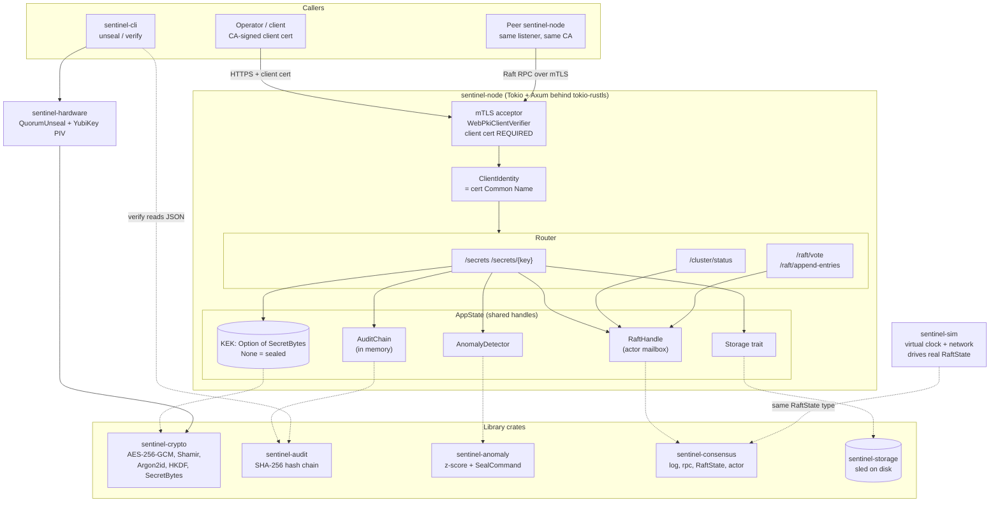
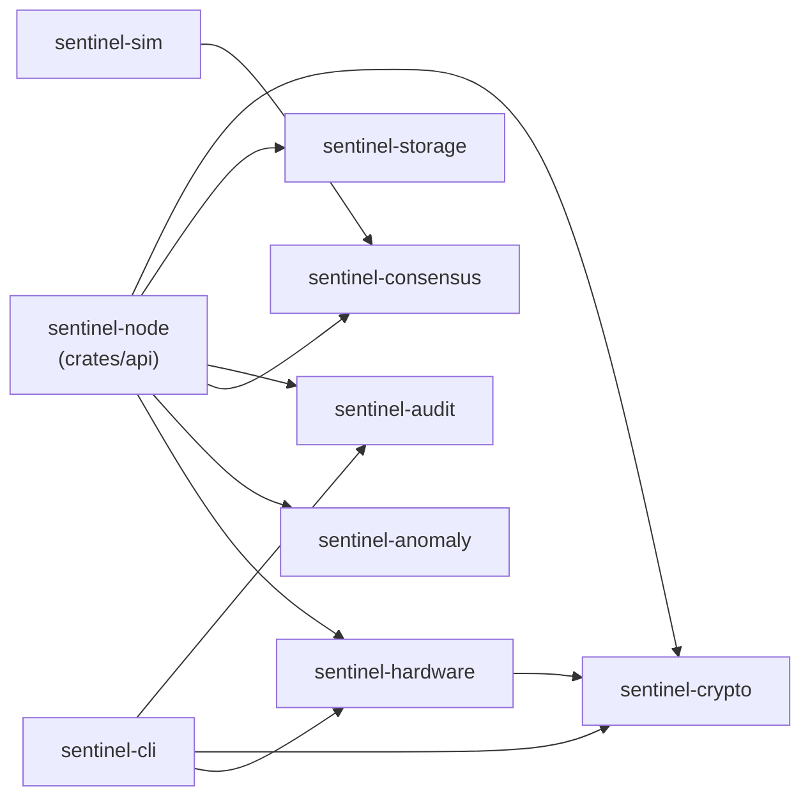
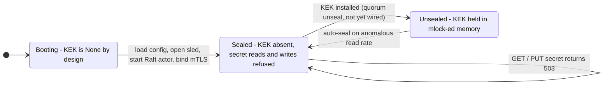
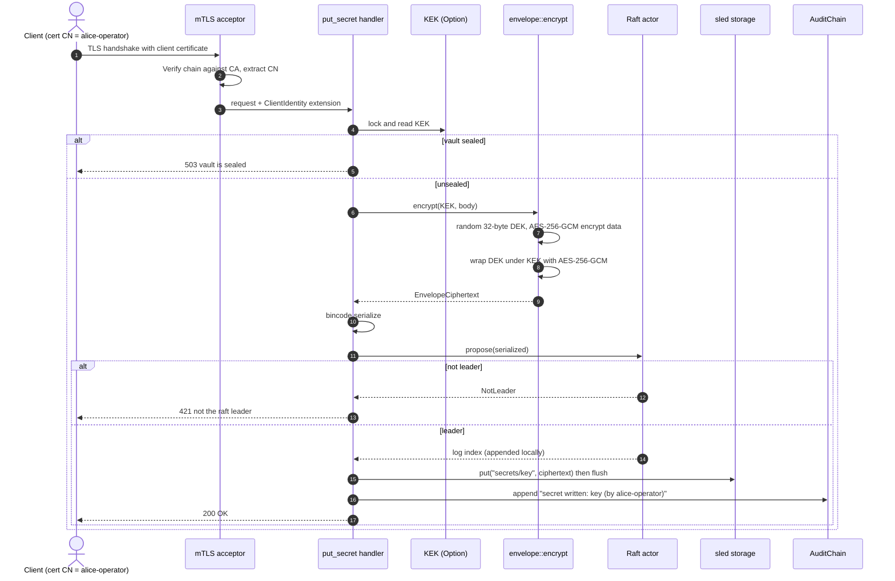
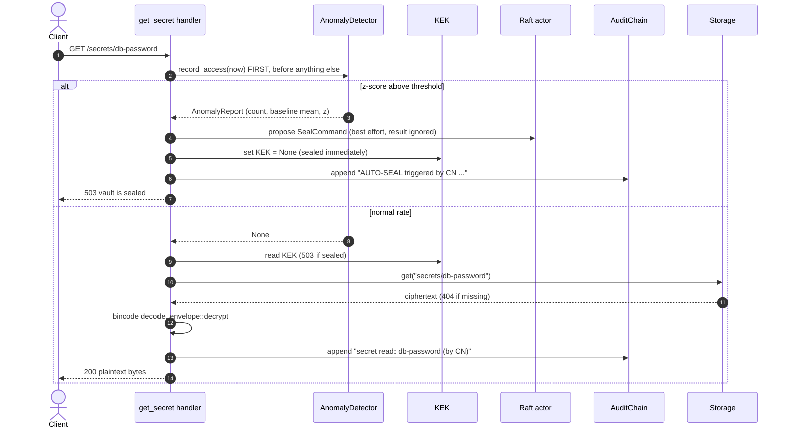
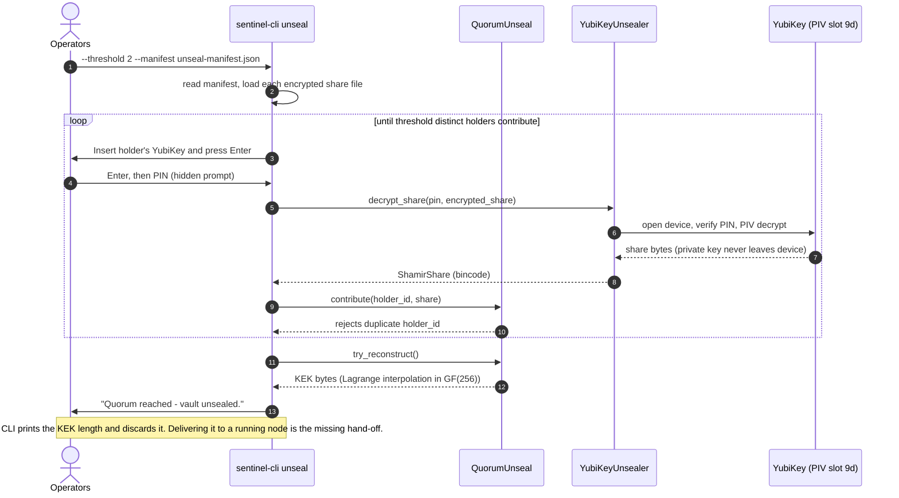
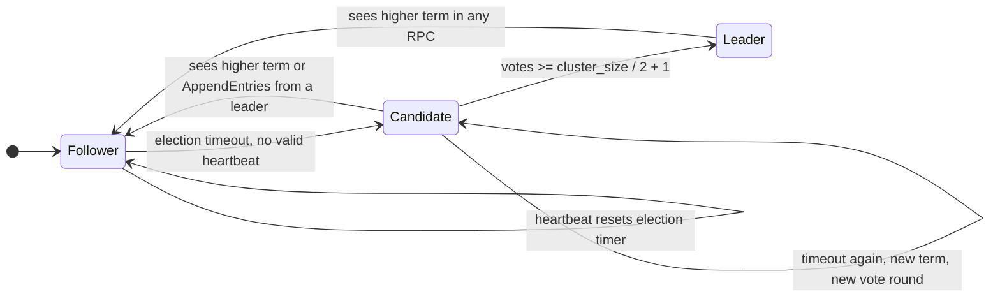
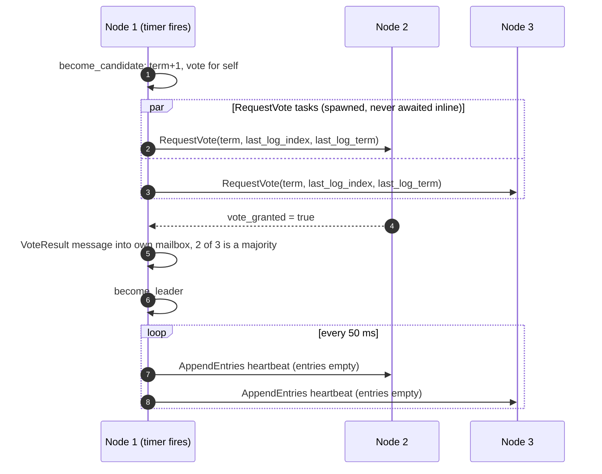
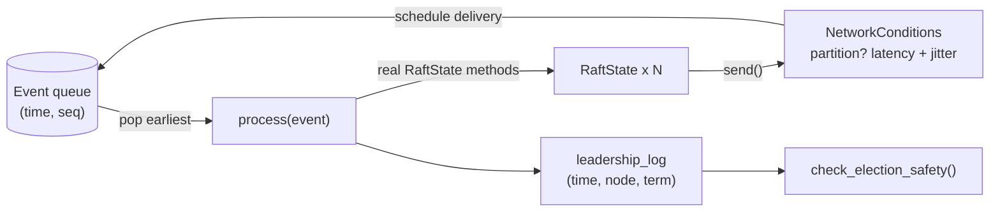
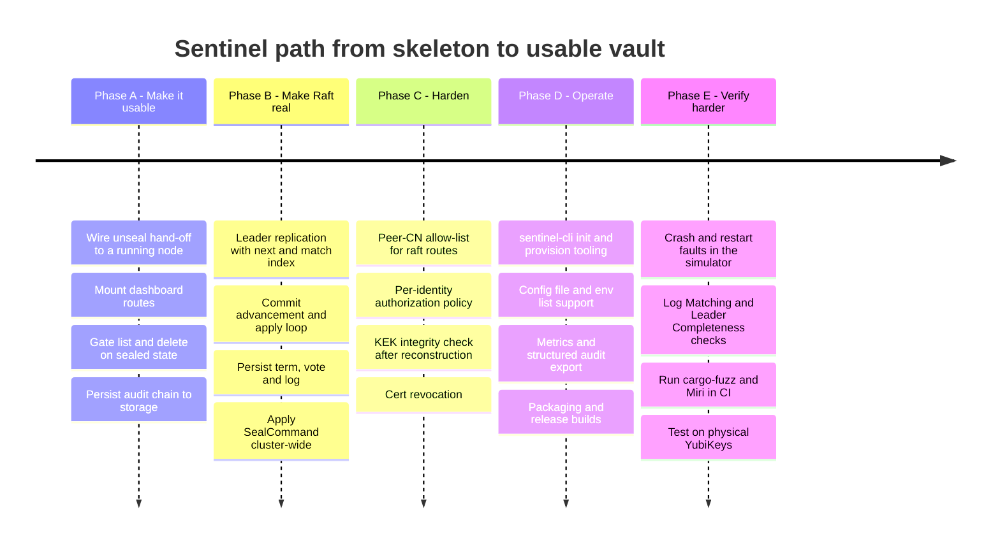

<div align="center">

# 🛡️ SENTINEL

### A zero-trust, hardware-rooted, distributed secrets vault — written in Rust

Envelope encryption · Shamir quorum unsealing · YubiKey PIV · hand-rolled Raft · mutual TLS ·
hash-chained audit log · statistical auto-seal · deterministic simulation testing


</div>

---

## Table of Contents

1. [Overview](#1-overview)
2. [Project Status — What Works Today](#2-project-status--what-works-today)
3. [System Architecture](#3-system-architecture)
4. [Request Lifecycles & State Machines](#4-request-lifecycles--state-machines)
5. [Concept Guide](#5-concept-guide)
6. [Crate-by-Crate Reference](#6-crate-by-crate-reference)
7. [HTTP API Reference](#7-http-api-reference)
8. [CLI Reference](#8-cli-reference)
9. [Configuration](#9-configuration)
10. [Getting Started](#10-getting-started)
11. [Testing, Fuzzing & Verification](#11-testing-fuzzing--verification)
12. [Security Model](#12-security-model)
13. [Known Limitations & Findings](#13-known-limitations--findings)
14. [Roadmap](#14-roadmap)
15. [Project Layout](#15-project-layout)
16. [Contributing & License](#16-contributing--license)

---

## 1. Overview

### The problem

Small engineering teams routinely keep database passwords and API keys in `.env` files, chat messages, or plaintext config — not out of carelessness, but because the "right" tools (HashiCorp Vault, AWS Secrets Manager) carry real operational weight. Leaked credentials remain a leading cause of breaches precisely because the correct path feels too heavy for a small team's risk profile.

### What Sentinel is

Sentinel is an attempt at a middle ground: a **single static Rust binary** with no JVM and no runtime dependencies, designed around the properties that actually matter:

| Principle | How Sentinel approaches it |
|---|---|
| **Secrets are never stored in plaintext** | Every value is envelope-encrypted (AES-256-GCM, fresh DEK per secret) before it touches storage; the storage trait only ever sees ciphertext. |
| **Unsealing requires physical hardware** | The master key (KEK) is designed to be split with Shamir's Secret Sharing across YubiKeys; no software-only path reconstructs it. |
| **Every connection is mutually authenticated** | One mTLS listener serves clients *and* cluster peers; there is no plaintext port anywhere in the code. |
| **History can't be silently edited** | Every operation is appended to a SHA-256 hash chain, attributed to the caller's certificate CN. |
| **Attacks trigger lockdown, not just alerts** | A rolling z-score detector watches read rate and clears the in-memory KEK the moment access looks like exfiltration. |
| **Consensus is proven, not assumed** | Raft is hand-written, and a deterministic simulator drives the *same* `RaftState` type through partitions, clock skew and reordering. |

It is also a **learning artifact**: the code is heavily commented with the *why* behind each decision, and this README explains every primitive and concept used.

---

## 2. Project Status — What Works Today

Sentinel is built in layers. The **building blocks are complete and tested**; the **end-to-end running node is a skeleton** with a few important gaps. This section is intentionally up-front so you know what you are getting. Everything below was verified by building the workspace (rustc 1.91.1) and running the real binaries.

| Layer | Status | Evidence |
|---|:-:|---|
| Envelope encryption, Shamir (GF(256)), HKDF/Argon2id, `mlock` + zeroize | ✅ Complete | 20 unit + 7 property tests |
| Hash-chained audit log + `sentinel-cli verify` | ✅ Complete | 8 + 2 tests; CLI run on clean and tampered files |
| Rolling z-score anomaly detector + `SealCommand` | ✅ Complete | 13 tests |
| Sled storage backend | ✅ Complete | 4 tests |
| Quorum logic (`QuorumUnseal`) | ✅ Complete | 5 tests |
| Raft state machine, log, election actor | ✅ Elections work | 28 tests incl. anti-deadlock stress test |
| Deterministic chaos simulator | ✅ Election Safety verified | 6 + 7 tests |
| mTLS listener (rustls, mandatory client certs) | ✅ Works | Real handshakes: valid cert accepted; no cert / untrusted CA rejected |
| Secrets CRUD handlers (encrypt → store → audit) | ✅ Works when a KEK is present | 7 handler tests |
| **Raft log replication & commit advancement** | ❌ Not implemented | Leader sends empty heartbeats only |
| **Unsealing a running node** | ❌ Not wired | Node starts sealed and nothing ever sets the KEK |
| **YubiKey PIV decryption on real hardware** | ⚠️ Never executed | Reviewed against crate docs only |
| **Web dashboard** | ⚠️ Built but not routed | `/` and `/api/status` return 404 (compiler warns both handlers are unused) |
| **Fine-grained authorization** | ❌ Not implemented | Any valid client cert may do anything |

> **Bottom line:** if you launch `sentinel-node` today, it boots, elects itself leader (single node), serves mTLS, and answers `/cluster/status` — but every secret read/write returns `503 vault is sealed`, because the unseal hand-off is the next missing piece. The full secret path *is* exercised end-to-end in the test suite by injecting a KEK. See [§13](#13-known-limitations--findings) for the complete list.

---

## 3. System Architecture

### 3.1 High-level architecture



### 3.2 ASCII fallback (for viewers without Mermaid)

```
                 ┌──────────────────────────────────────────────┐
                 │  Operator / client   ·   Peer sentinel-node   │
                 └───────────────────────┬──────────────────────┘
                                         │  mutual TLS — client cert REQUIRED
                 ┌───────────────────────▼──────────────────────┐
                 │               sentinel-node                   │
                 │  tokio-rustls acceptor ─► CN → ClientIdentity │
                 │                                               │
                 │  /secrets, /secrets/{key}   (CRUD, encrypted) │
                 │  /cluster/status            (Raft status)     │
                 │  /raft/vote, /raft/append-entries (peer RPC)  │
                 └──┬───────┬────────┬─────────┬──────────┬──────┘
                    │       │        │         │          │
              ┌─────▼───┐ ┌─▼─────┐ ┌▼──────┐ ┌▼───────┐ ┌▼────────┐
              │ crypto  │ │storage│ │ audit │ │consen- │ │ anomaly │
              │ AES-GCM │ │ sled  │ │ hash  │ │sus Raft│ │ z-score │
              │ Shamir  │ │       │ │ chain │ │        │ │ + seal  │
              │ mlock   │ │       │ │       │ │        │ │         │
              └─────────┘ └───────┘ └───────┘ └───▲────┘ └─────────┘
                                                  │ same RaftState type
      ┌────────────────────┐              ┌───────┴─────────┐
      │ sentinel-hardware  │              │  sentinel-sim   │
      │ Shamir quorum +    │              │ virtual time +  │
      │ YubiKey PIV (CLI)  │              │ chaos network   │
      └────────────────────┘              └─────────────────┘
```

### 3.3 Crate dependency graph

The direction is strictly one-way. `crypto` and `consensus` know nothing about HTTP, TLS, or each other, and `api` (the `sentinel-node` binary) is the only crate that assembles everything. That layering is exactly what makes `sentinel-sim` possible: the simulator drives the production `RaftState` through a different scheduler instead of needing a second Raft implementation.



### 3.4 Network surface

| Interface | Default | Notes |
|---|---|---|
| Client + cluster API | `api_bind_addr` (e.g. `127.0.0.1:8443`) | **Only** listener; TLS 1.2/1.3 via rustls with `ring` crypto provider. |
| Peer RPC | Same port, paths `/raft/*` | Peers call each other with a `reqwest` client presenting the node's own cert (5 s timeout). |
| Storage | Local directory (`storage_path`) | `sled` embedded KV store, `flush()` after every write. |
| Logging | stdout, JSON lines | `tracing` + `EnvFilter` (`RUST_LOG=info`). |

### 3.5 Node lifecycle



A node **always starts sealed** — nothing in the bootstrap path populates the KEK, deliberately, because a node that can unseal itself by starting up would defeat the purpose of the hardware quorum.

---

## 4. Request Lifecycles & State Machines

### 4.1 Writing a secret — `PUT /secrets/{key}`



> ⚠️ The handler proposes to Raft and then writes to storage **without waiting for majority commit** — see [§13](#13-known-limitations--findings).

### 4.2 Reading a secret and the auto-seal path — `GET /secrets/{key}`



Design notes that matter:

- Detection runs **before** the sealed check, so the triggering request is itself refused.
- The local seal does **not** wait on Raft — a node that sees an attack must protect itself even if replication is degraded.
- Reads are served locally (no leader required) — a stale follower may serve stale data.

### 4.3 Quorum unseal (CLI, designed flow)



### 4.4 Raft roles (as implemented in `RaftState`)



Timings in the production node: **heartbeat 50 ms**, **election timeout 150–300 ms** (randomized per reset).

### 4.5 One election round (3 nodes)



---

## 5. Concept Guide

Each concept below explains **what it is**, **why Sentinel uses it**, and **where it lives in the code**.

### 5.1 Envelope encryption

Instead of encrypting data directly with one master key, generate a fresh random **Data Encryption Key (DEK)** per secret, encrypt the data with it, then encrypt (wrap) the DEK with a longer-lived **Key Encryption Key (KEK)**. The stored artifact is `{encrypted_DEK, encrypted_data}`.

**Why:** the KEK only ever wraps 32-byte DEKs and never touches secret data directly. Rotating the KEK means re-wrapping DEKs, not re-encrypting every secret; compromising one DEK exposes one secret, not the vault.

**Code:** `crates/crypto/src/envelope.rs` — AES-256-GCM (an AEAD, so tampering is detected, not just hidden).

```
EnvelopeCiphertext  (bincode-serialized, stored at  secrets/<key>)
├── encrypted_dek : Vec<u8>   48 bytes  = 32-byte DEK + 16-byte GCM tag
├── dek_nonce     : [u8; 12]  fresh random nonce for the wrap
├── ciphertext    : Vec<u8>   plaintext length + 16-byte GCM tag
└── data_nonce    : [u8; 12]  fresh random nonce for the data
```

- Random 96-bit nonces from `OsRng`, a new one for *every* encryption.
- Wrong-length KEK (≠ 32 bytes) is rejected up front.
- The unwrapped DEK lives in a `SecretBytes` and is zeroized when it goes out of scope.
- Tests: round-trip, wrong KEK fails closed, tampered ciphertext fails closed, wrong key length rejected.

### 5.2 Shamir's Secret Sharing

Split a secret into `N` shares so that any `K` reconstruct it but any `K−1` reveal **nothing** — information-theoretically, not "computationally hard". The secret is the constant term of a random degree-`K−1` polynomial; shares are points `(x, p(x))`; `K` points determine the polynomial via **Lagrange interpolation**.

**Code:** `crates/crypto/src/shamir.rs` — hand-rolled over **GF(2⁸)** (the AES field, reduction constant `0x1B`):

- Each secret byte is an *independent* polynomial; a share is `{ x: u8, y: Vec<u8> }` with `x ∈ 1..=N`.
- `gf_mul` is a shift-and-XOR multiply; `gf_inv` is exponentiation (`a²⁵⁴`); a test verifies **all 255** nonzero inverses.
- Validation: threshold ≥ 2, total ≥ threshold, no duplicate `x`, equal share lengths.
- Randomness comes from a caller-supplied `RngCore` (tests use `OsRng`).

**Why hand-rolled:** an earlier attempt with the `vsss-rs` crate pulled in elliptic-curve scalar machinery just to split 32 raw bytes. GF(256) does it in ~120 lines with no extra surface. *(Housekeeping note: `vsss-rs` is still listed in `crates/crypto/Cargo.toml` but no code uses it — it can be removed.)*

> **A property worth understanding:** Shamir has **no integrity check**. Combining too few or wrong shares does not error — it silently returns garbage that looks like a secret. A real deployment must verify the reconstructed KEK (e.g. by trial-decrypting a known canary). `combine_shares` does not know the threshold, and `QuorumUnseal` only guards the count; the verification step is documented as the caller's job and is **not implemented yet**.

### 5.3 Hardware-rooted unsealing (YubiKey PIV)

PIV is a smart-card standard; a PIV-enabled YubiKey holds a private key that **never leaves the device**. Each Shamir share is meant to be encrypted to one holder's PIV public key at provisioning time, so recovering it requires that physical key plus its PIN (plus a touch, depending on slot policy).

**Code (deliberately split in two):**

| File | Role | Verified how |
|---|---|---|
| `hardware/src/quorum.rs` | Pure composition logic: collect fragments in any order, reject a repeated `holder_id`, reconstruct at threshold. Touches no `yubikey` types. | 5 unit tests, including "one holder touching twice cannot fake a 2-of-3 quorum" |
| `hardware/src/yubikey_piv.rs` | `YubiKeyUnsealer::decrypt_share(pin, encrypted_share)` — open device, verify PIN, PIV-decrypt (slot 9d "Key Management"). | **Never run against a physical device.** |

> ⚠️ **Worth double-checking before relying on it:** the code requests `AlgorithmId::EccP256` through `yubikey::piv::decrypt_data`. PIV's *decrypt* operation is defined for RSA keys, whereas ECC keys on PIV perform ECDH key agreement. Confirm against the `yubikey` crate's documentation (or use an RSA slot) when you first test on real hardware. There is also **no provisioning tool** in the repo that generates shares or encrypts them to a YubiKey.

### 5.4 Memory hygiene: `mlock` and zeroize

| Protection | Defends against | Mechanism |
|---|---|---|
| **Lock pages** | A KEK being swapped to disk and read long after the process exits | `libc::mlock` (Unix) / `VirtualLock` via `windows-sys` (Windows) |
| **Zeroize on drop** | A later allocation reading stale bytes | `zeroize` overwrites the buffer in `Drop`, then unlocks |

**Code:** `crates/crypto/src/secret.rs` — `SecretBytes`, the project's **only hand-written `unsafe`**.

- `shrink_to_fit()` *before* locking, so no later reallocation can silently move the secret to an unlocked page.
- Every `unsafe` block has a `SAFETY:` comment justifying pointer/length validity.
- If locking fails (e.g. low `RLIMIT_MEMLOCK`), it falls back to zeroize-only protection instead of panicking.
- `Debug` prints only the length — a stray `{:?}` in a log line cannot leak key bytes.
- A real Windows compile failure (no `mlock` there) drove the `cfg`-gated split.

### 5.5 Argon2id and HKDF

| KDF | Use when | Property | API |
|---|---|---|---|
| **Argon2id** | Input may be low-entropy | Deliberately slow and memory-hard | `derive_kek_argon2(input, salt)` — crate defaults: **19 MiB memory, t=2, p=1**, 32-byte output |
| **HKDF-SHA256** | Input is already high-entropy | Fast; derives independent per-purpose keys | `derive_key_hkdf(master, info, out_len)` |

Plus `random_salt()` (16 bytes). Tests cover determinism, salt separation, context separation, and no-panic across all lengths. *(Neither KDF is called by the running node yet; they are ready for the unseal hand-off and audit-log keying.)*

### 5.6 Raft consensus

Raft gets a cluster to agree on an ordered log despite crashes and partitions: one **leader** per **term** accepts writes and replicates them; an entry is committed once a **majority** has it.

**Why hand-rolled instead of `raft-rs`/`openraft`:** a portfolio decision (implementing from the paper demonstrates understanding) and consistency with the project's preference for small, fully understood dependencies.

**Files (separated by concern):**

| File | Contents |
|---|---|
| `log.rs` | `ReplicatedLog` — 1-based indices, `append_new` (leader), `append_entries` (follower consistency check §5.3 + delete-conflicting-suffix), `entries_from`, `term_at` |
| `rpc.rs` | `RequestVote{Request,Response}`, `AppendEntries{Request,Response}` — all `serde`-serializable (JSON on the wire) |
| `state.rs` | `RaftState` — synchronous, no `async`, no timers, no I/O: vote granting, step-down, `become_candidate`, `record_vote`, `handle_append_entries` |
| `actor.rs` | Tokio actor owning one `RaftState`, driven by a mailbox; election timer, heartbeat ticker, `Transport` trait |

**Safety properties:**

| Property | How it is upheld | How it is tested |
|---|---|---|
| **Election Safety** — ≤ 1 leader per term | One vote per term; candidate's log must be at least as up-to-date | `SimWorld::check_election_safety()` across partition / heal / skew / reordering scenarios |
| **Leader Append-Only** | Leader only ever calls `append_new` (push) | Structural |
| **Log Matching** | `append_entries` rejects a mismatched `prev_log_term` and truncates conflicting suffixes | 9 log unit tests |

> **Honest scope:** the simulator checks *Election Safety*. Log Matching is enforced and unit-tested, but because leaders do not yet send entries ([§13](#13-known-limitations--findings)), it is not yet exercised under chaos.

### 5.7 The actor model — and the deadlock that really happened

An **actor** owns its state exclusively; everything else talks to it via a channel. No shared locks, no data races by construction.

**The bug:** an early `actor.rs` sent `RequestVote` RPCs on election timeout and then **awaited the replies inline**, inside the same loop that handles the node's own mailbox. If two nodes campaigned simultaneously, each blocked waiting for the other's vote while neither could answer — a genuine deadlock, reproduced against the buggy code before it was fixed.

**The fix:** vote requests are `tokio::spawn`ed as independent tasks that report back via the actor's *own* mailbox as `RaftMessage::VoteResult`. The loop never blocks on a peer. The regression test (`repeated_elections_do_not_deadlock_under_tight_simultaneous_timeouts`) runs 20 clusters with 30–60 ms election timeouts and requires a leader within 2 s each.

**A second bug, found the same way:** a single-node cluster (`peers: []`) could never elect itself, because the majority check lived only in the vote-*response* path, which never runs with no peers. Fixed (a lone node's own vote is a majority of one) with a regression test.

### 5.8 Mutual TLS (mTLS)

Ordinary TLS authenticates the server; **mTLS makes the server demand a CA-signed client certificate too**, and aborts the handshake otherwise.

- `crates/api/src/middleware/mtls.rs` builds a `rustls::ServerConfig` with `WebPkiClientVerifier` — client certs are **mandatory**; there is no config path that admits an anonymous connection.
- `main.rs` runs a raw `tokio-rustls` accept loop (not `axum-server`, which doesn't expose peer certificates the way this project needs) and bridges each connection into the Axum router via `hyper-util`.
- The client cert's **Common Name** becomes `ClientIdentity`, attached once per connection and used for audit attribution. A cert with no readable CN is refused.
- `ring` is installed as the process-wide crypto provider (`Once`-guarded) because `reqwest` pulls in `aws-lc-rs` and rustls 0.23 refuses to guess between two compiled-in providers.
- Cluster RPCs use the *same* listener — no weaker internal channel.

**Observed behaviour (real handshakes against generated certs):**

| Client presents | Result |
|---|---|
| Cert signed by the trusted CA | ✅ handshake succeeds, CN extracted |
| No certificate | ❌ `peer sent no certificates` (curl exit 56) |
| Certificate from an untrusted CA | ❌ `invalid peer certificate` (curl exit 56) |

### 5.9 Hash-chained audit log

Each entry's hash covers its own content **plus the previous entry's hash**, so changing, deleting, or forging any entry breaks every link after it.

```
hash = SHA-256( index (u64, big-endian)
              ‖ timestamp (RFC 3339 string)
              ‖ event (UTF-8 bytes)
              ‖ prev_hash (32 bytes) )          genesis prev_hash = 32 zero bytes
```

An explicit byte layout (not `serde_json`) is hashed, so the encoding is unambiguous and stable.

`verify()` walks the chain and reports the first break with its type:

| Error | Meaning |
|---|---|
| `HashMismatch { index }` | An entry's content/timestamp was altered |
| `BrokenLink { index, … }` | `prev_hash` doesn't match the real predecessor (e.g. a spliced forgery) |
| `NonSequentialIndex { expected, found }` | An entry was deleted or reordered |

**What it proves:** *tamper-evidence*, not tamper-prevention — someone who can rewrite the whole file consistently can recompute every hash. It defeats the realistic attack: editing one entry to cover tracks.

> ⚠️ Today the chain lives **in memory** in the node (`AuditChain::new()` at boot) and nothing exports it, so `sentinel-cli verify` has no producer yet. The dashboard handler would expose a live `verified` flag, but it isn't routed.

### 5.10 Rolling z-score anomaly detection

```
time ─► │ bucket │ bucket │ bucket │ … │ current (open) bucket │
         counts feed a rolling window of the last N closed buckets

mean = Σcᵢ / n          stddev = √( Σ(cᵢ − mean)² / n )     (population stddev)
z    = (current_count − mean) / stddev        flag if  z > threshold
```

| Parameter | Node default | Meaning |
|---|---|---|
| Bucket width | 1 s | Resolution of the rate signal |
| `max_history` | 60 buckets | Rolling baseline length |
| `z_threshold` | 3.0 | Std-devs above mean that counts as anomalous |
| `min_history_for_detection` | 5 | Warm-up — **no detection before 5 closed buckets** |

Behaviours worth knowing:

- **Idle gaps count as zero buckets** — silence is part of the baseline.
- **Flat baseline (stddev = 0):** *any* count above the mean is flagged (`z = ∞`).
- **Worked example:** a baseline alternating 2 and 4 reads/second has mean 3, stddev 1, so with `z = 3.0` the current bucket is flagged once it exceeds `3 + 3×1 = 6` → on the **7th read** within that second.
- Detection fires *during* a burst, not after (tested: flagged well before 40 requests land).
- One detector covers **aggregate** node traffic, so a coordinated multi-identity attack still shows as one spike. Every `GET` counts — including 404s and requests made while sealed.
- Time is passed in as an `Instant` parameter (never read internally), which makes the detector fully deterministic to test.

**`SealCommand`:** `{ reason, current_count, baseline_mean, z_score }`, encoded as the ASCII tag `SEAL:` + bincode payload so a log applier can distinguish it from other commands without a shared enum (which would invert the crate layering).

### 5.11 Deterministic simulation testing

Instead of real sockets and real timers, `sentinel-sim` replaces the network and clock with programmer-controlled versions:

- **`SimTime`** — virtual milliseconds; a "30-second partition" costs microseconds of test time.
- **`NetworkConditions`** — symmetric partitions (`partition`, `heal`, `heal_all`) plus base latency and 0–3 ms random jitter, which naturally reorders in-flight messages.
- **`SimWorld`** — a discrete-event scheduler (binary heap ordered by `(time, seq)`) that calls the **production** `handle_request_vote`, `handle_append_entries`, `become_candidate`, `record_vote`. Same seed + same actions ⇒ byte-identical results.



**Scenarios tested** (all seeded):

| Test | Asserts |
|---|---|
| Five nodes, no faults | Exactly one leader; Election Safety holds |
| 2-node minority partitioned | Minority can't elect; one leader on the majority side |
| Leader isolated, then healed | Majority elects a higher-term leader; old leader steps down to follower after healing |
| One node with `-1000 ms` clock skew | Still converges to one leader |
| Heavy jitter (15 ms latency) | Correctness holds under reordering |
| Same seed twice | Identical `leadership_log` and event count |
| 4 partition/heal cycles | Election Safety holds over the cumulative history |

*Not modelled:* node crash/restart, message loss/duplication beyond partitions, disk faults, and log replication.

### 5.12 Property-based testing and fuzzing

- **`proptest`** (stable Rust, runs in every `cargo test`): states a property over generated inputs and shrinks failures. **7 properties** — `decrypt` never panics on arbitrary/garbage bytes (two variants), encrypt→decrypt round-trips for arbitrary plaintext, `combine_shares` never panics on arbitrary shares, HKDF never panics, `split_secret` never panics across the full 0–255 threshold/total space (40 cases), Argon2 never panics across input/salt lengths (20 cases).
- **`cargo-fuzz`/libFuzzer** (nightly, long coverage-guided runs): `crates/crypto/fuzz/fuzz_targets/{decrypt,combine_shares,kdf}.rs` mirror the same boundaries. The fuzz crate is deliberately isolated from the workspace (own empty `[workspace]` table).

Why both: the property tests catch regressions on every commit; the fuzzers find inputs a human or random sampler wouldn't. `decrypt` is the highest-value target — it parses attacker-influenced bytes read back from storage.

---

## 6. Crate-by-Crate Reference

| Crate (package) | Path | Responsibility | Key public API | Tests |
|---|---|---|---|:-:|
| `sentinel-crypto` | `crates/crypto` | Cryptographic primitives | `envelope::{encrypt, decrypt, EnvelopeCiphertext}`, `shamir::{split_secret, combine_shares, ShamirShare}`, `kdf::{derive_kek_argon2, derive_key_hkdf, random_salt}`, `SecretBytes` | 20 + 7 property |
| `sentinel-storage` | `crates/storage` | Pluggable ciphertext store | `trait Storage { get, put, delete, list }`, `SledStorage` (blocking calls in `spawn_blocking`) | 4 |
| `sentinel-audit` | `crates/audit` | Tamper-evident log | `AuditChain::{append, verify, tip_hash, from_entries}`, `AuditEntry`, `GENESIS_HASH` | 8 |
| `sentinel-consensus` | `crates/consensus` | Raft | `RaftState`, `ReplicatedLog`, RPC types, `spawn_raft_actor`, `RaftHandle::{request_vote, append_entries, propose, inspect}`, `Transport` | 28 |
| `sentinel-hardware` | `crates/hardware` | Quorum + YubiKey | `QuorumUnseal`, `UnsealFragment`, `YubiKeyUnsealer`, `HardwareError` | 5 |
| `sentinel-anomaly` | `crates/anomaly` | Detection + seal command | `AnomalyDetector::{record_access, snapshot}`, `AnomalyReport`, `DetectorSnapshot`, `SealCommand` | 13 |
| `sentinel-node` | `crates/api` | The server binary | mTLS listener, Axum router, handlers, `HttpTransport`, `NodeConfig` | 13 |
| `sentinel-sim` | `crates/sim` | Deterministic chaos harness | `SimWorld`, `SimTime`, `NetworkConditions` | 6 + 7 |
| `sentinel-cli` | `crates/cli` | Admin tool | `unseal`, `verify` subcommands | 2 |

**Total: 113 tests, all passing** (verified with `cargo test --workspace` on rustc 1.91.1).

Key dependencies (resolved in `Cargo.lock`): `axum 0.8.9`, `tokio 1.53.1`, `rustls 0.23.43`, `tokio-rustls 0.26.4`, `hyper-util 0.1.20`, `reqwest 0.12.28` (rustls), `x509-parser 0.16`, `aes-gcm 0.10.3`, `argon2 0.5.3`, `hkdf 0.12.4`, `sled 0.34.7`, `yubikey 0.8.0`, `zeroize 1.9.0`, `proptest 1.11.0`, `chrono 0.4.45`.

---

## 7. HTTP API Reference

All routes are served **only** over the mTLS listener. Identity is the client certificate's CN; nothing in a request body can claim an identity.

### 7.1 Routes

| Method | Path | Description | Needs unsealed | Needs leader |
|---|---|---|:-:|:-:|
| `GET` | `/secrets` | List stored key names (the `secrets/` prefix is stripped) | no | no |
| `GET` | `/secrets/{key}` | Decrypt and return the secret as raw bytes | **yes** | no |
| `PUT` | `/secrets/{key}` | Encrypt and store the raw request body | **yes** | **yes** |
| `DELETE` | `/secrets/{key}` | Delete a secret | no | **yes** |
| `GET` | `/cluster/status` | `{ role, term, commit_index }` | no | no |
| `POST` | `/raft/vote` | Peer `RequestVote` RPC (JSON) | no | no |
| `POST` | `/raft/append-entries` | Peer `AppendEntries` RPC (JSON) | no | no |

> The dashboard handlers (`GET /` and `GET /api/status`) exist in `handlers/dashboard.rs` but are **not mounted** in `routes/mod.rs`. Mounting them is a two-line change.

### 7.2 Error model

Errors are JSON `{ "error": "<message>" }`:

| Variant | HTTP status | Body message |
|---|:-:|---|
| `NotFound` | 404 | `not found` |
| `Sealed` | 503 | `vault is sealed` |
| `Unauthorized(_)` | 403 | *(reserved, not yet produced by any handler)* |
| `NotLeader(_)` | 421 | `not the raft leader; redirect to node …` |
| `Storage` / `Crypto` / `Internal` | 500 | `internal server error` (details only in the server log) |

### 7.3 Examples (verified against a running node)

```bash
# Set once. Certs from §10.3.
C="curl -s --cacert pki/ca.crt --cert pki/client.crt --key pki/client.key"
B=https://localhost:8443

$C $B/cluster/status
# {"commit_index":0,"role":"Leader","term":1}

$C $B/secrets
# []

$C -X PUT -d 'hunter2' -w ' [%{http_code}]\n' $B/secrets/db-password
# {"error":"vault is sealed"} [503]        <- expected until an unseal path exists

$C -X DELETE -w ' [%{http_code}]\n' $B/secrets/db-password
# [204]
```

Audit entries produced by handlers (when unsealed):

```
secret written: db-password (by alice-operator)
secret read: db-password (by alice-operator)
secret deleted: db-password (by alice-operator)
AUTO-SEAL triggered by alice-operator: access rate anomaly (count=…, baseline_mean=…, z_score=…)
```

---

## 8. CLI Reference

`sentinel-cli` — "Sentinel vault admin tool".

```text
Usage: sentinel-cli <COMMAND>

Commands:
  unseal  Unseal a node using a quorum of hardware keys
  verify  Verify the tamper-evident audit log chain
```

### `verify [PATH]` (default `audit-log.json`)

Loads a JSON array of `AuditEntry`, verifies the chain, and exits **0** on success / **non-zero** on violation — safe in scripts (`sentinel-cli verify audit-log.json && ./deploy.sh`).

```text
$ sentinel-cli verify audit-ok.json
chain OK — 3 entries, tip hash 3e7ecb6847116ef68c891e499ab5fbfced772eb5a26d3f7f23102117c6a18b32

$ sentinel-cli verify audit-bad.json
chain INTEGRITY VIOLATION: chain integrity violation at index 1: stored hash does not match recomputed hash
```

Entry format (hashes are arrays of 32 byte-values):

```json
[{ "index": 0, "timestamp": "2026-10-21T00:00:00Z", "event": "node started",
   "prev_hash": [0, 0, "…32 numbers…"], "hash": [62, 126, "…32 numbers…"] }]
```

### `unseal --threshold <K> [--manifest unseal-manifest.json]`

Interactive: for each holder in the manifest, prompts to insert the YubiKey and press Enter, then a hidden PIN prompt; stops as soon as `K` distinct holders have contributed.

**Manifest format** — a JSON array of `[holder_id, path_to_encrypted_share]` pairs (despite the help text saying "mapping"):

```json
[["alice-yubikey", "shares/alice.bin"],
 ["bob-yubikey",   "shares/bob.bin"],
 ["carol-yubikey", "shares/carol.bin"]]
```

Each share file is a bincode-serialized `ShamirShare` encrypted to that holder's PIV key. Needs real hardware and currently only prints `Reconstructed KEK: N bytes (not persisted).`

---

## 9. Configuration

`NodeConfig` (`crates/api/src/config.rs`) has seven fields, all required:

| Field | Type | Example | Purpose |
|---|---|---|---|
| `node_id` | `u64` | `1` | This node's Raft id |
| `api_bind_addr` | string | `"127.0.0.1:8443"` | mTLS listen address |
| `peers` | list of strings | `["2=https://10.0.0.2:8443"]` | `"<node_id>=<base_url>"`; malformed entries fail at startup |
| `storage_path` | string | `"/var/lib/sentinel/db"` | sled directory |
| `tls_cert_path` | string | `"pki/server.crt"` | Node cert (**must allow both `serverAuth` and `clientAuth`** — it is reused for outbound peer calls) |
| `tls_key_path` | string | `"pki/server.key"` | Private key (PKCS#8 recommended) |
| `ca_cert_path` | string | `"pki/ca.crt"` | CA used to verify every client and peer |

### How config is actually loaded (verified)

Sources are `SENTINEL__*` environment variables, then an optional config file — **and the file wins** over the environment.

- The environment prefix separator is `__`: `SENTINEL__NODE_ID=1`, `SENTINEL__API_BIND_ADDR=…`.
- **`peers` cannot be supplied through the environment** — a string such as `[]` fails with *invalid type: string, expected a sequence*. Use the file.
- The file is `File::with_name(".env")`; the `config` crate resolves that by trying known extensions, so the working file is **`.env.toml`** in the current directory. A file literally named `.env` is *not* read.
- `dotenvy` is a declared dependency but is not called.

### Example `.env.toml` (single node)

```toml
node_id        = 1
api_bind_addr  = "127.0.0.1:8443"
peers          = []
storage_path   = "./sentinel.db"
tls_cert_path  = "pki/server.crt"
tls_key_path   = "pki/server.key"
ca_cert_path   = "pki/ca.crt"
```

### Three-node example

```toml
# node 1
node_id = 1
api_bind_addr = "0.0.0.0:8443"
peers = ["2=https://10.0.0.2:8443", "3=https://10.0.0.3:8443"]
```

Runtime tuning is currently in code: heartbeat 50 ms; election timeout 150–300 ms (`ElectionTimeoutRange::default`); anomaly detector 1 s buckets / 60 history / z = 3.0; peer HTTP timeout 5 s.

---

## 10. Getting Started

### 10.1 Prerequisites

| Tool | Version | Notes |
|---|---|---|
| Rust toolchain | **1.85+** (edition 2024); verified with **1.91.1** | `rustup` recommended |
| C toolchain + `pkg-config` | any | Needed to compile native dependencies |
| PC/SC dev library | Linux: `libpcsclite-dev` | Required by the `yubikey` crate. Windows and macOS use the system smart-card service. |
| OpenSSL (or any CA tooling) | any | To generate dev certificates |
| Nightly Rust + `cargo-fuzz` | optional | Fuzzing and Miri only |
| A YubiKey with PIV | optional | Only for real hardware unseal |

### 10.2 Build and test

```bash
git clone https://github.com/MuaazTasawar/sentinel.git
cd sentinel

cargo build --workspace
cargo test  --workspace          # 113 tests; ~15 s of runtime after compiling
```

Expected: every `test result: ok`, **0 failed**. The build currently prints two warnings (`dashboard_status` / `dashboard_page` never used — the unmounted dashboard).

### 10.3 Generate development certificates

```bash
mkdir -p pki && cd pki

# CA
openssl req -x509 -newkey rsa:2048 -nodes -keyout ca.key -out ca.crt -days 30 \
  -subj "/CN=Sentinel Dev CA" \
  -addext "basicConstraints=critical,CA:TRUE" -addext "keyUsage=critical,keyCertSign,cRLSign"

# Extensions shared by node and client leaf certs
printf "subjectAltName=DNS:localhost,IP:127.0.0.1\nextendedKeyUsage=serverAuth,clientAuth\n" > ext.cnf

# Node (server) cert — CN becomes the node's identity to peers
openssl req -newkey rsa:2048 -nodes -keyout server.key -out server.csr -subj "/CN=sentinel-node-1"
openssl x509 -req -in server.csr -CA ca.crt -CAkey ca.key -CAcreateserial -out server.crt -days 30 -extfile ext.cnf

# Operator (client) cert — CN is what lands in the audit log
openssl req -newkey rsa:2048 -nodes -keyout client.key -out client.csr -subj "/CN=alice-operator"
openssl x509 -req -in client.csr -CA ca.crt -CAkey ca.key -CAcreateserial -out client.crt -days 30 -extfile ext.cnf
cd ..
```

> The key must be a PEM private key that `rustls-pemfile` understands; OpenSSL 3 emits PKCS#8 (`BEGIN PRIVATE KEY`) by default, which is also what `reqwest`'s identity loader expects.

### 10.4 Run a single node

```bash
cat > .env.toml <<'EOF'
node_id        = 1
api_bind_addr  = "127.0.0.1:8443"
peers          = []
storage_path   = "./sentinel.db"
tls_cert_path  = "pki/server.crt"
tls_key_path   = "pki/server.key"
ca_cert_path   = "pki/ca.crt"
EOF

RUST_LOG=info cargo run -p sentinel-node
```

Expected log (JSON lines):

```json
{"level":"INFO","fields":{"message":"sentinel node starting","node_id":1}}
{"level":"INFO","fields":{"message":"listening for mTLS connections","addr":"127.0.0.1:8443"}}
```

### 10.5 Talk to it

```bash
C="curl -s --cacert pki/ca.crt --cert pki/client.crt --key pki/client.key"
$C https://localhost:8443/cluster/status        # {"commit_index":0,"role":"Leader","term":1}

# Prove mTLS is mandatory — both of these fail at the handshake:
curl -s --cacert pki/ca.crt https://localhost:8443/cluster/status; echo "exit=$?"   # exit=56
```

Server log for the rejected attempt:

```json
{"level":"WARN","fields":{"message":"mTLS handshake failed","error":"peer sent no certificates"}}
```

### 10.6 Exercise the full secret path (via tests)

Because the running node has no unseal path yet, the encrypt → store → decrypt → audit → auto-seal flow is demonstrated by the handler tests, which inject a KEK:

```bash
cargo test -p sentinel-node -- --nocapture
cargo test -p sentinel-node sudden_read_burst_triggers_auto_seal_and_is_audit_logged
```

### 10.7 Run a 3-node cluster

Create three certs (CNs `sentinel-node-1..3`), three `.env.toml` files listing the other two nodes in `peers`, and start each with its own working directory. Elections will converge to one leader (check `/cluster/status` on each). Note the current limits: heartbeats carry no entries and Raft state is in memory ([§13](#13-known-limitations--findings)).

### 10.8 Fuzzing and Miri (nightly)

```bash
cargo install cargo-fuzz
rustup toolchain install nightly --component miri

cd crates/crypto
cargo +nightly fuzz run decrypt -- -max_total_time=60
cargo +nightly fuzz run combine_shares
cargo +nightly fuzz run kdf
cargo +nightly miri test -p sentinel-crypto      # Miri can't model mlock/VirtualLock syscalls
```

See `crates/crypto/fuzz/README.md` for crash-replay instructions and the Miri caveat.

---

## 11. Testing, Fuzzing & Verification

### 11.1 Test inventory

| Package | Unit | Integration / property | Total | What they cover |
|---|---:|---:|---:|---|
| `sentinel-crypto` | 20 | 7 | 27 | Round-trips, tamper detection, GF(256) inverses, share-set validation, `Debug` non-leak, KDF determinism, no-panic properties |
| `sentinel-consensus` | 28 | — | 28 | Vote rules, log conflict resolution, commit bounds, 3-node election, anti-deadlock stress, single-node leader |
| `sentinel-anomaly` | 13 | — | 13 | Warm-up, steady traffic, burst detection, early firing, idle gaps, flat baseline, snapshots, seal encoding |
| `sentinel-node` | 13 | — | 13 | Secrets CRUD, sealed → 503, audit recording, auto-seal, cluster status, dashboard payload, mTLS config/CN |
| `sentinel-sim` | 6 | 7 | 13 | Clock/network primitives + chaos scenarios |
| `sentinel-audit` | 8 | — | 8 | Tamper, splice, delete, genesis, reload |
| `sentinel-hardware` | 5 | — | 5 | Quorum logic |
| `sentinel-storage` | 4 | — | 4 | sled CRUD + prefix listing |
| `sentinel-cli` | 2 | — | 2 | Verify clean / tampered file |
| **Total** | | | **113** | |

### 11.2 Bugs found by adversarial testing

1. **Actor deadlock** (§5.7) — found by a timing stress test, reproduced against the buggy code, fixed, re-verified over repeated runs.
2. **Single-node election bug** (§5.7) — found while writing a later phase's handler tests; regression test proven to fail before the fix and pass after.
3. **Windows build break** — `mlock` doesn't exist on Windows; led to the `cfg`-gated `VirtualLock` implementation.

### 11.3 What has *not* been executed

| Item | Why |
|---|---|
| YubiKey PIV decryption on hardware | No physical device |
| `cargo-fuzz` under libFuzzer | Needs nightly; construction logic was checked on stable |
| Miri | Needs nightly |
| Multi-node `HttpTransport` | Only single-node paths are exercised end-to-end |

---

## 12. Security Model

### 12.1 What Sentinel is designed to guarantee

| Property | Mechanism | Status |
|---|---|:-:|
| Plaintext never persisted | Envelope encryption above the `Storage` trait | ✅ |
| Authenticated encryption | AES-256-GCM (tag verified on decrypt) | ✅ |
| Keys never swapped / lingering | `mlock` + zeroize | ✅ |
| No unauthenticated network access | mTLS with mandatory client certs; no plaintext listener | ✅ |
| Attributable actions | CN recorded in every audit entry | ✅ |
| Tamper-evident history | SHA-256 hash chain | ✅ (in memory) |
| Automatic lockdown on exfiltration-like reads | z-score → clear KEK | ✅ (local) |
| Unsealing needs physical hardware | Shamir + PIV | ⚠️ components exist; hand-off and hardware path unverified |
| Cluster-wide seal | `SealCommand` via Raft | ❌ needs replication |

### 12.2 Threat model

| Threat | Mitigation | Residual risk |
|---|---|---|
| Stolen disk / backup | Only ciphertext on disk; KEK never persisted | KEK wrap/unwrap strength = AES-256-GCM |
| Swap / core-dump leakage | `mlock`, zeroize | Core dumps while unsealed aren't addressed |
| Network eavesdropping / MITM | rustls mTLS | Cert management is manual |
| Rogue node joining the cluster | Needs a CA-signed cert | See "any cert can call `/raft/*`" below |
| Compromised token / client bulk-reading secrets | Auto-seal | Detection needs 5 s of baseline; anyone with a client cert can also trigger a seal (a DoS) |
| Log tampering | Hash chain | Whole-file consistent rewrite; not persisted/replicated yet |
| Insider with one YubiKey | k-of-n Shamir + duplicate-holder rejection | Needs real-hardware validation |

### 12.3 Non-goals (today)

Fine-grained authorization, key rotation tooling, certificate revocation, secret versioning/TTLs, HSM-backed server TLS keys, and protection from a root-level attacker on a running, unsealed node.

---

## 13. Known Limitations & Findings

Stated plainly, because a security project that advertises only what works is less trustworthy than one that also says what doesn't. Items marked 🔬 were reproduced by running the code.

### 13.1 Functional gaps (most important first)

1. 🔬 **A running node can never be unsealed.** `main.rs` creates `kek = Arc::new(Mutex::new(None))` and nothing writes to it; `sentinel-cli unseal` reconstructs the KEK but only prints its length. Reads and writes return `503`.
2. **Raft does not replicate or commit.** `propose` appends to the leader's local log only; heartbeats are always `entries: vec![]`; `AppendEntries` responses are discarded; `commit_index` is never advanced on the leader (no `match_index` tracking); there is no apply loop. The simulator mirrors this simplification.
3. **Writes aren't gated on commit.** `put_secret`/`delete_secret` propose and then write to storage immediately, so a partitioned old leader could apply a write that never reaches a majority. (Documented in the code as "the single biggest gap between 'looks like Raft' and 'is linearizable'".)
4. **Raft state isn't persistent.** `current_term`, `voted_for`, and the log live in memory; a restart forgets them, which Raft's safety proof forbids.
5. **`SealCommand` is proposed but never applied** by other nodes (consequence of 2 and 3). Only the local seal is effective.
6. 🔬 **The dashboard isn't served.** `GET /` and `GET /api/status` → 404; `cargo build` warns both handlers are unused. The HTML (`crates/api/dashboard/index.html`, polls `/api/status` every 2 s, no external assets) and a tested status payload are ready.
7. **The audit chain is in-memory only** and nothing exports it, so `sentinel-cli verify` has no producer.
8. **Quorum KEK isn't verified.** Shamir returns garbage on a wrong/insufficient set; the comment in `QuorumUnseal::try_reconstruct` refers to an "audit-log HMAC" check that doesn't exist yet.
9. **No provisioning tooling** — nothing generates shares, encrypts them to a PIV key, or writes the unseal manifest. The PIV path requests ECC P-256 via `decrypt_data` (see §5.3 caveat).
10. **No node bootstrap tooling** — dev certs and config files are hand-made (§10).

### 13.2 Security-relevant findings

- 🔬 **Any client with a CA-signed certificate can call `/raft/*`.** Peer and operator certs aren't distinguished. Sending `POST /raft/vote` with term 9 from an ordinary client cert made a leader at term 1 step down to follower at term 9. Fix: authorize `/raft/*` by an allow-list of peer CNs (or a separate peer CA/listener).
- **Authorization is all-or-nothing.** `AppError::Unauthorized` exists as a placeholder but is never produced; every authenticated identity may read, write, delete and list everything.
- 🔬 **`GET /secrets` and `DELETE /secrets/{key}` work while sealed** (list returns key names; delete returns 204). Consider gating both on unsealed state.
- **Auto-seal is also a DoS lever.** Any authenticated client can trigger it by reading quickly — and with no unseal path, recovery isn't possible yet. Counting all `GET`s (including 404s) makes that easier.
- **Cold-start blind spot.** No detection until 5 buckets of history exist.
- **Identity is the certificate CN only**, so two certificates with the same CN are indistinguishable in the audit log.
- **Revocation** isn't supported (no CRL/OCSP); rotate by re-issuing the CA.

### 13.3 Config and housekeeping

- 🔬 Config file must be named **`.env.toml`**; file overrides env; `peers` can't come from env (§9).
- The previous README claimed **106** tests; the actual, verified total is **113** (the old table already summed to 113).
- `vsss-rs` remains in `crates/crypto/Cargo.toml` (and the lockfile) but is unused; `dotenvy` is declared but unused.
- Each crate directory carries its own stray `Cargo.lock` (9 of them) in addition to the workspace lock.
- `sentinel-sim` uses `edition = "2021"` while the other crates use `2024`; `[workspace.package]` values aren't inherited by members.
- `AuditChain` timestamps use `to_rfc3339()` in the hash input; keep that exact format if you ever re-implement verification elsewhere.

---

## 14. Roadmap



Checklist:

- [ ] Unseal RPC / local admin socket that installs the KEK (and audit it)
- [ ] Mount `/` and `/api/status`
- [ ] Leader-side replication: `next_index` / `match_index`, majority commit, apply loop
- [ ] Persist Raft hard state and log; persist audit chain
- [ ] Restrict `/raft/*` to peer identities; add authorization policy
- [ ] Verify reconstructed KEK (canary decrypt or HMAC)
- [ ] Provisioning command: generate shares → encrypt to PIV keys → write manifest
- [ ] Validate the PIV path on hardware (algorithm/slot choice)
- [ ] Simulator: crash/restart, message loss, Log Matching & State-Machine-Safety checks
- [ ] Remove unused deps (`vsss-rs`, `dotenvy`) and stray per-crate lockfiles
- [ ] CI: `cargo test`, `clippy`, nightly fuzz smoke + Miri

---

## 15. Project Layout

```
sentinel/
├── Cargo.toml                     # workspace: 9 members, release profile (LTO, panic=abort)
├── Cargo.lock
├── .gitignore                     # /target, .env, *.sled, sentinel.db/, *.log …
└── crates/
    ├── crypto/                    # sentinel-crypto
    │   ├── src/{envelope,kdf,secret,shamir,error,lib}.rs
    │   ├── tests/fuzz_style_property_tests.rs   # 7 proptest properties
    │   └── fuzz/                  # cargo-fuzz crate (isolated workspace)
    │       ├── fuzz_targets/{decrypt,combine_shares,kdf}.rs
    │       └── README.md          # fuzz + Miri instructions
    ├── storage/                   # Storage trait + sled backend
    ├── audit/                     # AuditChain
    ├── consensus/                 # log.rs · rpc.rs · state.rs · actor.rs
    ├── anomaly/                   # detector.rs · seal.rs
    ├── hardware/                  # quorum.rs · yubikey_piv.rs
    ├── sim/                       # mock_clock · mock_network · world · tests/raft_safety_test.rs
    ├── cli/                       # main.rs · unseal.rs · verify.rs
    └── api/                       # package: sentinel-node
        ├── dashboard/index.html   # self-contained console UI (not yet routed)
        └── src/
            ├── main.rs            # bootstrap + raw mTLS accept loop
            ├── config.rs · errors.rs · state.rs · transport.rs
            ├── routes/mod.rs      # router
            ├── middleware/mtls.rs # rustls server config, CN extraction
            └── handlers/{secrets,cluster,raft,dashboard}.rs
```

---

## 16. Contributing & License

**Workflow:**

```bash
cargo fmt --all
cargo clippy --workspace --all-targets
cargo test --workspace
```

The house rule from the project's history: *write it, prove it runs, then ship it* — never hand over code that was only reviewed. If something can't be executed (hardware, nightly tooling), say so explicitly in the code and docs, as this repo does.

Good first contributions are the unchecked items in the [roadmap](#14-roadmap) — especially mounting the dashboard, restricting `/raft/*` to peers, and the leader replication loop.

**License:** MIT — © MuaazTasawar.

---

<div align="center">

*Built across 12 phases, each compiled and tested before being called done.*

</div>
